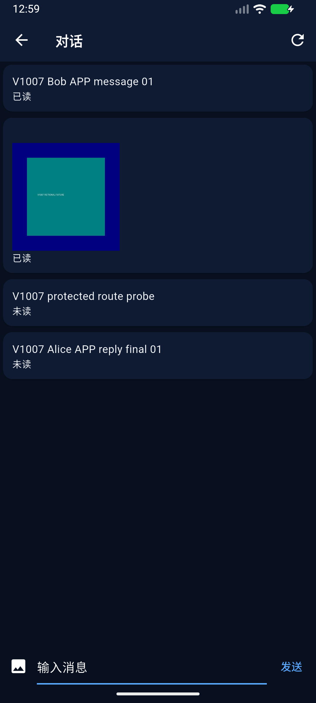
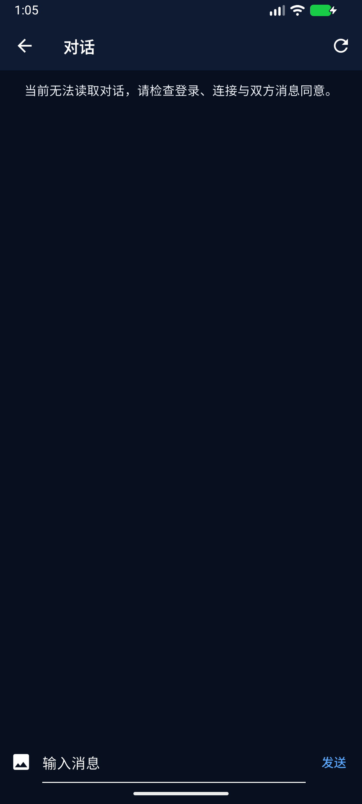
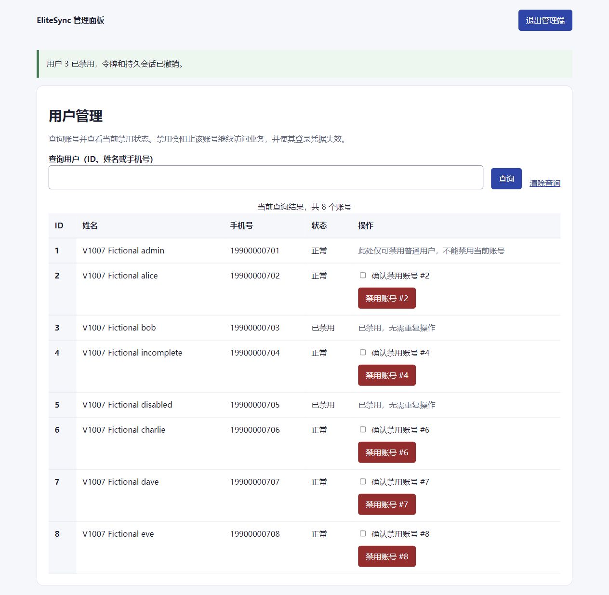

# v10.0.7 执行与候选交付报告

状态：**V10.0.7 CANDIDATE DELIVERED — AWAITING ASTRA FINAL ACCEPTANCE**。这是Codex实施/观测回报，不是独立ACCEPT。8项冻结AC未缩小；全量测试及未恢复项的缺口保留。

## 固定身份与交付方式

- 冻结计划提交 `ef1bf4d07f5d7b84a38fb0f59f2efbe951ff4307`，Blob `151d75b67238826841467fa93c140825ebf61282`，本版plan原对象保持。
- 实施起点 `0989812c141ce892915b67c14e9291d34e3c7053` / Tree `c2dd89f3a0726bff6cd18fb8fe0008c2f347aadf`。执行时实际main回读为 `0d2a0aff5cf51a12156958cbaef196446300c863`；没有重做K08。
- **最终产品/构建源码锚** `7f8da6954db8ef994f91e586c8a4f91fa0bc0a4f` / Tree `754b9a65b41ac9393687417836e380effc81c09b`。后续候选提交只登记本报告、台账及安全证据，不改变产品源码或重建包。
- 独立候选分支 `codex/v10.0.7-app-restoration`。最终候选commit/tree以Owner收到的固定GitHub交付链接及远端回读收据为准（Git提交不能在自身文件中写入自己的SHA）；本地 `candidate-publication.json` 保存该精确身份，manifest分别登记构建源码锚。普通non-force推送，不合并main。
- 专用工作树 `C:/Users/zcxve/.codex/worktrees/elitesync-main-be0636e/EliteSync-v10`；E为 `C:/Users/zcxve/.codex/visualizations/2026/10/14/01a13afa-b74f-7c11-b7e0-01a04335168d/v1007`。路径中的既有会话标识仅作证据定位，不冒称当前聊天身份。

## 源码与模块

Flutter恢复真实匹配/连接/聊天和会话列表；问卷canonical option/version/bank DTO、服务端durable draft、成功后才推进、重登续填；完整出生地手工坐标输入；可选MBTI Lite和真实八字入口；动态失败不退回mock；本地工具push保留返回路径。Android构建define只在本版显式local包启用。

Laravel新增 `LiveConsentService`、`LiveConnectionController` 和 `product_connections`/`messaging_consents` 迁移，复用已接受领域合同，持久化双方身份、revision及独立read/send用途。七条旧消息路由仍经过 `DenyUnverifiedMessagingLiveAccess`；仅准确local DB/loopback配置及当前服务端许可开放。用户升序事务锁协调block/禁用/CN/MC、消息和私有媒体；生产、未配置或错误DB继续fail-closed。私有图片存储disk `v1007`，下载每次检查当前权限并no-store，不通过public storage旁路。

`MatchingRunService`修复MariaDB同秒无变化heartbeat返回0的租约误判；保留fence/current lease检查。`AstroCompatibilityService`与`MatchingEngineService`统一实际/解释effective权重，未恢复三模块为0；`MatchController`旧开发记录公开投影也标待恢复，原DB与旧失败证据不改写。匹配like通知不再暗示可以立即聊天。请求派发层增加每请求会话guard及取消，阻止消息、附件与CN/MC在token异步读取/上传准备期间换号后错误派发。

关键入口：

- [API路由](../../../services/backend-laravel/routes/api.php)、[LiveConsentService](../../../services/backend-laravel/app/Services/LiveConsentService.php)、[七路由中间件](../../../services/backend-laravel/app/Http/Middleware/DenyUnverifiedMessagingLiveAccess.php)。
- [MatchingRunService](../../../services/backend-laravel/app/Services/MatchingRunService.php)、[MatchingEngineService](../../../services/backend-laravel/app/Services/MatchingEngineService.php)、[AstroCompatibilityService](../../../services/backend-laravel/app/Services/AstroCompatibilityService.php)。
- [真实聊天页](../../../apps/flutter_elitesync_module/lib/features/chat/presentation/pages/live_chat_page.dart)、[真实连接页](../../../apps/flutter_elitesync_module/lib/features/connection/presentation/pages/live_connection_page.dart)、[真实会话列表](../../../apps/flutter_elitesync_module/lib/features/chat/presentation/pages/live_conversation_list_page.dart)。

## AC-07-01：固定来源及独立环境

本版库 `elitesync_v1007_dev`、容器 `elitesync-v1007-db`、volume `elitesync-v1007-db-data`，仅127.0.0.1:43317；58项迁移。Laravel loopback8001经自有front8000转发，真实业务不由front模拟。专用AVD `elitesync_v1007_api36`，serial `emulator-5582`，ADB reverse8000；Flutter/Dart/JDK/Gradle沿用锁定基线。

固定旧源码 `0f06e895a89629a7f4f0cf0c62b784446ecf515a` 的五个获准题库Blob见[来源登记](question-bank-source.json)。四个split源50/57/30/20，共157条，distinct key157、重复0；研究20条保留inactive，其余137 enabled。legacy单文件原Blob保留，仅split缺失时fallback，不能把五份文件重复叠加为总题数。实际APP session20题，问卷不是MBTI必答；`evidence/question-source-import-counts.json`和`db-final-metadata-01.stdout`可核。

虚构开发用户：admin1、Alice2、Bob3、incomplete4、disabled5、Charlie6、Dave7、Eve8；account_type=test / generation_version=v10.0.7，非生产synthetic全局豁免。Eve为最后解释权重修复后新consumer正例对照。凭据只在E/secrets，未发布。原dirty根HEAD/index/status及本轮43个具名文件hash前后一致；不冒称历史105/109项全量重验。0.6容器/卷保留且未写入/seed；原3306、SQL gzip/VHDX、真实用户及生产未访问。

## AC-07-02：资料、真实题库与持续填写

Alice真实APP保存城市`V1007 APP City`、生日1994-03-18、12:00、`V1007 Shanghai`、坐标31.2304/121.4737与marriage目标，经HTTP和MariaDB同ID读回。Alice/Bob均在APP实际完成20题。Bob先3题draft，APP重启、Laravel/MariaDB重启、清本版APP数据后重新登录，从第4题继续，最终答案/attempt版本入库；没有重seed恢复进度。资料与attempt重启后仍一致。

每题draft成功后推进，失败停留且防重复点击。服务端校验enabled题、实际option/acceptable集合、current version/bank及legacy格式，非法/stale不写入；旧session非空snapshot版本过期会换新，不能默默携带旧答案。原五项题库缺失PHP错误有真实源恢复与相关套件重验，旧失败保留。证据：`bob-draft-*`、`alice-complete-profile-saved.*`、`db-final-after-restart-01.*`、问卷合同/legacy guards回归。

## AC-07-03：真实consumer和APP结果

实际prepare→execution request→CLI claim/execute/finalize→reveal，包含无候选、未发布拒绝、无资格/禁用排除、重复consumer无pending、租约过期/fence拒绝/retry成功。零题负例临时停用本版准确137 enabled ID，consumer exit1 failed，finally精确恢复137（不seed、不删答案），retry exit0 succeeded，reveal/close均成功。原首次heartbeat失败和错误reveal500留档，不改成成功。

MatchingRun 4产生Alice/Bob Match1；Run7/8分别产生Alice/Charlie Match2和Alice/Dave Match3；最新Run11产生Bob/Eve Match4（round9）。最终APP显示Eve/current及两条history，与API同Match4。Match4实际MariaDB说明中natal_chart/ziwei/pair_chart均weight0、score0、degraded/not_restored；MBTI/personality不排序。原Match1～3在修复前已写旧解释权重，其原数据保留，公开投影标待恢复；不能冒称旧原证已被新算法重新计算。见`persisted-explanation-comparison.json`、`matching-final-explanation-consumer-01.*`、`final-bob-match-result-*`。

## AC-07-04：双方独立Connection/消息同意

Bob APP请求CN，Alice APP独立接受，CN1_ACTIVE revision2；Alice另请求MC，Bob另接受，read/send两行MC_ACTIVE revision2，均不是match/like自动授予。Alice APP另拒绝Charlie→CN2_DECLINED rev2，撤回Dave→CN3_WITHDRAWN rev2。pending、只有match、CN active但无MC、MC pending全部消息404；stale409、非参与者404、重复/错角色转移拒绝有实测及回归。服务/DB重启后原CN和MC正确。

最后在独立MariaDB连接持有用户锁的事务内调用同一可信service撤销两种MC，提交后MC1/2_REVOKED revision3；并发发送/图片读取等待后均404，APP清空旧消息和图片。CN仍独立ACTIVE，没有因撤销MC改写Connection。见`concurrent-revoke-*`与`db-final-business-02.stdout`。

## AC-07-05：真实双账号文字、图片及权限

Bob APP发送`V1007 Bob APP message 01`及从系统picker选择本版虚构PNG，真实上传→处理ready→关联Message2→Alice APP授权读取；media1 owner3、disk v1007、image/jpeg。Android转换为JPEG；实际下载SHA256 `3b6551c2f935c5c1d5da79e74b4b13cee6bfcc24ea5e3c6c5d6afd4d13101a1d`，与fixture PNG原hash不同是格式转换，不伪称字节相同。非参与者下载404。

最终源码包安装并Laravel/DB重启后，Alice APP仍看见文字/图片，发送`V1007 Alice APP reply final 01`（Message4）；Bob在同一AVD严格隔离清会话重登，列表未读2，打开后两条变已读。不是两端mock或仅API；API辅助probe为Message3并单列。七条原消息路由逐一有权200、第三者404，幂等重播无重复记录。

真实block与revoke分别使用独立PHP事务和HTTP连接：请求在锁等待前未完成，提交后send/media均404。block随后通过正常unblock API解除以继续正例；最终MC撤销终态保留。DB确认`MUST NOT PERSIST`负例0条。Blade真实管理员禁用Bob，token/session撤销（Bob tokens0）；旧token/refresh/新login/资料/匹配/CN/消息/附件均拒绝，正常Alice仍200。媒体匿名拒绝是404而非401，初始诊断断言差异留档。APP尝试资料访问后清会话并提示失效，不声称消息页404自身立即全局注销。终态DB再次重启后拒绝仍成立。

## AC-07-06：本地八字、可选MBTI和可信解释

实际6tail/lunar-php依锁本地计算。Alice APP四柱`甲戌 丁卯 癸卯 戊午`，与API/DB一致；已知1989-09-05 14:30样例为`己巳 壬申 戊辰 己未`。25:99、未转换纽约时区、客户端伪造derived字段422；经度真太阳时跨日、缺时默认午时unknown/低置信度、重复缺时仍unknown与明确补时替换来源均有回归/真实读回。输入按Asia/Shanghai UTC+8，时区不自行猜测；这是已说明的支持边界。

Alice实际APP完成MBTI Lite3题，submit/attempt/API结果ENFP；最终包重进仍显示同服务端时间戳。自我了解用途，不是客观心理诊断，MBTI与人格权重0。紫微seed/完整西占/远端算法没有调用或恢复，算法展示与解释明确degraded，不将源码存在当计算已完成。

## AC-07-07：动态、通知、本地设置

Alice APP发布Status1，经DB保存；Bob APP点赞，重启后Alice仍看到1喜欢。Bob非作者DELETE403；Alice最终包APP确认删除后soft-delete，feed为空，DB保存is_deleted及作者，原记录不物理删除。source端远端失败throw，不mock伪成功。发布/点赞/作者删除和越权拒绝均有真实HTTP/DB证据；没有用mock数量替代。

真实消息产生Notification1/2/3/9，like/mutual事件产生4～7，status_like8。Bob APP标Match成功通知6已读，重登/DB重启后read_at保持；Alice最终包APP未读5→全部已读0，DB再次重启后1/2消息通知及5/7/8均有read_at。通知使用隐私保护正文占位并重新检查目标页面权限，顶部“示例”卡明确不是当前通知，不作真实事件计数。

已有主题light/性能on操作经APP重启保留；其作用为本设备显示/动画，后续测试清本版APP数据会清本地设置，不能误称云同步。无系统Push、外部地图、后台配置同步或真实外部发送。

## AC-07-08：包、检查及交付限制

最终`build-07`从固定源码锚生成AAR/debug APK，exit0 / BUILD SUCCESSFUL，安装receipt exit0，设备/地址/define见manifest和RUNBOOK。包只在Windows LOCAL_ONLY：

| 包 | bytes | SHA256 |
|---|---:|---|
| app-debug.apk | 222632154 | fe3d9556977e5cbd34ec006a67537fd6f41efbc9d2a57e724f5d64932b102765 |
| flutter_release-1.0.aar | 3953324 | 76800ca93d696d8cfb0db87be930bd106927bb26edd45c4c730ec3193957acb5 |

[测试与原失败清单](TEST_RESULTS.md)：相关PHP139项/1162断言exit0，后续投影5项/34断言exit0；**全量Flutter792通过/6失败 exit1**；全范围analyze3 info exit1，产品lib `No issues found!` exit0。2项PHP vendor弃用、strip libapp.so警告保留。失败的mock ID、旧contract文案/CTA、同次诊断fixture缺失没有被删除或静默PASS，也未证明是未修改基线的历史失败。Astra须结合这些未解决观察作最终裁决。

额外保留：PowerShell执行策略造成build02失败后改用既有pwsh；初次heartbeat误判、Astro test fake base配置、文件表单/会话竞态测试、截图导航目标未找到、错误诊断路径404、原DB读回列名错误/standalone exit0异常、错误Health字段等待等。重启容器没有Health配置，后改用真实PDO/业务读回确认就绪；不把health字段错误认作DB恢复失败。`run.py`外层exit0不代替child exit和stdout，独立bootstrap JSON也实际解析核验。

安全证据见[evidence/index.json](evidence/index.json)，逐文件保留SHA/原字节；部分Windows JSON为CP936，stdout主要UTF8，必要时按声明编码解码，不改原字节。未选raw及物理包、私配保留E；不发布secrets/.env/token/cookie或完整Docker Env。自有PHP/front、0.7容器和AVD已停止，持久卷/私配保留，0.6卷/dirty根及无关EVIDENCE不清理。

未运行/未交付：生产、真实用户/备份恢复、RTC双端通话/WebSocket、语音视频附件、完整紫微/高精西占、Buddy/Social真实业务、外部地图/Push/SMS、全套Web管理及全APP旧功能。它们继续具名留在恢复台账及冻结plan第3节，既非PASS也非永久删除。不合并main、不启动0.8、不发布生产；等待Astra独立终验。
