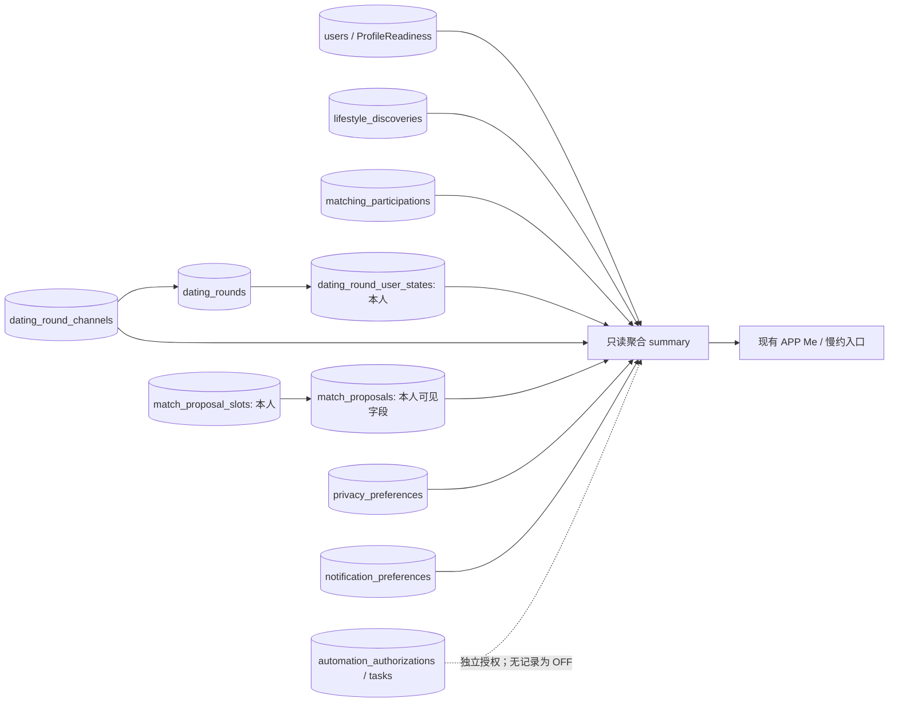

# v10.1.16 用户状态来源图 V1

初次盘点于2026-11-15。

2026-11-15按后续实现源码更新。

范围：AC16-01；依据任务书与 B2 状态合同及本地具名源码。下表保留初次盘点时点，并记录本次读取到的后续实现状态。源码存在不等于迁移已在任何数据库执行，也不构成运行验收。

## 实现状态更新

初次盘点时，统一用户状态和自动化来源尚无相应服务/迁移。随后源码已新增 `UserStateService::read()`、`AutomationAuthorizationService`、`AutomationService`、`MatchRoundProjectionService::readOnlySummary()`、`automation_*` migration，以及认证 API `GET /api/v1/user-state`、`GET /api/v1/automations`、`PUT /api/v1/automations/{scope}`。来源表中的“待实现”已按当前代码更新；本来源盘点基于静态源码。后续运行结果另由实施报告及证据摘要固定。

## 设计约束

- 状态中心是当前认证用户私有的只读聚合，不建立第二套可写用户状态真相。业务事实继续写回各自既有权威源。
- `ProfileReadinessService::forUser()`、`LifestyleDiscoveryService::read()`、`SlowDatingService::participation()` 可作为状态域只读来源；Lifestyle 响应须只保留状态、版本、revision、时间和必要进度，裁剪 `answers`、`derived_preferences` 与题库 `bank`。
- `SlowDatingService::journey()` 与 `MatchRoundProjectionService::currentForUser()` 不能直接作为聚合依赖：揭晓分支会调用提案路径并触发过期、撤回或 slot reconcile 等业务写入。AC16 聚合已新增纯读 summary 路径，只查询并投影现有事实。
- `matching_participations.intent` 是用户私密输入，不进入统一状态视图；只展示状态码、revision/generation 与必要时间。
- 不纳入精确出生资料、身份凭证、私聊、peer 私密信息、Safety/Moderation 案卷、内部匹配分数、OS 运行时权限详情。隐私摘要不包含 `self_profile`。
- 版本与更新时间若来源本身没有 revision，使用来源 `updated_at`；聚合响应另提供 `generated_at`。不得伪造源 revision。

## 权威来源清单

| 状态域 | 读取路径（当前认证用户） | 权威表/字段及版本 | freshness / revision | 隐私与聚合白名单 | 更新触发 | 纯读风险 / 处理 |
|---|---|---|---|---|---|---|
| 账号与基础资料摘要 | 当前 `User`（`users`）；资料摘要逻辑参考 `ProfileController` 与 `ProfileReadinessService::forUser($user)` | `users` 账号状态字段（如 `disabled`、`account_status`、`moderation_status`、`verify_status`、`is_match_eligible`）；readiness 返回 `contract_version=profile_readiness_v1017`、匹配输入 revision、资格原因码及必要计数 | `users.updated_at`（如可用）；审核状态另有 `verify_revision`；匹配输入由 `MatchingInputService` 提供 revision | 只返回可用/受限等稳定状态码、必要恢复提示与资格原因码；不带审核说明原文、精确资料或凭证 | 账号/资料业务命令及运营审核更新相应 `users` 字段；问卷/匹配输入变更由各自来源更新 | `forUser()` 中计算 `matching_eligibility` 本身未调用 round/proposal reconcile；禁止改用可能返回完整档案的 profile/self-profile 接口作为原文快照 |
| ProfileReadiness / 匹配准备 | `ProfileReadinessService::forUser($user)` | `users`、有效问卷答案/题目、`MatchingInputService`、`TrustedIdentityService` 的既有资格合同；返回资格、稳定原因码、下一步码及问卷计数 | `contract_version=profile_readiness_v1017`；`matching_input_revision`；问卷来源没有统一聚合 revision 时不另造 revision | 仅资格结果、原因码、next action；不返回答案文本或资料输入 | 用户完成/修改问卷与匹配输入、账号审核/资格字段变化、题目配置变化 | 仅调用 `forUser()`；**禁止**使用 `eligibleUsersQuery()` 当只读个体快照，它会调用 `SlowDatingService::proposal()` 并可能 reconcile 提案/slot |
| Lifestyle Discovery | `LifestyleDiscoveryService::read($userId)`（当前方法输出比聚合许可范围更宽） | `lifestyle_discoveries`: `status`、`questionnaire_version`、`preference_projection_version`、`revision`、`completed_at`、`updated_at`；题库版本来自配置 JSON | 表内 `revision`、`updated_at` 和两个版本字段 | 聚合当前保留状态、`questionnaire_version`、revision、完成/更新时间及答题/场景计数；**未返回**来源的 `preference_projection_version`；必须裁剪 `answers`、`derived_preferences`、`bank` | `LifestyleDiscoveryController::update` 经 `LifestyleDiscoveryService::command` 的答题、跳过、重置命令 | `read()` 在事务内会对行 `lockForUpdate()`，虽不自行写字段仍会取得锁；纯读 summary 应避免锁，并只查询白名单列/投影 |
| 慢约当前参与事实 | `SlowDatingService::participation($userId)` | `matching_participations`: `state`、`revision`、`generation`、`intent`、`opted_in_at`、timestamps；`intent` 是私密内容，不入聚合 | `revision`、`generation`、`updated_at` | 当前返回状态、revision/generation、updated_at 和 delegated；排除 `intent` 与 opted_in_at | `SlowDatingController::participate` → `SlowDatingService::participate` 的明确 `opt_in`、`pause`、`exit`/草稿命令 | 此方法仅读，但事务内有条件 `lockForUpdate()`；聚合应走无锁纯读 summary。业务事实仍由 `matching_participations` 管理 |
| 当前轮次本人状态 | **已实现：**`UserStateService::read()` → `MatchRoundProjectionService::readOnlySummary($userId)`；读取 `dating_round_channels.active_round_id` → `dating_rounds` → 当前用户的 `dating_round_user_states` | channel `active_round_id/state_version/updated_at`；round `state_version`、状态、计划/揭晓时间；本人 user state `state`、`projection_version`、`updated_at`。summary 返回 `code`、`source_revision`、`round_revision`、`source_updated_at` 和时间字段 | 本人 `projection_version`（无本人行时退回 round `state_version`）；另带 round revision。无开放轮时用 channel revision/time | 仅本人轮次状态及时间，不带 match/peer/候选人、内部评分或 run 明细 | 获准管理员轮次流程更新源表；GET 状态接口本身不协调轮次 | 新 `readOnlySummary()` 不调用 proposal 链，是聚合指定读取路径。旧 `currentForUser()` 仍在揭晓分支调用 `SlowDatingService::proposal()`，可能 expire/reconcile，不能替代该路径 |
| 本人提案占位与状态摘要 | **已实现：**`UserStateService::proposalSummary()` 按本人 `match_proposal_slots.user_id` 读 slot，再按双方参与者与 slot id 读取 proposal | slot `user_id/proposal_id`；proposal 的 `state`、`revision`、`created_at/updated_at`、`expires_at`；返回 `code/recorded_code`、本人 proposal id、revision、时间及 `requires_reconciliation` | proposal revision/updated_at；过期判断基于 `expires_at`，过期只映射 `RECONCILIATION_REQUIRED` | 只返回单个与本人关联的 proposal 标识、状态、版本和期限；不返回 peer 决定或身份资料。proposal id 属于私有状态 | 现有揭晓、用户决定、参与退出及既有协调流程更新 proposal/slot | 纯读摘要检测过期但不执行 expire/reconcile；状态读取不清理业务事实。slot 为空时实现仍可能返回本人最新历史 proposal，不保证 `NONE`；调用方需按状态区分当前事实。`SlowDatingService::proposal()` 与 `journey()` 仍不能作为聚合来源 |
| 隐私与分享设置摘要 | 本人 `privacy_preferences`；仅读取 `fields` 可见性、请求权限，不调用返回 `self_profile` 的 `PrivacyController::show` | `fields`、`revision`；`requests_enabled`、`requests_revision`；表有 timestamps。`self_profile` 是控制器实时计算值，不属于此状态域 | 字段设置 `revision`；请求授权 `requests_revision`（开关值变化时递增）；两者均更新 `updated_at` | 当前聚合只输出共享字段数量 `shared_field_count`（可见性档位为 `RELATIONSHIP_SHARED`/`FRIENDS`）、请求开关和版本；不返回逐字段 key/value、profile 内容、敏感值或其他授权/关系事实 | PrivacyController 更新字段权限；SocialController 更新请求开关及 `requests_revision` | 只查询本人的偏好记录，不调用社交策略获取 peer 资料；字段白名单必须剔除 `self_profile` |
| 通知偏好 | `NotificationDeliveryService::preferences($userId)` | `notification_preferences`: `categories`、`silent`、`updated_at`；领域合同归一化 categories；不存在 revision | 无 revision；以行 `updated_at` 为 freshness；未建记录时表示合同默认偏好 | 仅用户可控通知分类开关与静音；不返回设备 token、会话、投递尝试或设备权限详情 | `NotificationPreferencesController::update` → `updatePreferences()`；表的 `updated_at` 更新 | `preferences()` 是查询路径；不要把通知设备注册/撤销或 OS 权限混作偏好状态 |
| 自动化授权、任务与审计 | **已实现：**`UserStateService::read()` → `AutomationAuthorizationService::read()`；独立 `GET /api/v1/automations` 可读、PUT 命令可变更；scheduler 命令 `app:automation:tick` 驱动白名单 worker | migration `2026_11_15_220000_create_user_automation.php` 建立 `automation_authorizations`（scope、policy/consent version、state、revision、grant/pause/revoke/expiry/check 时间）、`automation_tasks`（周期/round、idempotency/correlation、授权 revision、指纹、状态/attempt、available/start/finish、lease/fencing、result/error/reconciliation）、`automation_effects`、`automation_commands`、`automation_audits`；另为 `matching_participations` 增加自动化授权 id/revision/round 引用 | 授权 `revision/updated_at`；task `state/attempt_count/max_attempts/reconciliation/updated_at`；任务可用时间为 `available_at`；policy/consent 版本来自 `config/user_automation.php`。无授权行时 `OFF`；当前 `effectiveState` 还会把版本不符或到期的 ACTIVE/PAUSED 计算为 `EXPIRED`，持久状态由 scheduler 后续检查更新 | 聚合仅暴露本人授权状态、scope、版本、时间、最近 task 的 id/state/result/error code/attempt/reconciliation 与下次计划；不读命令 payload，不跨用户取数据。注：当前实现会透出 `error_code`，当前写入固定安全码，不存异常原文 | 用户通过授权命令 grant/pause/resume/revoke；`AutomationService` 每分钟排期/执行任务及核对过期；现有人工 pause/exit 也会暂停/撤销委托 scope | `AutomationAuthorizationService::read()` 查询授权与最近任务；若处于已有事务中，授权行查询会 `lockForUpdate()`。worker 会写任务、审计、effects 与现有参与事实；状态 GET 本身不调用 tick。当前 recent task 查询按用户取最新一条，未显式过滤 scope；现阶段只有一个授权 scope，增加 scope 后需收窄。本单元格记录静态审计边界；实际调度已在实施报告具名取证 |
| 每周慢约持续参与自动化 scope | **已实现：**scope 常量为 `weekly_slow_dating_participation`；授权在 automation 服务/接口维护，真实报名仍由 `matching_participations` 维护；`UserStateService` 的 `participation.delegated` 显示是否绑定自动化授权 | `automation_authorizations` 的授权状态与 revision；`matching_participations` 原有 state/revision/generation/intent/opted_in_at，新增 `automation_authorization_id`、`automation_authorization_revision`、`automation_round_id`。当前实现不迁移旧 ACTIVE 到授权 | 授权 revision 与参与 revision/generation 分别维护；task 按 round `cycle_key` 去重并带授权 revision | intent 继续排除。只展示是否委托，不展示 authorization 内部 id 或内部配对信息；自动化摘要面向本人 | 用户明确授权后，由白名单 scheduler 在已有可执行轮次安排任务；worker 执行前重核授权版本、账号/资格、轮次和 proposal slot。无开放轮次会得到 `NO_OPEN_ROUND` 跳过结果；人工 opt-in 清除委托绑定，pause/exit 对委托 scope 生效 | 静态盘点时已有服务/迁移路径，后续已完成具名 worker 验证。轮次创建、管理员执行、匹配 consumer 和关系决策继续由原权限合同管理，实际范围见实施报告 |

## 单向读取结构

`GET /api/v1/user-state` 由 `UserStateService::read()` 组合上述来源，返回 `contract_version=user_state_v1`、当前主体 id、`generated_at`、状态域与 `next_actions`；路由使用认证/账号可用中间件和 `JourneyPrivateResponse`（private, no-store）。Lifestyle 原服务 `read()` 返回答案、derived preferences 与 bank，但聚合只输出完成状态、版本、revision、时间和答题/场景计数，不输出其原始内容。聚合也不会返回 `matching_participations.intent` 或 `privacy.self_profile`。

状态 GET 只投影来源，不直接写业务事实；过期 proposal 仅返回 `RECONCILIATION_REQUIRED`。自动化 worker 在已有开放轮次且资格通过时会调用 `reconcileOwnProposalDeadlines()`，按原提案期限清理已到期 proposal；这是自动化执行路径可能触发的既有业务事实更新，需在验收中核实符合提案期限合同。APP 的报名、资料更新、隐私变更、通知偏好和自动化授权仍分别走各自命令。本文首次源码盘点的运行状态为未核验。后续主代理已完成具名迁移、HTTP、后台可靠性及模拟器验证，最终范围与原失败见[实施报告](IMPLEMENTATION_REPORT.md)和[证据摘要](EVIDENCE_SUMMARY_20261115.json)。

## 源码核对索引

- `services/backend-laravel/app/Services/ProfileReadinessService.php`
- `services/backend-laravel/app/Services/LifestyleDiscoveryService.php`
- `services/backend-laravel/app/Services/SlowDatingService.php`
- `services/backend-laravel/app/Services/MatchRoundProjectionService.php`
- `services/backend-laravel/app/Services/NotificationDeliveryService.php`
- `services/backend-laravel/app/Services/UserStateService.php`、`AutomationAuthorizationService.php`、`AutomationService.php`
- `services/backend-laravel/app/Services/MatchRoundProjectionService.php`（`readOnlySummary()` 与旧 `currentForUser()` 路径差异）
- `services/backend-laravel/app/Http/Controllers/Api/V1/UserAutomationController.php`、`services/backend-laravel/routes/api.php`、`services/backend-laravel/routes/console.php`
- `services/backend-laravel/app/Http/Controllers/Api/V1/PrivacyController.php`、`SocialController.php`、`NotificationPreferencesController.php`、`SlowDatingController.php`
- `services/backend-laravel/database/migrations/2026_11_15_190000_create_lifestyle_discoveries.php`
- `services/backend-laravel/database/migrations/2026_10_20_160000_create_slow_dating_relationship_tables.php`
- `services/backend-laravel/database/migrations/2026_07_12_000100_create_match_round_foundation_tables.php`
- `services/backend-laravel/database/migrations/2026_10_19_200000_social_privacy.php`、`2026_10_21_080000_bind_formal_request_authority.php`、`2026_10_21_220000_create_notification_delivery_contracts.php`
- `services/backend-laravel/database/migrations/2026_11_15_220000_create_user_automation.php`、`services/backend-laravel/config/user_automation.php`
