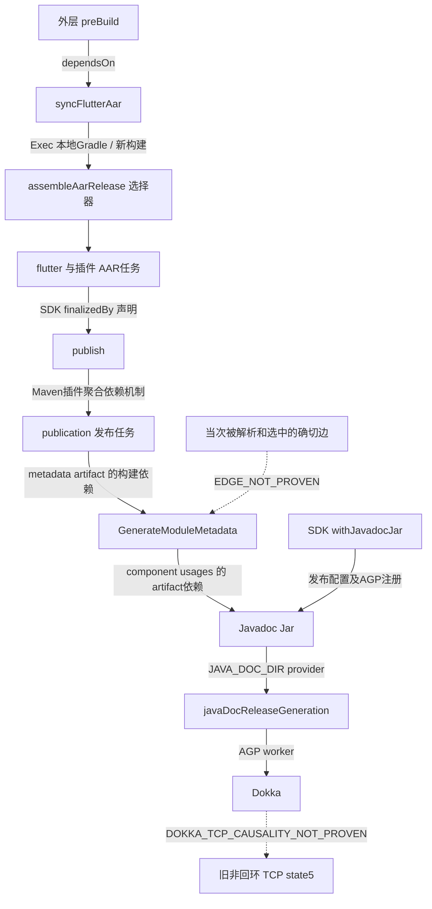

# EliteSync v10.1.5｜Flutter AAR / Dokka 静态依赖链调查

日期：2026-10-27（Asia/Shanghai）。状态：`STATIC_DEPENDENCY_PATH_SUPPORTED / EDGE_NOT_PROVEN / DOC_TASK_EXECUTION_REUSED_LOG / DOKKA_TCP_CAUSALITY_NOT_PROVEN / ROOT_CAUSE_NOT_PROVEN`。

**本轮找到了比“移除artifact并未禁用任务”更具体的静态机制：Flutter AAR init主动请求`withJavadocJar()`；AGP注册文档生成与文档Jar；Gradle模块元数据生成仍从SoftwareComponent收集artifact的构建依赖，不只读取MavenPublication中已过滤的主artifact集合。** 因此，仅在publication上移除javadoc不能证明所有文档依赖边已消失。这是已有字节支持的候选解释，**尚无历史任务图证明当次Dokka恰好经此边被调度，更不证明Dokka发起了原TCP连接**。

本轮没有执行Gradle、Wrapper、Flutter、AAR、Kotlin/JVM、APK、设备、服务、测试、实时网络观察器或Gate2。没有`tasks`、`--dry-run`、`dependencies`、`help`或任务图查询。只读取既有文件，用Python标准库解析ZIP/ClassFile、Hash和JSON，以及执行只读Git/GitHub核验和授权文档发布；没有加载插件类、启动JVM、下载工具/来源或写入任何SDK/pub/Gradle缓存。

## 1. 权威与实时身份

Owner本会话手动派发的正式任务Blob已fresh核为`516eb555c26a13bb82e24e16d371826170ec9559`，没有按历史任务恢复构建预算。

| 对象 | 本轮核验身份 |
|---|---|
| Owner任务分支HEAD / Root | `owner/v10.1.5-aar-dokka-static-investigation-20261027` → `8c2423b56c6b6ea15e818feb2baaee480fb21786` / `f42e28624ef29df0292f769e75e1c6ec95950ef3` |
| 任务分支ACTIVE_STATE | Blob `cf982db3024bb2589149d315c51dea64ff4e64cc` |
| live main / Root | `4df2e7f0f36cc7b80258faa73e80dad682cff6c5` / `03b0ecfcc360e38a462539dd50690c64b663a21e` |
| 上轮有界接受TCP文档候选 / 唯一Parent / Root | `7abea213feacc52a1e43c6ed58a40c83009c74df` / `cfddecc944a043b1d85361a954a692be0dd4ce23` / `8a7775c97f3161f2f6f54d6499deba584349f307` |
| 原TCP报告 / Astra独立审阅 | Blob `72975510872fbe3251caf1b8ddbd687761165d88` / `6a7dc815eadd6950d793727b1d2679026411d5bf` |
| 实际构建源码 / 唯一Parent / Root | `12d4e284feea609935eab12c973f5fd2efbc2992` / `7674b5e60a219cb76aba387dd2cee85cae67bd0a` / `1fbd4a7a2de6dc56b42b0e3a51f7d74f712d7250` |
| 候选apps / services完整子Tree身份 | `cea01309fa9da5f99ccc9829654c6ec279c8c343` / `21eebf69bbc6397b1562d40f8cd9ebd7b246720f` |
| 冻结plan | Blob `7d3466b3be67135dc641cfee7c7faef78937ba03` |
| 旧实施报告 / Manifest | Blob `71e039051ba0c6205f496444bc466d71f11a6fff` / `d91a50d3653ef6304b4f45e53ddb4a242dbce284` |
| 产品main仍为已接受v10.1.4 | apps `3468a3dd97da7accfda2539a0f8d8f68931a6110` / services `0cb1f9d19659291a462488b3686fd0a07a6698ac` |

新Owner文档分支并不包含全部旧候选交付文件；首次按该分支读取TCP报告/旧报告/Manifest的不可用响应保留，随后从它们已核验的固定候选读取，没有把缺文件当原证丢失。Astra既有裁决为`READONLY_ROOTCAUSE_DIAGNOSIS_ACCEPTED_WITH_LIMITATIONS`，明确保留实例身份和根因未证明，未独立复算Windows原证。

连续本地工作树保持原候选`cfddecc...`及原分支，干净；受保护dirty根不动。新交付仅在`7abea213...`上增加本报告，计划分支`codex/v10.1.5-aar-dokka-static-investigation-20261027`；最终Commit/Parent/Root/Blob、原字节及完整子Tree回读身份在本任务LOCAL_ONLY `final-readback.json`外部绑定，不自引用文档Hash。

## 2. 来源、版本及只读方法

所有任务副本/SDK/pub/Gradle位置从既有`trusted-build-inventory.json`及生成插件元数据定位，未扫描其它项目。旧库存SHA256为`3eafdc458ee7a0dd06b3a5e47fb1d26396aa30faac950732e82fd20c26f1c0c6`，本轮Hash一致。

本轮建立30个关键输入的Hash索引：包括执行源码、生成的`.android`脚本、Flutter loader/AAR init、被实际元数据引用的`connectivity_plus`脚本、AGP/Gradle/Dokka缓存Jar、原stdout/stderr/JSONL及前次daemon Hash。既有pin均匹配。只读代码图谱仅能定位仓库的`syncFlutterAar`变量，未覆盖实际SDK/缓存；未重新索引受保护根，改从具名现存文件及有pin的Jar读取。

静态Jar方法：用自有任务目录中的Python读取ZIP条目、ClassFile常量池、方法Code、BootstrapMethods、SourceFile与LineNumberTable；**没有反射、类加载、javap、Java编译或执行**。下面的`*.kt/*.java:行号`是该类文件内嵌的来源行映射，不冒充已经取得完整上游源码；同时给出方法名/字节偏移，使结论可在同一Jar字节上复核。派生解析和原始路径仅LOCAL_ONLY，公开不上传Jar或整段反汇编。

### 版本不能混为一谈

- `.android/settings.gradle`声明`com.android.library 8.11.1`、Kotlin Android `2.2.20`；本项目顶层声明AGP `8.11.1`。
- 元数据指向的`connectivity_plus 7.3.1/android/build.gradle`又声明buildscript classpath `com.android.tools.build:gradle:8.12.1`，并`apply plugin: 'com.android.library'`。该脚本没有声明或应用`org.jetbrains.dokka` Gradle插件。
- 两个声明对应的原始AGP Jar均已存在、Hash匹配库存；二者的`JavaDocGenerationTask$CreationAction.class`字节相同，SHA256为`43dec8058ba1d02c8b24e84ed3c583d67c981b9150abd21ad480410c8e924220`，均配置Dokka `1.4.32`。因此注册机制在两份已查候选字节中一致。
- **没有运行时classloader/实际已加载Jar身份记录，不能仅凭声明或缓存存在断言当次该项目最终用了8.11.1还是8.12.1。** `TASK_ORIGIN_STATIC_AGP_SUPPORTED`；精确当次版本仍`TASK_ORIGIN_NOT_PROVEN`，这里专指运行实例的版本闭合，不否认已找到AGP注册代码。

生成的`.flutter-plugins-dependencies`被库存pin，loader从其Android插件条目取得`connectivity_plus`路径。该路径并非当前任务复制的`roots.pub`路径；本轮按元数据只读读取其具名`android/build.gradle`，与库存副本原字节完全相同，Hash均为`e43e962b...`。**字节相同不等于路径隔离或整个被引用包都已受任务库存保护。** 本轮不重写元数据、不迁移缓存；以后若授权修复/构建，应先单独闭合实际引用路径及必要输入范围，不能把库存副本等同为运行一定使用的路径。

## 3. 外层到内层：调用和静态依赖

固定源码`apps/android/app/build.gradle.kts`：

1. `:302-303`：`tasks.named("preBuild") { dependsOn(syncFlutterAar) }`，这是明确的任务依赖声明。
2. `:245-272`：普通v10.1.5 R1分支将工作目录设为模块`.android`，直接调用已核验本地Gradle8.14；命令先加载SDK `aar_init_script.gradle`，再加载项目`offline_debug.init.gradle`，选择`assembleAarRelease --offline --console=plain --no-daemon --max-workers=2`及原有禁自动下载参数。这是**跨构建Exec调用**，不是同一Gradle图中的`dependsOn`。
3. `assembleAarRelease`命令是未限定项目路径的任务选择器；原stdout记录了`:connectivity_plus:assembleAarRelease`、`:flutter:assembleAarRelease`等。不能把选择器伪写为只执行一个全限定任务，亦不能从UP-TO-DATE文本判断全部发布链完成。
4. `.android/settings.gradle`→`include_flutter.groovy:17-20,33`引入`:flutter`及SDK module loader；SDK `module_plugin_loader.gradle:15-20`按元数据引入插件Android工程。`native_plugin_loader.gradle.kts:33-65,138-141`读取`.flutter-plugins-dependencies`并筛选需native build的Android插件。这是`connectivity_plus`成为内层项目的静态来源。

## 4. Flutter主动请求文档；AGP注册任务

### SDK AAR init的可证实边

`aar_init_script.gradle`原字节Hash与前次`b6b87095...`一致：

- `:113-115`：对各项目应用`maven-publish`。
- `:117-147`：`afterProject`里，仅对有Android扩展且尚未声明singleVariants的项目，遍历buildTypes/产品flavor，调用`singleVariant(...) { withSourcesJar(); withJavadocJar() }`。无flavor分支的Javadoc请求在`:140-142`。条件分支不能省略，不能声称任意项目都必然走同一路径。
- `:87-105`：`addAarTask`创建`assembleAar<Variant>`；当该名称在请求taskNames中时，从component创建MavenPublication，并为AAR任务声明`finalizedBy "publish"`。publication保留`from component`。
- `:150-187`：projectsEvaluated时配置`:flutter`和插件项目；`:183-187`显式让模块的`assembleAar<Variant>`依赖插件对应AAR任务。

在当前实现中，发布不是可以随意删除的文档步骤：外层`app/build.gradle.kts:429`以Maven坐标依赖版本化`flutter_release`，`settings.gradle.kts:35`读取R1本地repo；SDK init`:33-37`配置文件repo，并通过`from component`保留POM依赖模型。若取消publish/POM或丢失插件AAR，会破坏这一消费路径。这里说明当前设计的产物契约，不声称本次失败构建已经成功产生或验证完整POM/运行时依赖。

### AGP中的具体注册位置

下列字节位置以原始AGP8.11.1 Jar为例，8.12.1的对应注册类和机制也已只读核对：

| 节点/边 | 字节级定位 | 可证实含义 |
|---|---|---|
| 发布选项→任务注册 | `LibraryTaskManager.createBundleTask`，`LibraryTaskManager.kt:290-293`，offset126的谓词、151的条件跳转、173/187及197/211的创建/注册 | 检查`ComponentPublishingInfo.getWithJavadocJar()`；为true的路径注册`JavaDocGenerationTask$CreationAction`和`JavaDocJarTask$CreationAction`，不是connectivity插件自己注册同名Dokka Gradle任务 |
| 生成任务命名 | `JavaDocGenerationTask$CreationAction.getName`，`JavaDocGenerationTask.kt:221`，offset1/3/5 | 以`javaDoc`、`Generation`调用变体任务名计算；与旧日志`javaDocReleaseGeneration`吻合 |
| 生成输出→Jar输入 | `CreationAction.handleProvider:225-227`及`JavaDocJarTask$CreationAction.configure:73` | 生成任务注册`JAVA_DOC_DIR` provider；Jar任务从该provider取得目录，存在生产者/消费者构建依赖机制 |
| Jar输出→发布模型 | `JavaDocJarTask$CreationAction.handleProvider:58-63`；`LibraryTaskManager.createComponent:337-353` | Jar注册`JAVA_DOC_JAR` provider；component加入`JAVA_DOC_PUBLICATION` configuration变体 |
| 文档动作→Dokka worker | `JavaDocGenerationTask.doTaskAction:92-93`，offset15/33 | 使用classloader隔离worker，提交`DokkaWorkAction`；这里的任务实现来自AGP，文档引擎依赖来自Dokka |

不要把“注册”当“被调度”。例如已查`LibraryTaskManager$createBundleTask$1.execute:280`只把AAR provider接到assemble；本轮没有在这段代码找到`assembleRelease`直接`dependsOn(javaDocReleaseGeneration)`。文档相关静态路径主要在publication/component及metadata输入依赖这一层，不应编造直接assemble→Dokka边。

## 5. 为什么publication移除不等于任务图删除

现有项目`offline_debug.init.gradle:5-12`在projectsEvaluated检查nested offline，然后只做：遍历MavenPublication的`artifacts`，移除`classifier == 'javadoc'`的项。没有改Android发布DSL的`withJavadocJar`标志、SoftwareComponent变体、Gradle元数据任务输入、AAR的publish finalizer，也没有禁用文档生成/Jar任务。

本地Gradle8.14原始发行Jar提供了更具体的静态解释：

| 静态环节 | 现存字节定位 | 与artifact过滤的关系 |
|---|---|---|
| Maven主artifact集合 | `DefaultMavenPublication.getArtifacts`，`.java:281-282`；`populateFromComponent:260-267` | 返回`mainArtifacts`，项目removeAll作用于此集合；`from:247-254`仍将SoftwareComponent附着于publication |
| 发布输入并非只有mainArtifacts | `DefaultMavenPublication`构造器`:134-137`、`getPublishableArtifacts:350-351` | publishable集合还包括metadata和derived artifacts |
| 创建模块元数据任务 | `MavenPublishPlugin.createGenerateMetadataTask:216-225`、`lambda$createGenerateMetadataTask$13:221-223` | 注册`GenerateModuleMetadata`并关联publication；模块描述artifact在`DefaultMavenPublication.updateModuleDescriptorArtifact:218-225`加入metadata集合 |
| 发布任务消费这些输入 | `AbstractPublishToMaven`构造器`:49`及`lambda$new$0:50-51`；`SingleOutputTaskMavenArtifact`构造器`:37` | 发布任务输入来自publication的publishable文件；模块描述artifact保留其生成任务构建依赖 |
| 模块元数据独立看component | `GenerateModuleMetadata.component:339`、`getArtifacts:141`；`VariantFiles.getBuildDependencies:299-302`、`forEachArtifactOf:322-323` | 从`publication.getComponent()`→`getUsages()`→每个variant的`getArtifacts()`，向依赖集合添加artifact；**没有改读已经过滤过的Maven mainArtifacts集合** |

所以，即使Maven主列表已经删除Javadoc，只要SoftwareComponent仍暴露文档变体，模块元数据生成的输入/构建依赖仍**可以**到文档Jar→生成任务。该机制无需重新出现Maven主列表中的同一个artifact。

以下是**静态候选图**。箭头文字区分声明、Exec和输入依赖；虚线表示当次历史调度尚未证明，不是动态任务图输出：

本轮没有历史完整任务图、配置后publication/component快照或每条依赖选择记录，不能宣称metadata路径已被确认为当次唯一入口；其它publication构建依赖/懒配置路径也未全部排除。**已证实静态机制，实际选中边保持`EDGE_NOT_PROVEN`。**

## 6. 文档引擎配置与旧执行证据

AGP `JavaDocGenerationTask$CreationAction.configure`建立Dokka `dokka-base`、`javadoc-plugin`、`dokka-core:1.4.32`的配置/类路径；这些不是在本轮解析或下载的依赖，而是既有Jar中的坐标常量。

AGP8.11.1 `DokkaWorkAction.defaultExternalDocumentationLinks:202-207`调用Dokka的JDK、Kotlin标准库、Android SDK、AndroidX外部文档链接工厂；`buildDokkaSourceSetImpl:187`将其放进source set。`buildDokkaConfiguration:168`调用Dokka配置默认构造器，offset118的默认参数mask为16280，包含offlineMode位16；已读Dokka1.4.32配置类的该默认分支置false（offset60-66，`DokkaConfigurationImpl`来源行12）。这支持**该实现没有把Gradle依赖解析的`--offline`映射成Dokka的offlineMode=true**。它仍只是静态配置机制，不能证明这次执行确实访问了任何外部链接、目标地址或payload。

旧原件Hash复核后，stdout的`#94/#101`仍是`:connectivity_plus:javaDocReleaseGeneration`，`#95-107`含Dokka文档模型、页面与渲染进度；`#25`为`:app:syncFlutterAar`，`#42/#146`等记录插件/Flutter AAR任务。**这是历史实际执行的复用证据，不是本轮运行。** 没有逐行统一时钟，不能将这些输出精确对齐JSONL #734的TCP建立时间。

原stdout/stderr/JSONL分别保持原候选pin；两个daemon日志仅与前次TCP只读诊断中新增的Hash匹配，不提升为原构建时已pin。前次462连续PID样本、父链和实例缺口沿用其原结论，本轮不重做设备或进程观测，也不从当前缓存版本反推当时已加载组件身份。

因此保持：`DOC_TASK_EXECUTION_REUSED_LOG / DOKKA_TCP_CAUSALITY_NOT_PROVEN / INSTANCE_IDENTITY_NOT_PROVEN / ROOT_CAUSE_NOT_PROVEN`。外部链接配置、Dokka默认offline=false与历史TCP同时存在，也不构成排他因果证明。

## 7. 最多两个候选修正方向——只建议，不实施

### 方向一：在发布变体创建阶段不请求Javadoc

如Owner后续授权，可在**项目拥有、保存上游来源/许可/原Hash的新AAR init副本**中，仅针对批准的普通本地runtime AAR路径去除`withJavadocJar()`请求，保留`withSourcesJar()`、AAR任务、`from component`、插件AAR依赖、publish及POM/模块元数据。调用点和清单应显式pin这个新副本，不能直接修改共享Flutter SDK，不能默默改变其它构建模式。

这是从配置源头不创建文档发布变体的候选，预计比事后只删Maven artifact更完整；**尚未证明其生命周期时点和全部依赖足以消除当次文档调度**。它不应删除runtime AAR、POM或Flutter插件依赖，但必须在新的明确授权下核对这些产物及消费者元数据；本轮没有验证通过，也不能声称会消除TCP。

### 方向二：在SoftwareComponent层过滤仅文档变体

若保持SDK init不变，可在项目自有配置中调查按AGP实际`JAVA_DOC_PUBLICATION`配置，对对应AdhocComponent的文档变体使用Gradle变体跳过机制，使Maven主artifact和模块元数据都不再收集该文档variant。保留API/runtime变体、必要sources、AAR/POM与正确的运行时依赖描述。不能猜configuration名称，也不能只禁用`javaDocReleaseGeneration`后留下引用缺失文档输出的元数据。

这取决于已注册component与publication取值的正确时点，当前实际调度边未闭合，属于需要Owner新授权后才能实现/验证的候选。**不建议为规避文档输入而全关GenerateModuleMetadata、publish、必要POM或监控。** 两方向都将改变构建定义与库存身份；不能复用旧Hash声称新输入已验证，重复构建claim/预算和网络强停止规则仍须保留。

两者只供后续选择，不派发后继任务，不新增构建预算，不给出本轮已完成补丁。本任务授权仍仅为0构建预算静态调查。

## 8. 最小Hash索引和保护

以下只公开标签和SHA256，实际路径/完整索引留在本任务LOCAL_ONLY `v1015-aar-dokka-static-20261027`。共30项关键输入；完整52项旧根证据Hash亦按前次索引复核。

| 标签 | SHA256 |
|---|---|
| 执行源码 app/build.gradle.kts | `c357a1859f55cb4928dab3dcce2d46b4dc89ab01004b88bac39a284ffda0f567` |
| 项目 offline_debug.init.gradle | `750e685737e090826753792c427914d25aaf747c687bdd23d3d0267d3f534aee` |
| SDK aar_init_script.gradle | `b6b870954405c5d52afea183bb51b3220100c234401142d8c1bf3e2410cee2c2` |
| 生成 .android/settings.gradle | `58ed6cf1a5ff74237dba2c0dbbd19669aeeea145c2f442462b04c20541a8f609` |
| 生成 .flutter-plugins-dependencies | `3fa78aafdc551d1aff5c390f490218cffa8b5d922587c5ecc19f67964844e7e1` |
| connectivity_plus7.3.1 Android脚本（两处当前字节一致） | `e43e962b5f4e8975bcac35073840136ccd4a1a7a790e6f340f5863d2e110623b` |
| 原始 AGP8.11.1 Jar | `3f71d6d3bf4226a2c83131fe28980842f834b84375f04bf124cb00ab72506ea2` |
| 原始 AGP8.12.1 Jar | `bf703e8d92c598a73764a4ce9a06f60a0dddd9834ff90a8ce1e5e1308b50a37a` |
| Gradle8.14 maven Jar | `e88343f5e61c20129ba7fa19140ab676ffd836ca80e1ea09907e802bd7785e27` |
| Gradle8.14 publish Jar | `c5fa2f3715ee991f848c6559087c03ff218ca96c807e1bfcdc63449873806b8b` |
| Dokka core1.4.32 Jar | `b514f4fd11c410d1bf441b815da017607d32a500e1d200c423181aec3ed66fb1` |
| 原 stdout | `0fbc2c233ab87dd83f152c23e23f7ed58ddf59ee79481a3f2f7822d47fe346d5` |
| 原 stderr | `6d3b8ee7dc564a062738d52cd5a473391565b56f664e9528daa54201b0fff5aa` |
| 原 JSONL | `19222dde39878d8a8f755db0f7d22b6903bb671d74c7b9d2e7e7dae6d5d5f0cd` |

本地根级`apps/android/build.gradle.kts`工作树为145字节CRLF版本，Git源对象142字节LF版本；首次输入核验器错误假定原字节完全相同而exit1，随后保留失败并分别记录两个Hash及仅换行差异，未改文件或降低源码内容比较。工作树SHA256 `f4db52252e3f16cdb2ee6b783ab3330366534d236024ce69ad6924c136133461`；Git规范字节SHA256 `86fcc8e670ba5cc3fcfa4876ac7330c1133d173bef93887a2db638c950f1670e`，LF内容相同。缓存静态定位还读到一份既有instrumented AGP8.11.1副本（Hash `ac3b354d...`）；随后使用完整模块坐标路径限定原始Jar，以上引用按原始Jar，未替换/重写缓存，也未把instrumented字节冒称原始Jar。

有界保护核验：26784份具名历史文件、5个历史Git根及524个开工refs中的既有保护项一致；旧claim、52项旧根证据、源文件/SDK/缓存及本次具名引用脚本均不写入。原实施报告、Manifest、冻结plan、已接受TCP报告及Astra记录保留，不改main。旧7,941,328字节partial及SHA256 `b6fd9e325eaf2b1d785efdd9e32baad65e85c6a577be7c28c970a80158a679d4`保留，历史SQL/APK/refs不清理。这里只是具名范围核验，不是整盘或全部缓存/引用包审计，也没有本轮进程/网络/设备实时普查。

## 9. 结论等级与交付停止

| 命题 | 结论及范围 |
|---|---|
| 外层preBuild到Exec内层AAR | `STATIC_DEPENDENCY_PATH_SUPPORTED`；任务依赖与跨构建调用分开 |
| Flutter请求Javadoc、AGP注册任务 | `STATIC_DEPENDENCY_PATH_SUPPORTED`；原始8.11.1/8.12.1候选注册字节支持，精确当次加载版本`TASK_ORIGIN_NOT_PROVEN` |
| 主artifact删除后metadata仍能依赖component文档产物 | `STATIC_DEPENDENCY_PATH_SUPPORTED`；由当前被pin的Gradle8.14实现支持 |
| 当次Dokka的确切选中边和唯一调度路径 | `EDGE_NOT_PROVEN`；没有实际已解析任务图/模型快照 |
| Dokka实际执行 | `DOC_TASK_EXECUTION_REUSED_LOG`；原stdout复用，非本轮执行 |
| Dokka发起原TCP | `DOKKA_TCP_CAUSALITY_NOT_PROVEN / ROOT_CAUSE_NOT_PROVEN` |
| 修正安全有效及构建成功 | `NOT_RUN / NOT_PROVEN`；只交付最多两条候选思路 |

`ASTRA_DIRECT_GITHUB`只用于既有正式裁决和其已直接核验的源码/远端身份，不把本轮缓存结果写成Astra亲验。`CODEX_REPORTED_LOCAL_READ_ONLY`用于本轮源码、ClassFile静态解析、Hash和旧stdout复核；`LOCAL_ONLY_RAW`保留所有原始路径、插件元数据、日志、socket标识及完整字节提取。没有调用新的非作者执行者；本报告交付后由Astra独立验收，不能自行接受本轮调查或产品。

真实构建/Gradle查询/测试/设备/新观察器/服务/Gate2/Writer/Serializer均0；原真实构建预算1/1已耗、剩余0。最终保持`V10.1.5_PARTIAL_NOT_ACCEPTED / AC05_OPEN / ACTUAL_BUILD_NOT_COMPLETED / ROOT_CAUSE_NOT_PROVEN / SINGLE_REAL_BUILD_BUDGET_EXHAUSTED_1_OF_1 / GATE2_NOT_AUTHORIZED`。本报告普通non-force文档候选回读完成后停止，等待Astra；不启动修复、真实构建、产品main集成或v10.1.6。
