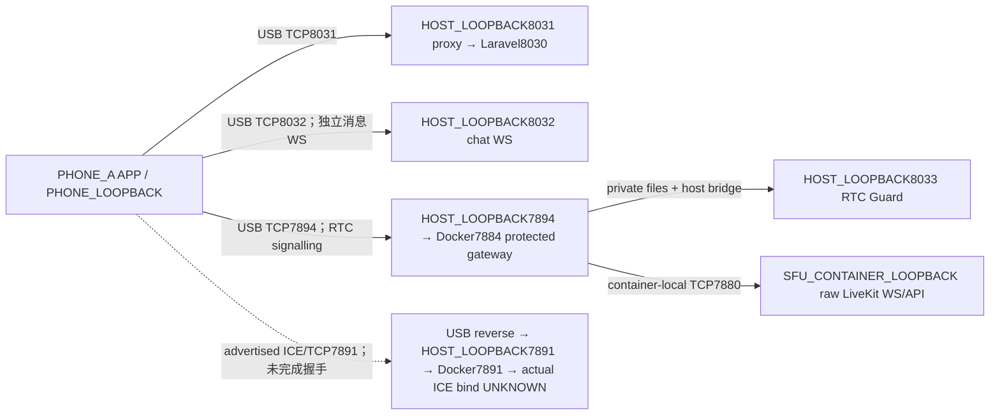

# v10.1.5 ICE Candidate 与 USB/SFU 网络拓扑只读审计

2026-10-22（Asia/Shanghai）。**READ_ONLY / RUNTIME_NOT_RUN / PHONE_NOT_TOUCHED / SOURCE_UNCHANGED / AC05_OPEN / OWNER_DECISION_REQUIRED / NO_R2**。

结论：旧USB路径的**TCP7891候选、reverse与Docker发布端口在数字/协议上相符**，已有记录也支持受保护信令，但不能证明真实ICE/TCP握手可用。没有证据证明USB TCP从原理上不可行，也没有证据证明必须开放UDP/LAN。已确认的失败边界仍是合法信令之后、有效ICE媒体连接之前；具体根因未闭合。此次不修复、不重试、不执行任何设备/业务网络探测。

## A0｜权威、原件与时间域

- 正式任务Blob `994fdb154c898faf7e6f55f85c5dbd86ff603612`，全文读取，原字节Git Blob身份核验一致。
- 实时main `51154041ed10da582c962c86b30d554cfcd1bb86`，Root `2ca64703fc4a537403885e3395712bf25af03994`；apps `3468a3dd97da7accfda2539a0f8d8f68931a6110`，services `0cb1f9d19659291a462488b3686fd0a07a6698ac`，仍为已接受v10.1.4产品。
- 固定R1源码 `1c5cd2bb7919c435e8486a76959db75e9ccc367f`，Root `165eb1f362db533ca94bfe1db677ff6f7bd477ed`，完整apps `0784c8aa7b0915a04b83693a45401197e31d93a2` / services `1e1e20bb3500bedb1a521e5f2ddeece915d09424`。
- 审计候选唯一父提交为上一轮交付 `fe2e4397e4db894257276238c1a3118ba3c6a5f9`，父Root `b7a2dc5c3071e52c57cd14be82d05651975415fb`；上一轮报告Blob `bf936c300d6b12b0f4ecae0b083dca277035f784`、manifest Blob `d2e0f15623e7f1a05513f4ae2286f396db523a0c`均重核。
- Astra真机独立复审Blob `fcd62d873ead2ac5e9884ecf2a6db654c138dff4`全文读取，维持PARTIAL/NOT_ACCEPTED；方案A Blob `a5a0ab1f99e0fd76365820e51af6ac3f83bb9a43`及冻结plan Blob `7d3466b3be67135dc641cfee7c7faef78937ba03`保持。

原件为已归属的上一轮PHONE_USB专项LOCAL_ONLY目录，路径只保存在本地清单。本轮读取原始APP PID日志、完整SFU日志、715条观测、历史配置与映射回执；不是仅转述公开报告，因此审计整体不标DOCUMENTARY_ONLY。原件均可读，具体缺失的网络字段记MISSING_ICE_CANDIDATE_EVIDENCE，不伪造pcap或候选对。E01～E20的原文件SHA256/bytes见本清单；私人原地址仅经本机解析输出类别，不发送原candidate文本给审阅模型。

| 时间域 | 已有真值与限制 |
|---|---|
| Android APP wall epoch | E02:L2377开始 `1792649962.969`、L2481失败 `1792649993.193`，同设备日志差30.224s；不是HTTP耗时或成功媒体时长。 |
| SFU container UTC | E01:L2024开始session 06:19:23.398Z；L2191～2192在06:19:38.617Z关闭/无连接移除，connectionType=unknown；L2196出现could not restart participant；L2419 idle close。它们是服务端结果，不能把SIGNAL_SOURCE_CLOSE改写成已证明的ICE根因。 |
| 观测脚本 | E17在容器内调用time.time，E03的epoch不是因文件落在Windows就成为host时钟。715样本覆盖 `1792649874.6283958`—`1792650054.5282998`。 |
| Host wall/monotonic | 启动/bridge/探测回执使用各自host时钟；单进程monotonic仅能算本进程耗时，不能跨设备/容器对齐。旧空TCP探测回执未给绝对epoch，也没有STUN帧，不能和某ICE检查逐包关联。 |

没有可信跨时钟偏移校准或5秒撤权时序，不能从这些日志计算跨设备延迟或≤5秒通过。

## A1｜三平面拓扑与Authority

以下是**上一轮历史配置/回执重建**，不是本轮运行图。别名表示不同网络命名空间，不代表相同IP字面量就是同一端点。

| 平面 | 固定来源 | 可支持的结论 |
|---|---|---|
| 身份/业务 | SOURCE_LINE S2 RtcController:171–194；S3 RtcGuardController:13–49；S4 RtcAuthorityService:27–88,117–160；S5 LiveKitTokenService:13–73 | 用户参与资格、device_session绑定/撤销/期限、当前CN/MC授权签名及短期room/identity JWT约束；guard再次查当前权威。未访问或解码JWT/网关secret。限定所读文件内无独立call-epoch比较；客户端connectionGeneration与consent generation不能冒称同一个服务端call epoch。 |
| APP入口/信令 | RUNTIME_RECEIPT E13仅提取APP消费响应的URL字段：scheme=ws、host=PHONE_LOOPBACK、port7894；CONFIG_RECEIPT E04/E06；SOURCE_LINE E14:137,181、E15:14、E16:88 | 历史手机7894/TCP反向到host7894，再publish到container7884；gateway经本地bridge请求host8033当前授权，再代理container-local7880。8031是APP API代理到8030，8032是消息WS，均不等于ICE媒体。raw7880未发布。 |
| 媒体 | CONFIG_RECEIPT E05键rtc.tcp_port/node_ip/use_external_ip/force_tcp/enable_loopback_candidate；E04端口publish；RUNTIME_RECEIPT E01:L214,L2192 | 配置ICE/TCP7891，node地址为loopback类别，use_external_ip=false、force_tcp=true、enable_loopback_candidate=true；实际记录的SFU本地候选是IPv4 loopback TCP7891。配置标志不替代实际listener/协议观测。 |
| 容器边界 | CONFIG_RECEIPT E05 bind_addresses为CONTAINER_LOOPBACK；E04仅host loopback7894→container7884/TCP及7891→7891/TCP | 真正ICE listener绑定接口、Docker后端accept与STUN流量均MISSING。顶层bind_addresses是否约束此版本ICE TCP listener不能只从键名断定。 |
| 客户端配置/启麦 | SOURCE_LINE S1:696–761,893–955 | connect/publish/subscribe/peerConnection/iceRestart配置各30s；没有显式tcpType/iceTransportPolicy。restorationLocalBuild分支传iceServers空列表，另一分支用默认RTCConfiguration；所核具名build stdout未保存该编译开关，不能倒推出该APK实际分支或SDK最终ICE servers。Room.connect成功后才执行启麦；本轮静态读取不补成采音实测。 |

E01:L214启动日志版本为LiveKit1.13.10，输出rtc.portTCP7891和ICE range50000–60000。后者仅是启动日志元数据，E05没有显式udp_port/port_range，不能把默认/打印范围当作本轮实际UDP监听或放行依据。仅所见close快照里的SFU本地候选为TCP；`NOT_OBSERVED_IN_AVAILABLE_LOGS`不等于全过程`CONFIRMED_NOT_ADVERTISED`。

## A2｜候选矩阵与各层结果

E01:L2192同一无连接移除事件保存publisher9条、subscriber11条候选记录，总20；其中SFU local2、Phone remote18。下表是**SFU视角**：Phone项是服务端收到的候选，不是手机端完整原始SDP。某些地址本来已被服务端截断，保持PREFIX_TRUNCATED。18次APP onIceCandidate回调与18条remote记录只是数量吻合，没有ID不能一一关联。

完整逐行矩阵在manifest `candidate_matrix`，每行包含task要求的phase、side、source_credential_boundary、candidate_type、protocol、tcp_type、address_class、advertised_port、listener_role_port、phone_reachability_class、adb_reverse_match、docker_publish_match、pair_state、recorded_error、evidence_ID、conclusion_confidence；这里按相同ID分两表便于阅读。所有行phase均为call3 trickle在close时的快照，credential boundary为经当前授权gateway到达SFU session，仅表示信令边界。所有type=host，TCP tcp_type均NOT_RECORDED；UDP不适用tcp_type。手机端口原值仅LOCAL_ONLY；其中6条TCP记录虽均为非零高端口且无discard占位9，仍不据此证明ephemeral分配或TCP角色。

| ID | side/地址类别 | IP版本 | 协议 | 宣告端口 | P/S记录数 |
|---|---|---:|---|---|---|
| M01 | SFU_LOCAL / ADVERTISED_LOOPBACK_LITERAL | 4 | TCP | 7891 | 1/1 |
| M02 | PHONE_REMOTE / LAN_PRIVATE | 4 | UDP | 动态/LOCAL_ONLY | 2/2 |
| M03 | PHONE_REMOTE / LOOPBACK_PREFIX_TRUNCATED | 4 | UDP | 动态/LOCAL_ONLY | 1/1 |
| M04 | PHONE_REMOTE / NON_LOOPBACK_PREFIX_TRUNCATED | 6 | UDP | 动态/LOCAL_ONLY | 2/2 |
| M05 | PHONE_REMOTE / LOOPBACK | 6 | UDP | 动态/LOCAL_ONLY | 1/1 |
| M06 | PHONE_REMOTE / LOOPBACK_PREFIX_TRUNCATED | 4 | TCP | 记录端口/LOCAL_ONLY，role未知 | 1/2 |
| M07 | PHONE_REMOTE / LOOPBACK | 6 | TCP | 记录端口/LOCAL_ONLY，role未知 | 1/2 |

| ID | listener/路径和映射 | phone reachability | pair/error | 证据及置信度 |
|---|---|---|---|---|
| M01 | 配置SFU ICE7891；reverse7891/TCP与host→container7891/TCP数字吻合，真实内层接口未知 | 历史空TCP connect exit0；不是本候选ICE成功 | selected pair MISSING；session unknown；每对错误MISSING | E01:L2192,E04～E07；枚举CONFIRMED，可行性UNKNOWN |
| M02–M05 | Phone UDP动态端点；记录中的USB reverse与Docker publish没有对应UDP通路 | 不能以这些TCP tunnel承载UDP；不推断其它未授权网络可达性 | 同上；call级SIGNAL_SOURCE_CLOSE、APP MediaConnectException不是逐候选错误 | E01:L2192,E06；协议限制CONFIRMED，非根因证明 |
| M06 | Phone IPv4 TCP记录端点，未映射这些端口 | 若手机作为active端向固定server端口拨号，未必需要映射该手机记录端口；但tcpType/候选配对未记录 | 不制造失败pair，也不能据高端口推断passive | E01:L2192,E06；理论路径HYPOTHESIS |
| M07 | Phone IPv6 loopback TCP记录端点 | 与所见server IPv4候选族不同，不能直接证明有效TCP pair；其它未记录检查UNKNOWN | 无nominated/selected/DTLS证据 | E01:L2192,E02,E03；UNKNOWN |

**分层结果**：旧TCP socket connect回执exit0；受保护信令session/JOINED有证据；ICE connected/selected pair未观察；DTLS connected未观察；成功Room.connect没有；启麦帧、音频publish、SFU可归属音频RTP和remote receive未证成。APP原日志RTC_MEDIA_ICE/RTP各0条，DTLS/selected-pair关键词APP与SFU均0行。S1:260–335的4秒stats timer在connect成功后才开启；缺日志不等于SDK没有执行过ICE检查。

E03最终715个样本，其中60个有显式tracks字段且均空，655个没有字段。E18通用packet指标incoming26/4102bytes、outgoing15/3065bytes没有音轨/codec归属，不是音频RTP成功。HTTP-only peer没有SDK或音频接收能力，不是第二APP。没有将媒体失败后的server resume错误当作合同里的same-call真实媒体重连实测。

## A3｜假设、证伪证据与最多两个纸面方案

| 判断 | 分级 | 支持与未知 | 将来最小证据 |
|---|---|---|---|
| 宣告TCP7891与USB/Docker端口相符 | CONFIRMED | 字面地址也与配置node_ip及URL host相等，但分别在手机、host、容器命名空间解释 | 此吻合不要求新实测；可用性仍需下列证据 |
| UDP项不能通过旧TCP-only USB tunnel | CONFIRMED | 已记录Phone有12条UDP，同时也有6条TCP；不能解释为“全部候选都是UDP” | 若判断具体失败原因，需实际候选对与检查结果 |
| 信令和媒体是不同连接 | SUPPORTED（本项目信令），CONFIRMED（端口角色） | 7894/7884/7880为signal，7891为ICE；JOINED不升级为ICE连接 | candidate pair nominated、DTLS与归属媒体 |
| H01：TCP active/passive或SDK loopback配对行为不兼容 | HYPOTHESIS | tcpType、priority、ICE role和检查均缺；不能由记录端口倒推角色 | 同call完整local/remote SDP或等价候选字段、逐pair检查与STUN request/response |
| H02：容器loopback listener与Docker后端目标不一致 | HYPOTHESIS | E05顶层bind限制loopback，E04发布到container端口；但ICE listener是否继承此限制及实际目标接口缺证 | 同时间段容器内ICE真实bind、Docker后端accept/ICE帧；host前端accept不足 |
| H03：UDP/IPv6检查在该IPv4 TCP USB路径不合适 | HYPOTHESIS | 有这些候选，不知SDK实际测试/选择次序 | 完整pair集合、协议族、role与失败原因；不能只数候选 |
| SIGNAL_SOURCE_CLOSE触发者及SDK restart过程 | UNKNOWN | 有关闭、could not restart participant结果，不能证明是主动挂断或某个确定ICE内部错误 | 当次SDK/服务端ICE状态和信令生命周期关联；不得拿新实验改写旧证据 |

**P1：USB＋host loopback＋真实ICE/TCP** — `WITHIN_EXISTING_PERMISSION_THEORETICAL / NO_VERIFIED_PATH`。纸面最小路径是PHONE_LOOPBACK7891→具名USB reverse→HOST_LOOPBACK7891→Docker7891→经证实的SFU ICE listener。保持7894受保护信令、8031 API，8032仅在需要消息WS时保留，不增加LAN/UDP/TURN/公网或设备权限。优先建议Owner把它作为未来最小、可回退诊断路线：先拿到tcpType/候选对及真实内层listener证据，再决定是否存在无需新网络权限的修正。**当前只读任务不授予任何运行权**；后续须Owner明确派发有界phone/服务/reverse/诊断窗口，若需改listener或配置，必须具名批准并保持host loopback和raw SFU隔离。只有same-call ICE succeeded/nominated、DTLS及真实音频计数成立才是VERIFY_READY；仅再次nc/HTTP成功仍不是。

**P2：单私网接口的隔离LAN ICE/TCP** — `NEEDS_OWNER_EXPLICIT_PERMISSION / VERIFY_READY=false`。信令/API可仍走USB；只将专属host私网接口7891/TCP映射到SFU ICE，候选宣告必须与手机可达接口一致。须Owner单独确认所用现有手机/网络/接口、单端口bind/publish与candidate声明；如需限设备来源的防火墙差异也必须具体授权。限定单设备源、时间窗、无公网/raw7880暴露，不预设批准UDP、TURN、新SDK/镜像或新手机。未来正例需真实ICE/DTLS/音轨；负例需未经批准来源不能进、raw SFU不可绕过、旧JWT/撤权fail-closed与≤5秒真实媒体停止。回滚只恢复具名配置/port binding及特别批准的防火墙差异，保留原快照/数据/证据。本轮不检查LAN状态，不声称此方案现在可用。

不提出无本项目配置依据的第三条TURN/UDP方案。无论选哪条网络路径，**独立第二媒体APP仍是另一道门**：目前一台真机＋HTTP-only peer不能完成双端APP合同。未来第二端必须由Owner明确归属授权并证明实际媒体能力，不要求采购、不擅自启动AVD或代替Owner选设备。

所有将来路线都保留当前授权gateway、旧JWT首次/重入拒绝及撤权COMMIT→已有流动媒体停止≤5秒；没有合法流动媒体前，不执行或计入这些媒体安全门。纯网络路线纸面可行不等于AC05通过。

## A4｜有界非作者复核与公开材料白名单

独立非作者GPT-6.1 Sol/high完成一次有界静态审查，未发现已证实阻断。其独立安全聚合确认20条候选（P9/S11，server TCP2、Phone UDP12/TCP6）、715/60/655观测分层及固定S1～S5/产品Tree。采纳一项措辞收窄：Phone TCP记录端口不冒称OS ephemeral分配或active/passive。主代理已核6条为非零高端口且无discard占位9，仍保留ROLE_UNKNOWN。矩阵与正文已相应修正。

非作者未读取私密配置原件、secrets/SQL/APK，未进行设备、服务、DB/API、网络、测试或写操作；保护最终状态依据主代理回执与回报，未独立重做907文件核验。审阅不是功能接受，也不替代将来ICE实验。

只公开候选类型/协议族/端口角色/匹配关系、稳定角色别名、源码Blob与原件hash。没有原IP、MAC、SSID、序列号、JWT、secret、原candidate文本、SQL/APK或设备完整日志；原件与私密配置一律LOCAL_ONLY。对E13仅本机字段级提取URL，不提取/解码token字段。一次URL读取初稿未兼容JSON转义斜线而断言失败，修正为仅URL字段的JSON解析后完成；这是离线解析修正，无运行、无原件改写。上一轮已记录的输出边界问题不删除，也不以此次脱敏审计消除。

外部资料只作 `EXTERNAL_REFERENCE_NOT_PROJECT_EVIDENCE`： [LiveKit端口说明](https://docs.livekit.io/transport/self-hosting/ports-firewall/)区分API/WS与ICE/TCP/UDP；[LiveKit连接说明](https://docs.livekit.io/intro/basics/connect/)说明URL/token与Room接入；[Android本地server说明](https://developer.android.com/develop/ui/views/layout/webapps/access-local-server)解释具名TCP reverse。三者不证明本项目listener、TCP角色、所选候选或媒体实际成功，不据默认端口覆盖E04/E05/E01。

## A5｜保护、交付与停止

5个历史保护根HEAD、branch、index SHA256与dirty/untracked状态逐项不变；907份登记既有文件bytes/SHA256全等，原489个refs目标与private .env不变。原SQL/APK、730份旧原证及上一轮新增原件均包含在该907文件基线中。读取/派生仅发生在本次自有审计目录，未覆盖原件；数据库volume和手机数据本轮没有访问或操作。保护结果为主代理本地核验，不冒称Astra现场实核。

单一干净连续工作树、分支 `codex/v10.1.5-ice-topology-audit`；只新增本报告和 `ice_topology_read_only_manifest.json`。产品完整apps/services子Tree与固定R1及上一轮候选相等；不改ACTIVE_STATE、冻结plan/AC或任一旧报告/原件。最终候选SHA/Root/两份Blob由发布后固定对象回读给出，避免文档自身哈希循环。

本轮手机/AVD/APP/SFU/数据库/API/guard启动、ADB命令、新reverse、业务HTTP/WS/ICE连接、端口探测、网络配置及媒体测试全部 **NOT_RUN**。GitHub权威读取/候选发布/对象回读与上述业务网络动作分开；只额外读取三份官方静态技术文档。不存在本轮需停止或移除的运行资源。

**V10.1.5_ICE_TOPOLOGY_AUDIT_DELIVERED / READ_ONLY / SOURCE_UNCHANGED / AC05_OPEN / OWNER_DECISION_REQUIRED / NO_RUNTIME / NO_R2**。保留 `MISSING_ICE_CANDIDATE_EVIDENCE / NO_VERIFIED_ICE_PATH`；这不是仅文档转述，也不是解决ICE或独立接受。等待Astra独立审查及Owner明确决定；不签ACCEPTED、不合main、不启动R2/v10.1.6。
