# UI截图画廊

共120张实际截图。每张保留原采样候选、路径和执行设备，点击原图可查看完整尺寸。当前结果、历史范围与缺陷原证按截图索引阅读。

001-messages 消息列表 · 5e023b06

恢复后当前消息底栏

执行设备为 Owner fictional A phone，来源为 `5e023b0632bc32ed4811818963b023b841e13dba`。

[查看原图](screenshots/001-messages.png)

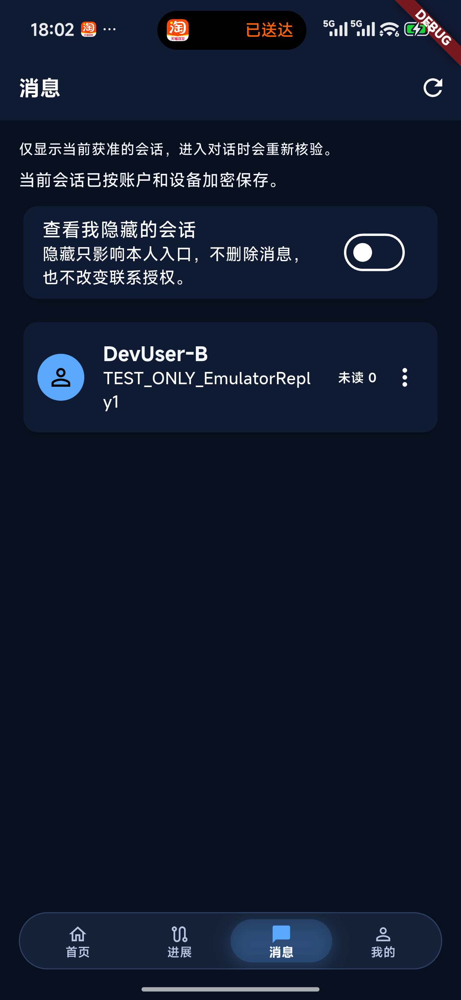

002-me-top 我的分支保留的慢约会旅程 · 5e023b06

消息底栏→我的

执行设备为 Owner fictional A phone，来源为 `5e023b0632bc32ed4811818963b023b841e13dba`。

[查看原图](screenshots/002-me-top.png)

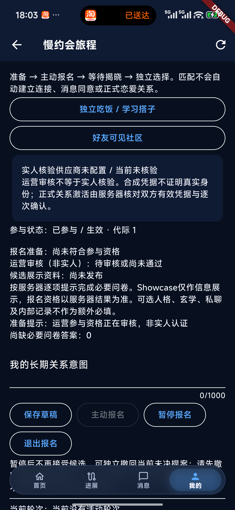

003-me-landing 我的 · 5e023b06

再次点击当前我的底栏返回分支初始页

执行设备为 Owner fictional A phone，来源为 `5e023b0632bc32ed4811818963b023b841e13dba`。

[查看原图](screenshots/003-me-landing.png)

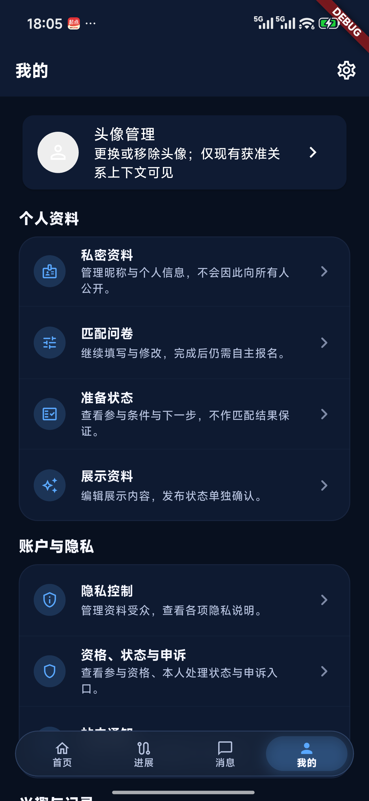

004-settings-top 设置上部 · 5e023b06

我的→设置

执行设备为 Owner fictional A phone，来源为 `5e023b0632bc32ed4811818963b023b841e13dba`。

[查看原图](screenshots/004-settings-top.png)

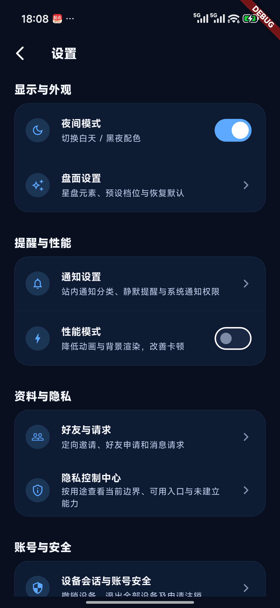

005-notification-settings 通知设置 · 5e023b06

设置→通知设置

执行设备为 Owner fictional A phone，来源为 `5e023b0632bc32ed4811818963b023b841e13dba`。

[查看原图](screenshots/005-notification-settings.png)

006-notifications-silent 通知设置静默开启 · 5e023b06

设置→通知设置→静默提醒

执行设备为 Owner fictional A phone，来源为 `5e023b0632bc32ed4811818963b023b841e13dba`。

[查看原图](screenshots/006-notifications-silent.png)

007-notification-category-off 消息提醒关闭后重新进入 · 5e023b06

通知设置→关闭消息类别→返回→重新进入

执行设备为 Owner fictional A phone，来源为 `5e023b0632bc32ed4811818963b023b841e13dba`。

[查看原图](screenshots/007-notification-category-off.png)

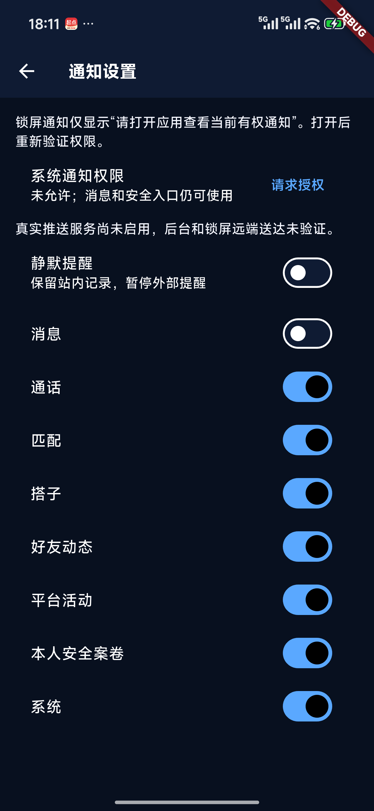

008-chart-settings 盘面设置 · 5e023b06

设置→盘面设置

执行设备为 Owner fictional A phone，来源为 `5e023b0632bc32ed4811818963b023b841e13dba`。

[查看原图](screenshots/008-chart-settings.png)

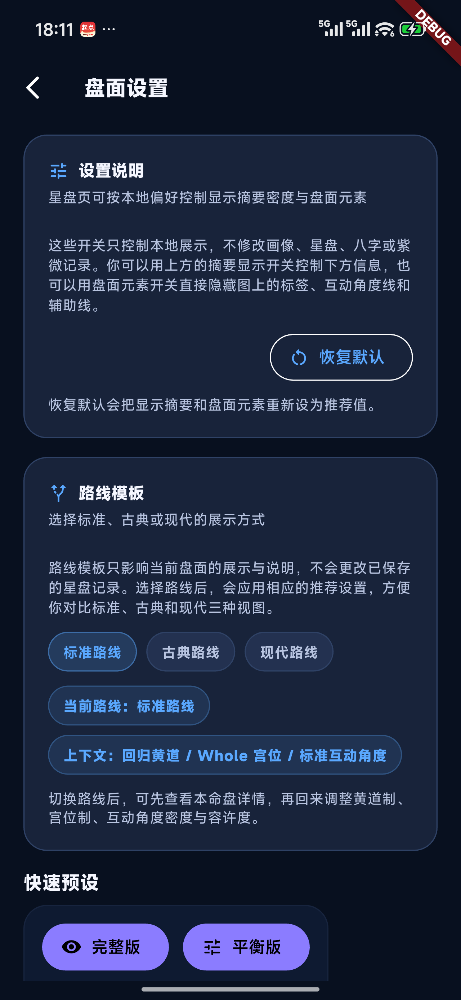

009-friends-requests 好友与请求 · 5e023b06

设置→好友与请求

执行设备为 Owner fictional A phone，来源为 `5e023b0632bc32ed4811818963b023b841e13dba`。

[查看原图](screenshots/009-friends-requests.png)

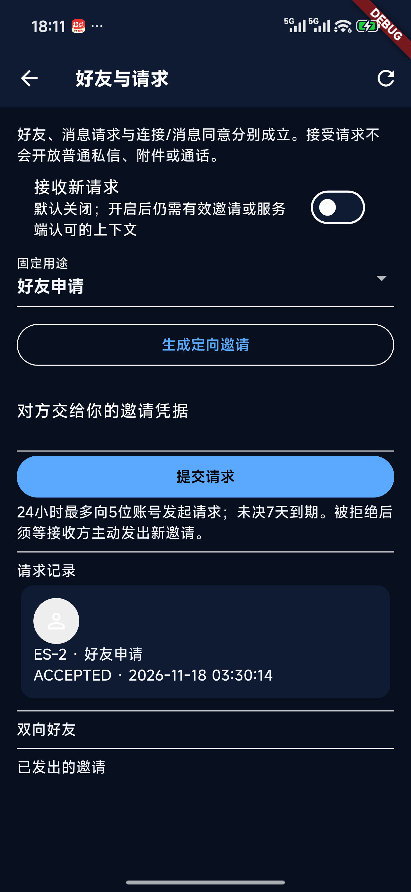

010-privacy-control-center 隐私控制中心 · 5e023b06

设置→隐私控制中心

执行设备为 Owner fictional A phone，来源为 `5e023b0632bc32ed4811818963b023b841e13dba`。

[查看原图](screenshots/010-privacy-control-center.png)

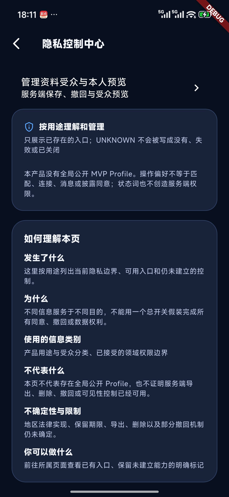

011-account-security 设备会话与账号安全 · 5e023b06

设置→设备会话与账号安全

执行设备为 Owner fictional A phone，来源为 `5e023b0632bc32ed4811818963b023b841e13dba`。

[查看原图](screenshots/011-account-security.png)

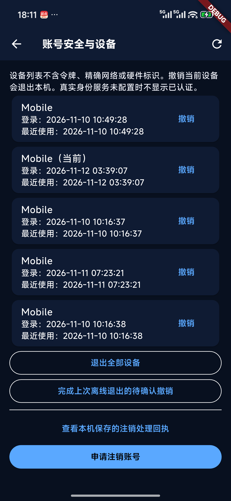

012-settings-lower 设置下部 · 5e023b06

设置向下滚动

执行设备为 Owner fictional A phone，来源为 `5e023b0632bc32ed4811818963b023b841e13dba`。

[查看原图](screenshots/012-settings-lower.png)

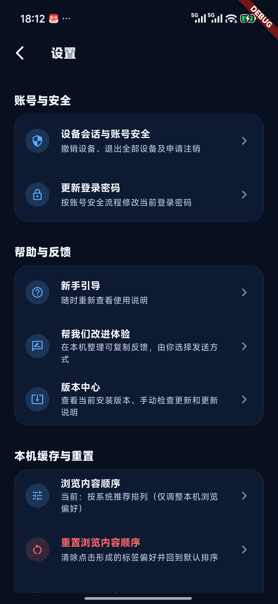

013-change-password 更新登录密码 · 5e023b06

设置→更新登录密码

执行设备为 Owner fictional A phone，来源为 `5e023b0632bc32ed4811818963b023b841e13dba`。

[查看原图](screenshots/013-change-password.png)

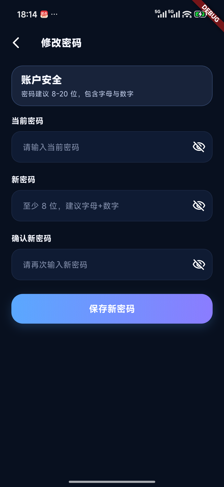

014-feedback 反馈 · 5e023b06

设置→帮我们改进体验

执行设备为 Owner fictional A phone，来源为 `5e023b0632bc32ed4811818963b023b841e13dba`。

[查看原图](screenshots/014-feedback.png)

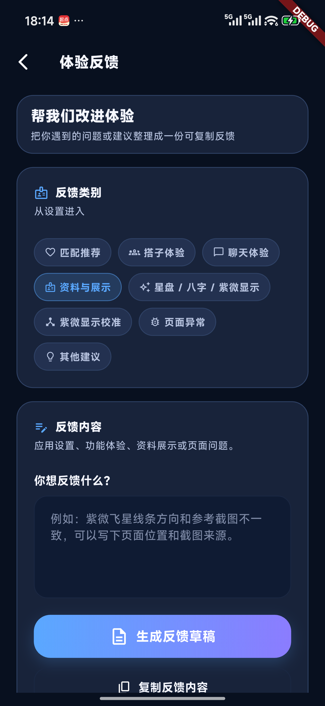

015-version-center 版本中心 · 5e023b06

设置→版本中心

执行设备为 Owner fictional A phone，来源为 `5e023b0632bc32ed4811818963b023b841e13dba`。

[查看原图](screenshots/015-version-center.png)

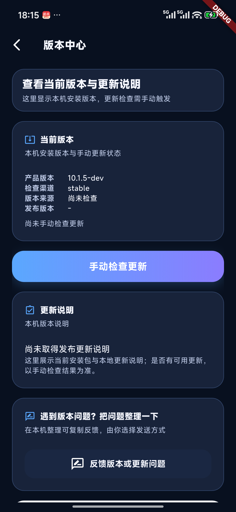

016-settings-bottom 设置底部 · 5e023b06

设置继续向下滚动

执行设备为 Owner fictional A phone，来源为 `5e023b0632bc32ed4811818963b023b841e13dba`。

[查看原图](screenshots/016-settings-bottom.png)

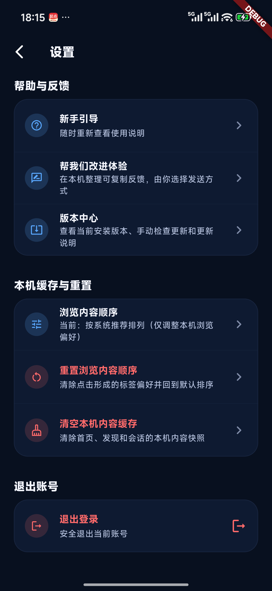

017-version-check-result 版本中心手动检查结果 · 5e023b06

设置→版本中心→手动检查更新

执行设备为 Owner fictional A phone，来源为 `5e023b0632bc32ed4811818963b023b841e13dba`。

[查看原图](screenshots/017-version-check-result.png)

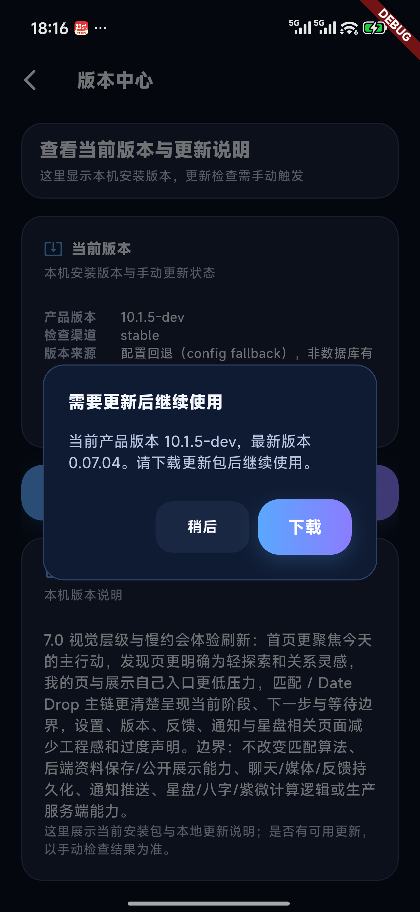

018-private-identity 私密资料 · 5e023b06

我的→私密资料

执行设备为 Owner fictional A phone，来源为 `5e023b0632bc32ed4811818963b023b841e13dba`。

[查看原图](screenshots/018-private-identity.png)

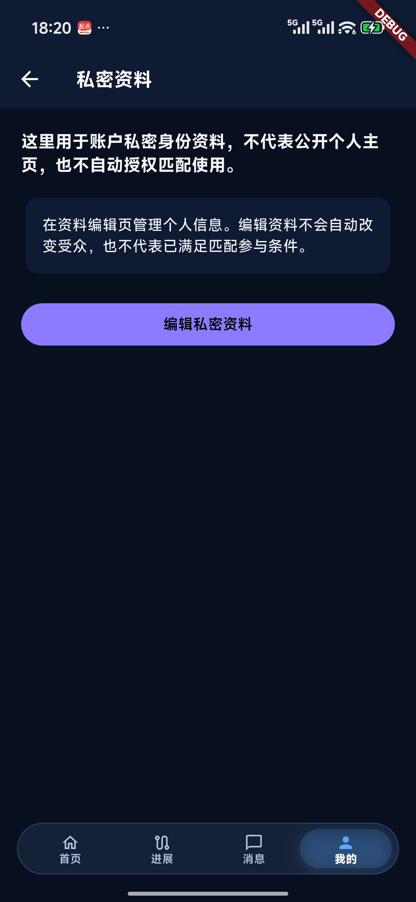

019-edit-profile-top 编辑资料上部 · 5e023b06

私密资料→编辑私密资料

执行设备为 Owner fictional A phone，来源为 `5e023b0632bc32ed4811818963b023b841e13dba`。

[查看原图](screenshots/019-edit-profile-top.png)

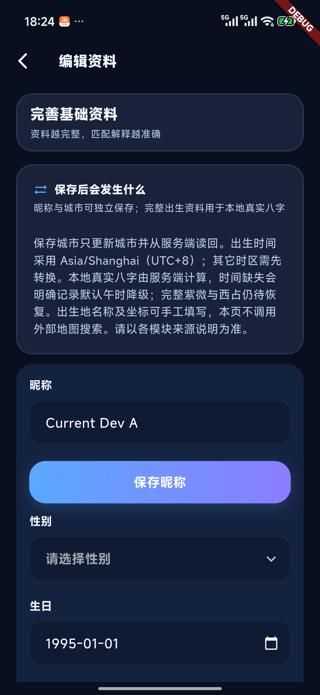

020-nickname-saved 昵称独立保存并读回 · 5e023b06

编辑资料→修改昵称→保存昵称

执行设备为 Owner fictional A phone，来源为 `5e023b0632bc32ed4811818963b023b841e13dba`。

[查看原图](screenshots/020-nickname-saved.png)

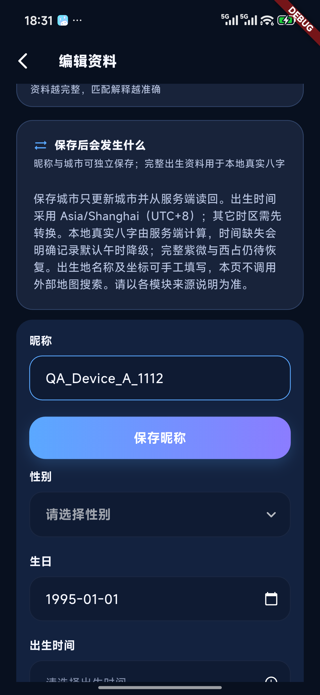

021-edit-profile-middle 编辑资料中部 · 5e023b06

编辑资料向下滚动

执行设备为 Owner fictional A phone，来源为 `5e023b0632bc32ed4811818963b023b841e13dba`。

[查看原图](screenshots/021-edit-profile-middle.png)

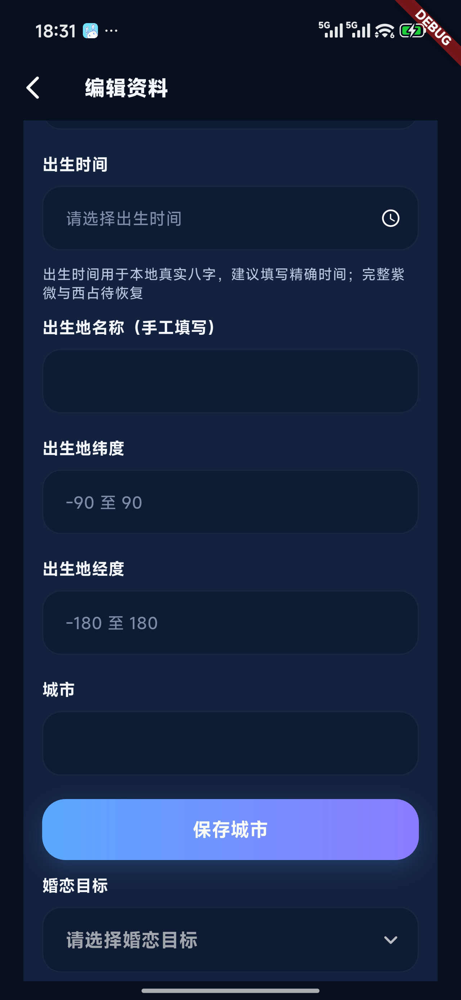

022-edit-profile-bottom 编辑资料底部 · 5e023b06

编辑资料继续向下滚动

执行设备为 Owner fictional A phone，来源为 `5e023b0632bc32ed4811818963b023b841e13dba`。

[查看原图](screenshots/022-edit-profile-bottom.png)

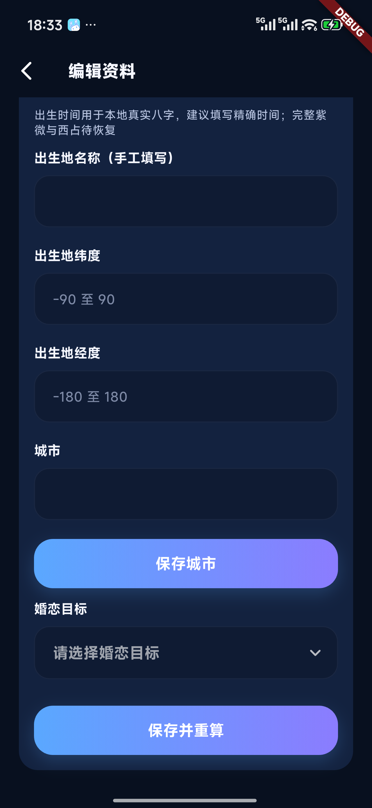

023-version-check-fixed 版本中心修复后的检查结果 · 5e023b06

设置→版本中心→手动检查更新

执行设备为 Owner fictional A phone，来源为 `5e023b0632bc32ed4811818963b023b841e13dba`。

[查看原图](screenshots/023-version-check-fixed.png)

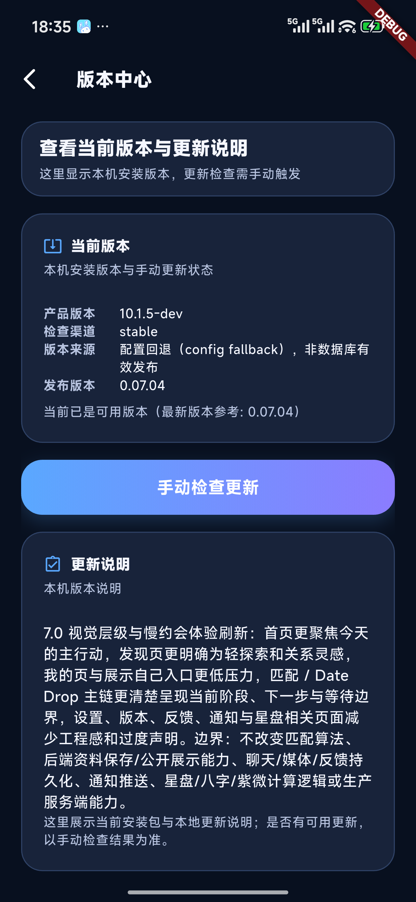

024-avatar-management 头像管理 · 5e023b06

我的→头像管理

执行设备为 Owner fictional A phone，来源为 `5e023b0632bc32ed4811818963b023b841e13dba`。

[查看原图](screenshots/024-avatar-management.png)

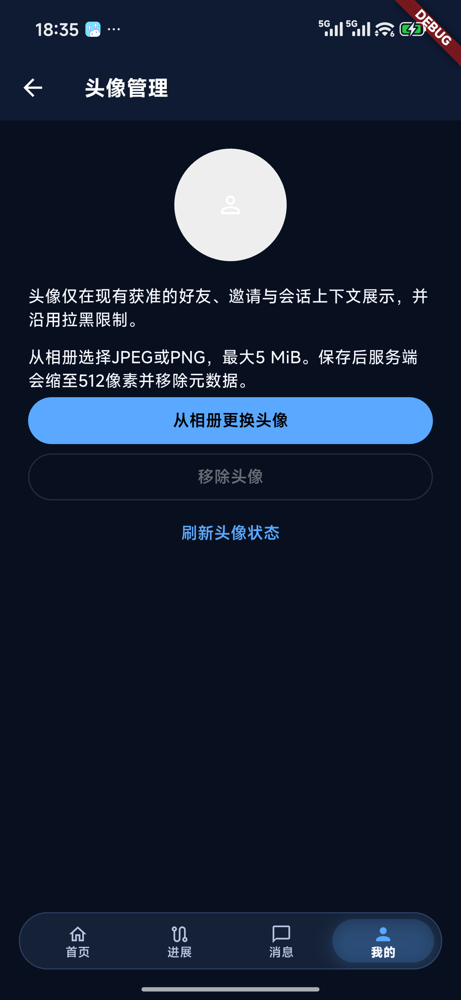

025-readiness 慢约会旅程（准备状态入口） · 5e023b06

我的→准备状态

执行设备为 Owner fictional A phone，来源为 `5e023b0632bc32ed4811818963b023b841e13dba`。

[查看原图](screenshots/025-readiness.png)

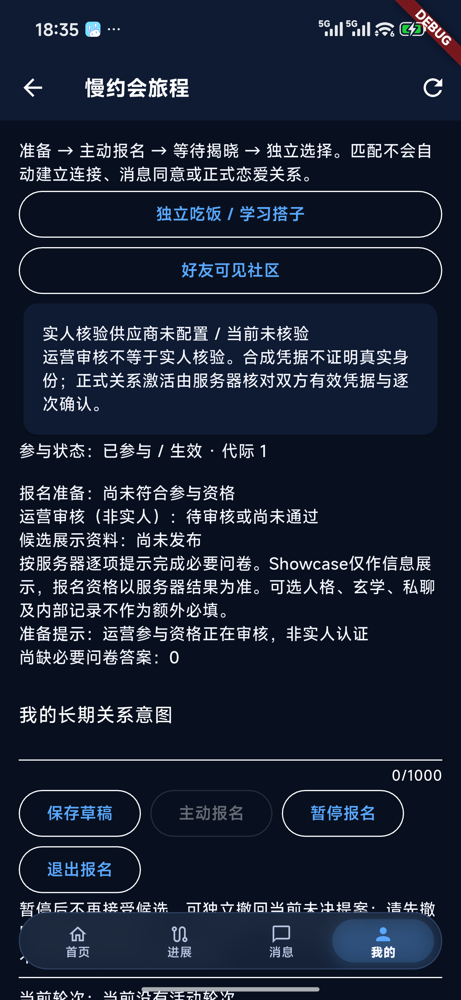

026-showcase 展示资料 · 5e023b06

我的→展示资料

执行设备为 Owner fictional A phone，来源为 `5e023b0632bc32ed4811818963b023b841e13dba`。

[查看原图](screenshots/026-showcase.png)

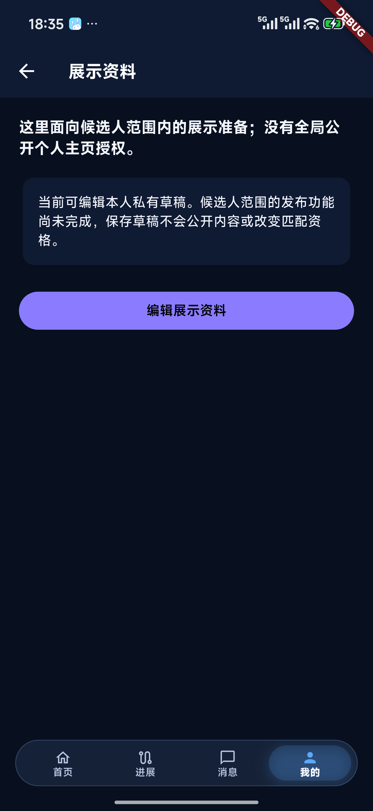

027-me-privacy 隐私控制 · 5e023b06

我的→隐私控制

执行设备为 Owner fictional A phone，来源为 `5e023b0632bc32ed4811818963b023b841e13dba`。

[查看原图](screenshots/027-me-privacy.png)

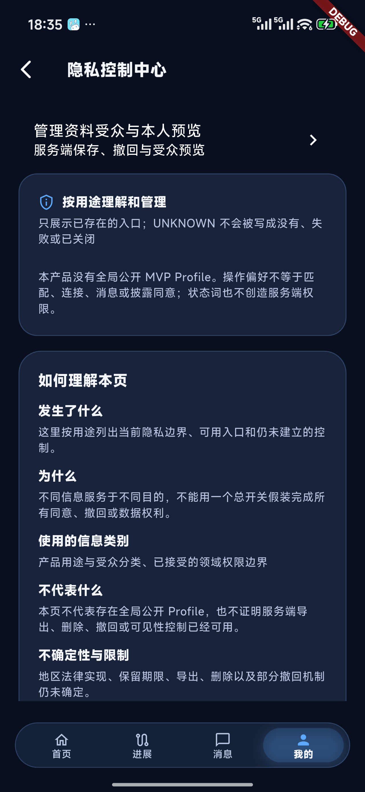

028-verification-status 资格、状态与申诉 · 5e023b06

我的→资格、状态与申诉

执行设备为 Owner fictional A phone，来源为 `5e023b0632bc32ed4811818963b023b841e13dba`。

[查看原图](screenshots/028-verification-status.png)

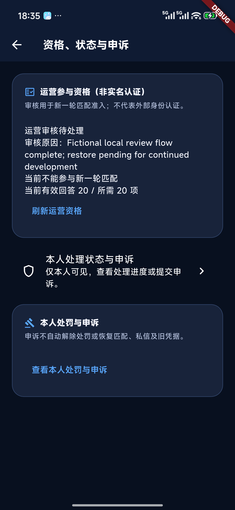

029-notification-center 消息列表（底栏实际命中） · 5e023b06

我的→站内通知

执行设备为 Owner fictional A phone，来源为 `5e023b0632bc32ed4811818963b023b841e13dba`。

[查看原图](screenshots/029-notification-center.png)

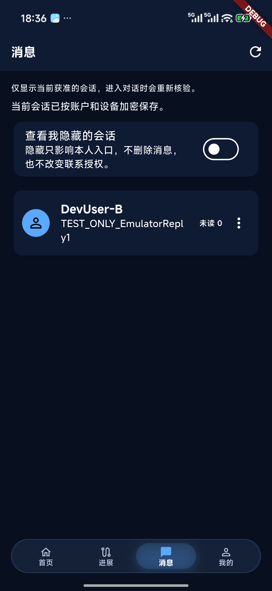

030-me-lower 我的下部 · 5e023b06

我的向下滚动

执行设备为 Owner fictional A phone，来源为 `5e023b0632bc32ed4811818963b023b841e13dba`。

[查看原图](screenshots/030-me-lower.png)

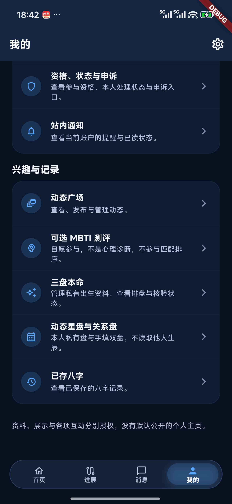

031-notification-center-actual 站内通知中心 · 5e023b06

我的→滚动至站内通知→打开

执行设备为 Owner fictional A phone，来源为 `5e023b0632bc32ed4811818963b023b841e13dba`。

[查看原图](screenshots/031-notification-center-actual.png)

032-notification-read 站内通知已读结果 · 5e023b06

通知中心→标记已读

执行设备为 Owner fictional A phone，来源为 `5e023b0632bc32ed4811818963b023b841e13dba`。

[查看原图](screenshots/032-notification-read.png)

033-notification-target 通知所属页面当前鉴权结果 · 5e023b06

通知中心→打开所属页面

执行设备为 Owner fictional A phone，来源为 `5e023b0632bc32ed4811818963b023b841e13dba`。

[查看原图](screenshots/033-notification-target.png)

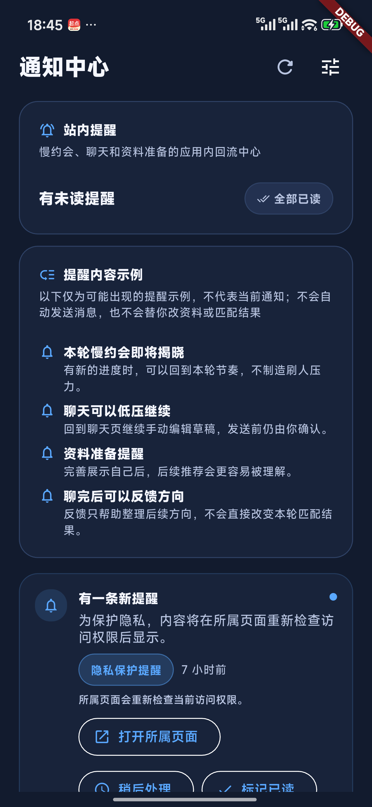

034-notification-list-actions 通知操作区 · 5e023b06

通知中心向下滚动至可见操作区

执行设备为 Owner fictional A phone，来源为 `5e023b0632bc32ed4811818963b023b841e13dba`。

[查看原图](screenshots/034-notification-list-actions.png)

035-notification-fixed-top 通知中心修复后初次读取 · 8216b56c

新包→我的→站内通知

执行设备为 Owner fictional A phone，来源为 `8216b56cfeafa633169fd5639c9cb55ec1866e84`。

[查看原图](screenshots/035-notification-fixed-top.png)

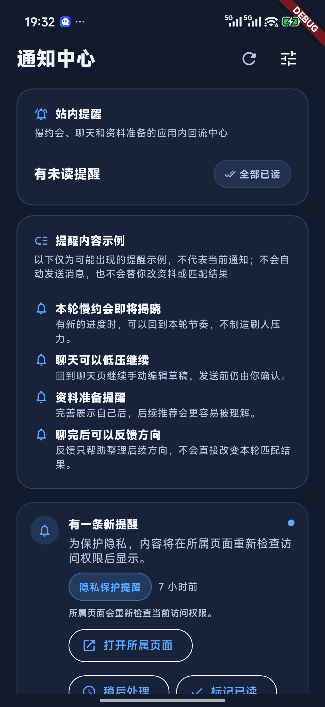

036-notification-fixed-scrolled 通知列表滚动保持稳定 · 8216b56c

通知中心向上滑动并跨来电扫描周期停留

执行设备为 Owner fictional A phone，来源为 `8216b56cfeafa633169fd5639c9cb55ec1866e84`。

[查看原图](screenshots/036-notification-fixed-scrolled.png)

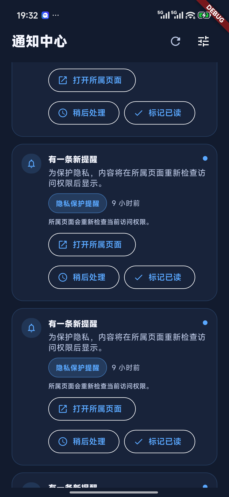

037-notification-fixed-read 通知单条标记已读成功 · 8216b56c

通知中心→可见标记已读→服务端未读数减少一条

执行设备为 Owner fictional A phone，来源为 `8216b56cfeafa633169fd5639c9cb55ec1866e84`。

[查看原图](screenshots/037-notification-fixed-read.png)

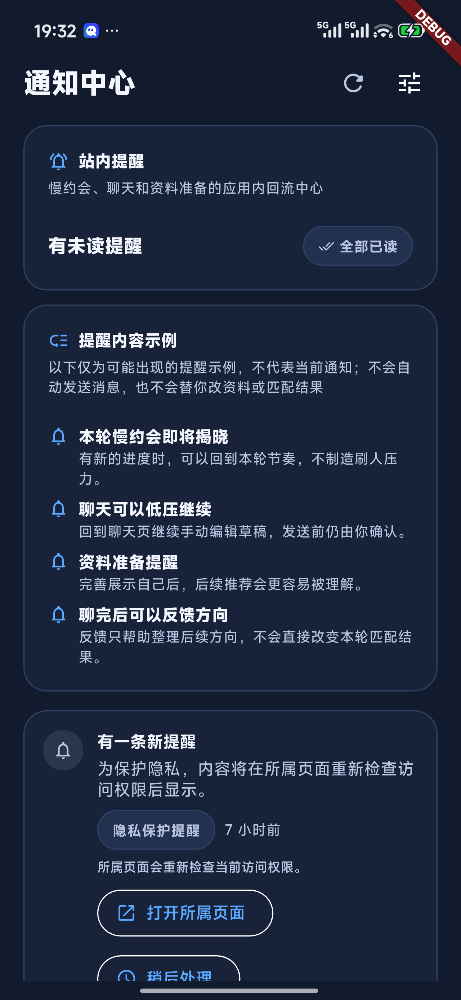

038-notification-failure-stopped 通知读取失败后稳定错误态 · e5aa6a29

一次手动刷新遇受控503

执行设备为 Owner fictional A phone，来源为 `e5aa6a29a76711b0e4bdb01613e269759d1ffe8e`。

[查看原图](screenshots/038-notification-failure-stopped.png)

039-notification-error-until-manual 网络恢复后等待手动重试 · e5aa6a29

恢复真实服务读取，通知页仍保留失败态

执行设备为 Owner fictional A phone，来源为 `e5aa6a29a76711b0e4bdb01613e269759d1ffe8e`。

[查看原图](screenshots/039-notification-error-until-manual.png)

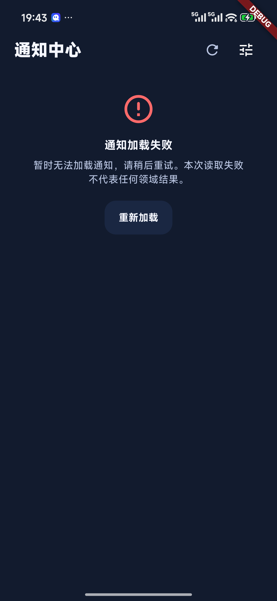

040-notification-manual-retry-success 通知手动重试恢复列表 · e5aa6a29

错误态→截图确认的重新加载按钮→真实通知列表

执行设备为 Owner fictional A phone，来源为 `e5aa6a29a76711b0e4bdb01613e269759d1ffe8e`。

[查看原图](screenshots/040-notification-manual-retry-success.png)

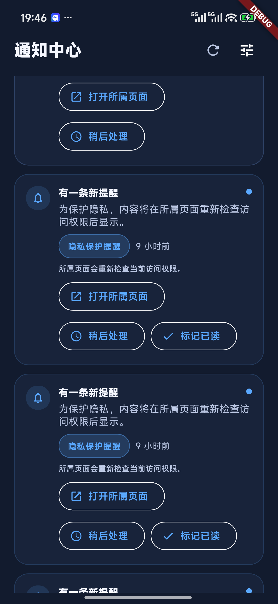

041-phone-chat-current 手机已有对话 · e5aa6a29

消息→已有账号B会话

执行设备为 Owner fictional A phone，来源为 `e5aa6a29a76711b0e4bdb01613e269759d1ffe8e`。

[查看原图](screenshots/041-phone-chat-current.png)

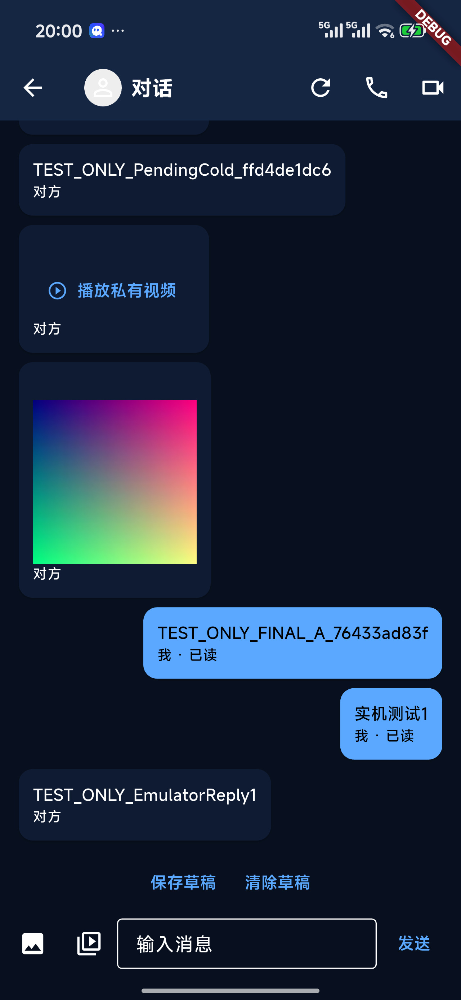

042-phone-received-text 手机收到模拟器文字 · e5aa6a29

模拟器正常发送→手机收到

执行设备为 Owner fictional A phone，来源为 `e5aa6a29a76711b0e4bdb01613e269759d1ffe8e`。

[查看原图](screenshots/042-phone-received-text.png)

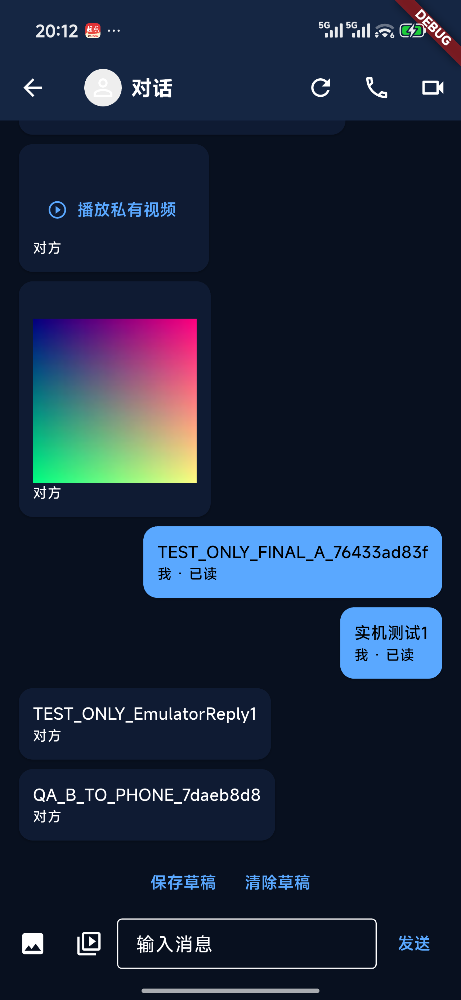

043-phone-sent-text 手机文字发送确认 · e5aa6a29

手机正常发送→模拟器收到并手机读回

执行设备为 Owner fictional A phone，来源为 `e5aa6a29a76711b0e4bdb01613e269759d1ffe8e`。

[查看原图](screenshots/043-phone-sent-text.png)

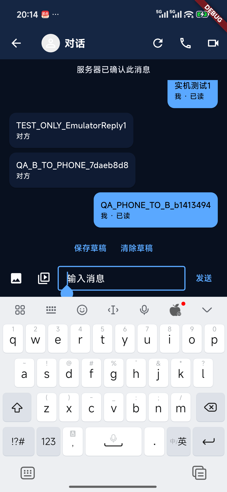

044-phone-image-preview 手机收到图片并预览 · bd4c07e7

模拟器发送自有合成图片→手机点击预览

执行设备为 Owner fictional A phone，来源为 `bd4c07e74327c75296745adcc63f2619bcb8a835`。

[查看原图](screenshots/044-phone-image-preview.png)

045-phone-video-completed 手机短视频播放到结束 · bd4c07e7

模拟器发送2秒合成视频→手机播放到0:02

执行设备为 Owner fictional A phone，来源为 `bd4c07e74327c75296745adcc63f2619bcb8a835`。

[查看原图](screenshots/045-phone-video-completed.png)

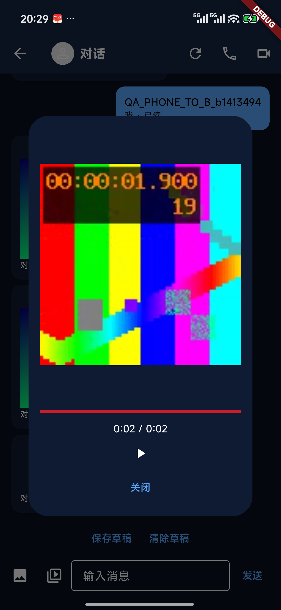

046-moments-community 好友可见社区 · bd4c07e7

我的→动态广场

执行设备为 Owner fictional A phone，来源为 `bd4c07e74327c75296745adcc63f2619bcb8a835`。

[查看原图](screenshots/046-moments-community.png)

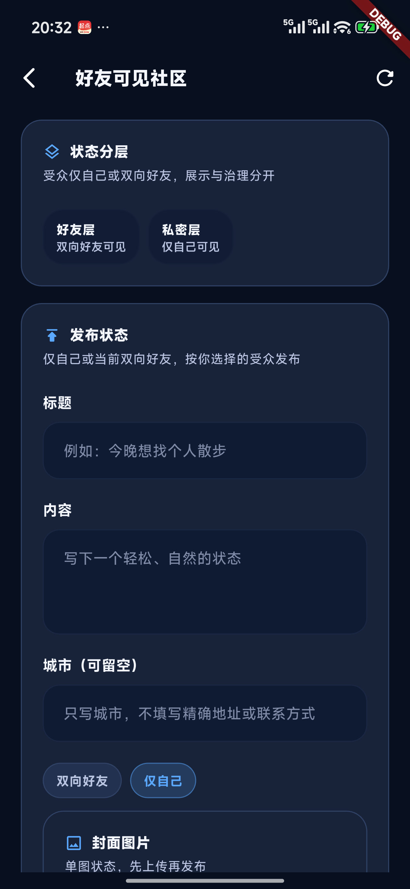

047-moments-community-lower 好友可见社区下部 · bd4c07e7

好友可见社区向下滚动

执行设备为 Owner fictional A phone，来源为 `bd4c07e74327c75296745adcc63f2619bcb8a835`。

[查看原图](screenshots/047-moments-community-lower.png)

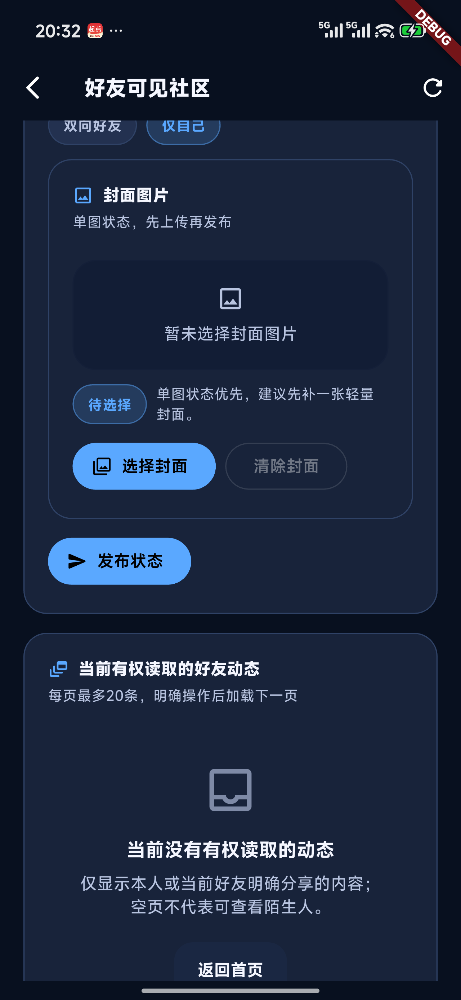

048-mbti-entry 可选MBTI测评 · bd4c07e7

我的→可选MBTI测评

执行设备为 Owner fictional A phone，来源为 `bd4c07e74327c75296745adcc63f2619bcb8a835`。

[查看原图](screenshots/048-mbti-entry.png)

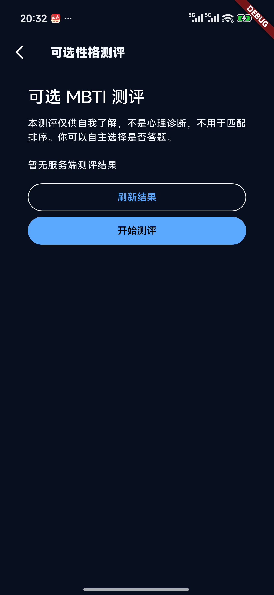

049-mbti-questions 可选MBTI答题页 · bd4c07e7

可选性格测评→开始测评

执行设备为 Owner fictional A phone，来源为 `bd4c07e74327c75296745adcc63f2619bcb8a835`。

[查看原图](screenshots/049-mbti-questions.png)

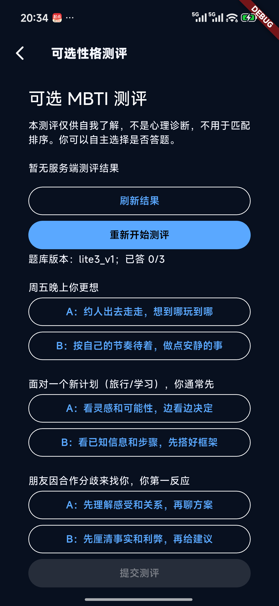

050-mbti-answered MBTI三题选择完成 · bd4c07e7

虚构测试账号依次选择三题A

执行设备为 Owner fictional A phone，来源为 `bd4c07e74327c75296745adcc63f2619bcb8a835`。

[查看原图](screenshots/050-mbti-answered.png)

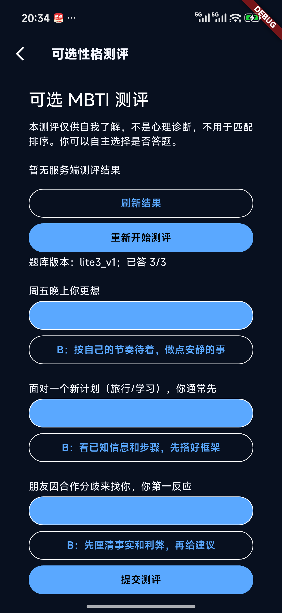

051-mbti-result MBTI服务端测评结果 · bd4c07e7

三题填写→提交测评

执行设备为 Owner fictional A phone，来源为 `bd4c07e74327c75296745adcc63f2619bcb8a835`。

[查看原图](screenshots/051-mbti-result.png)

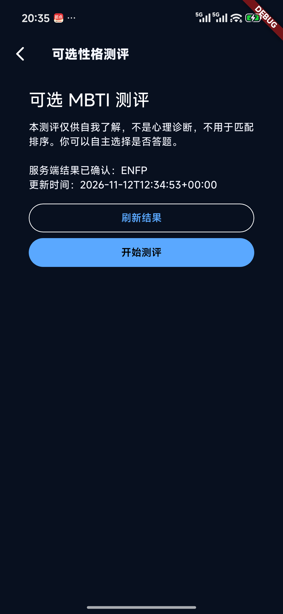

052-natal-entry 星盘画像与三盘本命入口 · bd4c07e7

我的→三盘本命

执行设备为 Owner fictional A phone，来源为 `bd4c07e74327c75296745adcc63f2619bcb8a835`。

[查看原图](screenshots/052-natal-entry.png)

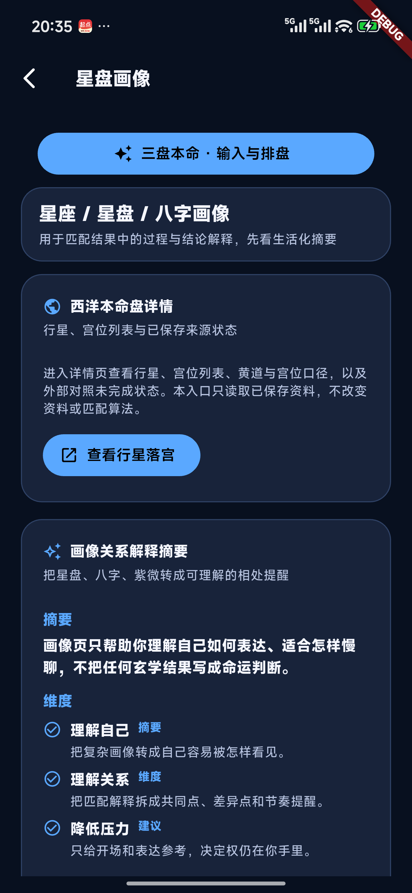

053-natal-inputs 星盘画像摘要与空态 · bd4c07e7

星盘画像向下滚动

执行设备为 Owner fictional A phone，来源为 `bd4c07e74327c75296745adcc63f2619bcb8a835`。

[查看原图](screenshots/053-natal-inputs.png)

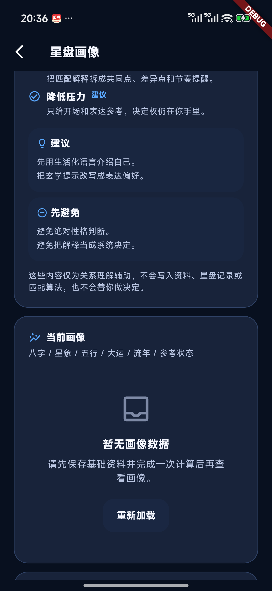

054-natal-settings 星盘画像底部数据来源说明 · bd4c07e7

星盘画像再次滚动，页面已到底

执行设备为 Owner fictional A phone，来源为 `bd4c07e74327c75296745adcc63f2619bcb8a835`。

[查看原图](screenshots/054-natal-settings.png)

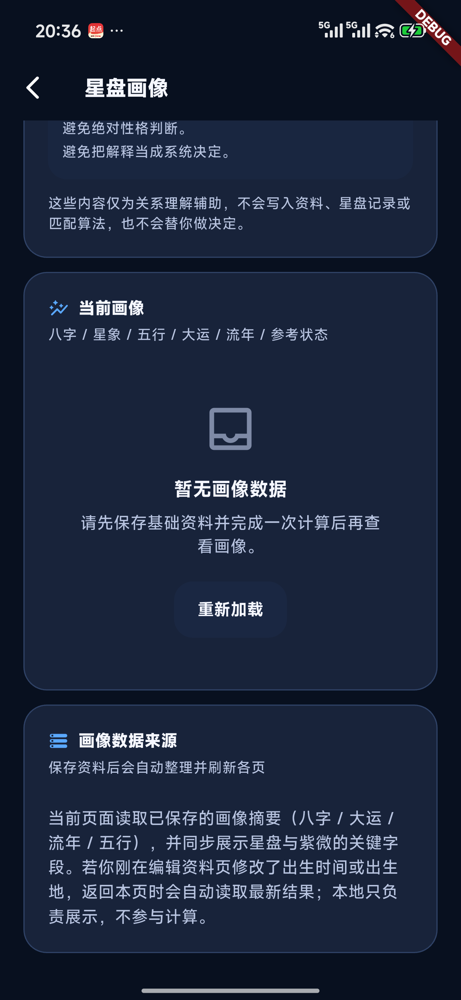

055-natal-form 本人三盘本命输入与排盘 · bd4c07e7

星盘画像→三盘本命输入与排盘

执行设备为 Owner fictional A phone，来源为 `bd4c07e74327c75296745adcc63f2619bcb8a835`。

[查看原图](screenshots/055-natal-form.png)

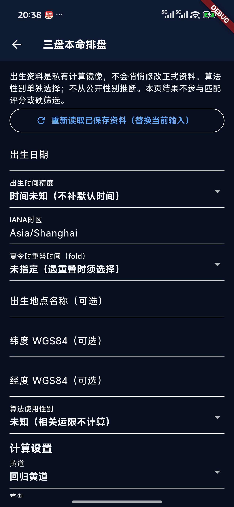

056-natal-form-lower 三盘本命设置与保存区域 · bd4c07e7

本人本命输入向下滚动

执行设备为 Owner fictional A phone，来源为 `bd4c07e74327c75296745adcc63f2619bcb8a835`。

[查看原图](screenshots/056-natal-form-lower.png)

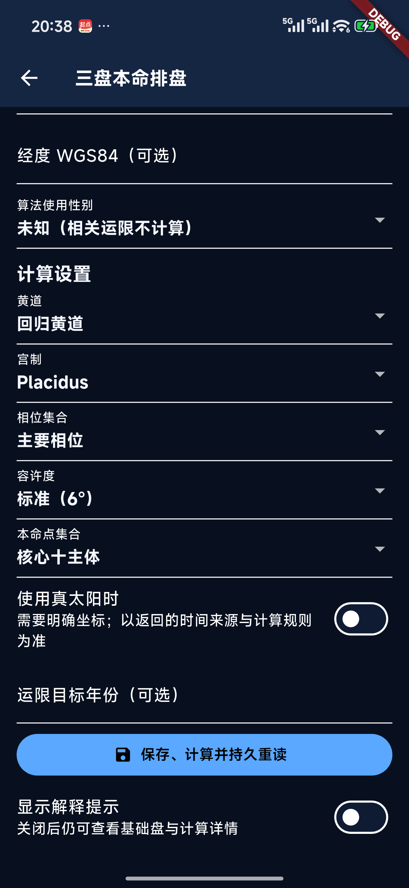

057-natal-fictional-input 三盘本命虚构输入 · bd4c07e7

手机正常UI填写虚构出生日期、时间、坐标与算法性别

执行设备为 Owner fictional A phone，来源为 `bd4c07e74327c75296745adcc63f2619bcb8a835`。

[查看原图](screenshots/057-natal-fictional-input.png)

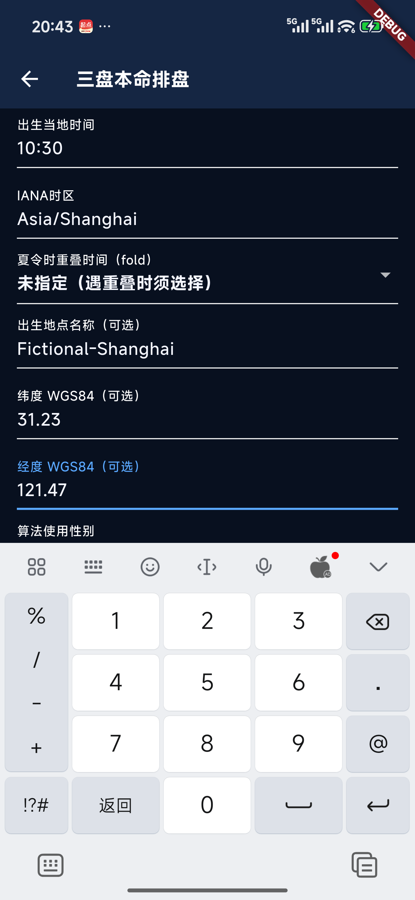

058-natal-verified-before-save 三盘本命已核输入与设置 · bd4c07e7

虚构日期1995-01-01、10:30、31.23/121.47，目标2026

执行设备为 Owner fictional A phone，来源为 `bd4c07e74327c75296745adcc63f2619bcb8a835`。

[查看原图](screenshots/058-natal-verified-before-save.png)

059-natal-persisted 手机三盘持久读回 · bd4c07e7

保存计算后服务端读回输入版本1与结果版本1

执行设备为 Owner fictional A phone，来源为 `bd4c07e74327c75296745adcc63f2619bcb8a835`。

[查看原图](screenshots/059-natal-persisted.png)

060-natal-western-results 三盘本命持久结果下部 · bd4c07e7

已存三盘结果向下查看

执行设备为 Owner fictional A phone，来源为 `bd4c07e74327c75296745adcc63f2619bcb8a835`。

[查看原图](screenshots/060-natal-western-results.png)

061-western-natal-detail 西洋本命盘详情 · bd4c07e7

星盘画像→查看行星落宫

执行设备为 Owner fictional A phone，来源为 `bd4c07e74327c75296745adcc63f2619bcb8a835`。

[查看原图](screenshots/061-western-natal-detail.png)

062-dynamic-chart-entry 动态星盘与关系盘 · bd4c07e7

我的→动态星盘与关系盘

执行设备为 Owner fictional A phone，来源为 `bd4c07e74327c75296745adcc63f2619bcb8a835`。

[查看原图](screenshots/062-dynamic-chart-entry.png)

063-admin-login 独立管理面板登录 · 6549f028

本机独立Web管理面板 /admin/login

执行设备为 isolated headless Chrome, fictional admin，来源为 `6549f02880968f99ae3f45439d15a37c1b3d5251`。

[查看原图](screenshots/063-admin-login.png)

064-admin-users 独立管理面板用户列表 · 6549f028

本机独立Web管理面板 /admin

执行设备为 isolated headless Chrome, fictional admin，来源为 `6549f02880968f99ae3f45439d15a37c1b3d5251`。

[查看原图](screenshots/064-admin-users.png)

065-admin-user-detail 管理面板虚构用户详情 · 6549f028

本机独立Web管理面板 /admin/users/1

执行设备为 isolated headless Chrome, fictional admin，来源为 `6549f02880968f99ae3f45439d15a37c1b3d5251`。

[查看原图](screenshots/065-admin-user-detail.png)

066-admin-reports 管理面板举报列表 · 6549f028

本机独立Web管理面板 /admin/reports

执行设备为 isolated headless Chrome, fictional admin，来源为 `6549f02880968f99ae3f45439d15a37c1b3d5251`。

[查看原图](screenshots/066-admin-reports.png)

067-admin-matching 管理面板匹配运营 · 6549f028

本机独立Web管理面板 /admin/matching

执行设备为 isolated headless Chrome, fictional admin，来源为 `6549f02880968f99ae3f45439d15a37c1b3d5251`。

[查看原图](screenshots/067-admin-matching.png)

068-admin-account-security 管理面板账号安全审计 · 6549f028

本机独立Web管理面板 /admin/account-security

执行设备为 isolated headless Chrome, fictional admin，来源为 `6549f02880968f99ae3f45439d15a37c1b3d5251`。

[查看原图](screenshots/068-admin-account-security.png)

069-admin-audits 管理面板操作审计 · 6549f028

本机独立Web管理面板 /admin/audits

执行设备为 isolated headless Chrome, fictional admin，来源为 `6549f02880968f99ae3f45439d15a37c1b3d5251`。

[查看原图](screenshots/069-admin-audits.png)

070-admin-buddy-community 管理面板搭子社区 · 6549f028

本机独立Web管理面板 /admin/buddy-community

执行设备为 isolated headless Chrome, fictional admin，来源为 `6549f02880968f99ae3f45439d15a37c1b3d5251`。

[查看原图](screenshots/070-admin-buddy-community.png)

071-admin-platform-events 管理面板平台活动 · 6549f028

本机独立Web管理面板 /admin/platform-events

执行设备为 isolated headless Chrome, fictional admin，来源为 `6549f02880968f99ae3f45439d15a37c1b3d5251`。

[查看原图](screenshots/071-admin-platform-events.png)

072-admin-questions 管理面板问卷管理 · 6549f028

本机独立Web管理面板 /admin/questions

执行设备为 isolated headless Chrome, fictional admin，来源为 `6549f02880968f99ae3f45439d15a37c1b3d5251`。

[查看原图](screenshots/072-admin-questions.png)

073-admin-releases 管理面板版本记录 · 6549f028

本机独立Web管理面板 /admin/releases

执行设备为 isolated headless Chrome, fictional admin，来源为 `6549f02880968f99ae3f45439d15a37c1b3d5251`。

[查看原图](screenshots/073-admin-releases.png)

074-dynamic-chart-sources 动态星盘来源选择 · bd4c07e7

第一盘明确选择本人私有本命快照

执行设备为 Owner fictional A phone，来源为 `bd4c07e74327c75296745adcc63f2619bcb8a835`。

[查看原图](screenshots/074-dynamic-chart-sources.png)

075-admin-user-detail-full 管理面板虚构用户详情完整长页 · 6549f028

本机独立Web管理面板 /admin/users/1

执行设备为 isolated headless Chrome, fictional admin，来源为 `6549f02880968f99ae3f45439d15a37c1b3d5251`。

[查看原图](screenshots/075-admin-user-detail-full.png)

076-admin-matching-full 管理面板匹配运营完整长页 · 6549f028

本机独立Web管理面板 /admin/matching

执行设备为 isolated headless Chrome, fictional admin，来源为 `6549f02880968f99ae3f45439d15a37c1b3d5251`。

[查看原图](screenshots/076-admin-matching-full.png)

077-admin-platform-events-full 管理面板平台活动完整长页 · 6549f028

本机独立Web管理面板 /admin/platform-events

执行设备为 isolated headless Chrome, fictional admin，来源为 `6549f02880968f99ae3f45439d15a37c1b3d5251`。

[查看原图](screenshots/077-admin-platform-events-full.png)

078-admin-releases-full 管理面板版本记录完整长页 · 6549f028

本机独立Web管理面板 /admin/releases

执行设备为 isolated headless Chrome, fictional admin，来源为 `6549f02880968f99ae3f45439d15a37c1b3d5251`。

[查看原图](screenshots/078-admin-releases-full.png)

079-dynamic-chart-ready 私有双盘来源与计算设置 · bd4c07e7

两盘均明确读取本人虚构本命快照版本1

执行设备为 Owner fictional A phone，来源为 `bd4c07e74327c75296745adcc63f2619bcb8a835`。

[查看原图](screenshots/079-dynamic-chart-ready.png)

080-dynamic-chart-persisted 手机私有双盘持久结果 · bd4c07e7

本人两个虚构快照→保存计算→持久重读

执行设备为 Owner fictional A phone，来源为 `bd4c07e74327c75296745adcc63f2619bcb8a835`。

[查看原图](screenshots/080-dynamic-chart-persisted.png)

081-saved-bazi 已存八字 · bd4c07e7

我的→已存八字

执行设备为 Owner fictional A phone，来源为 `bd4c07e74327c75296745adcc63f2619bcb8a835`。

[查看原图](screenshots/081-saved-bazi.png)

082-home-current 当前首页 · bd4c07e7

底栏→首页

执行设备为 Owner fictional A phone，来源为 `bd4c07e74327c75296745adcc63f2619bcb8a835`。

[查看原图](screenshots/082-home-current.png)

083-platform-events 平台活动合成演练 · bd4c07e7

首页→平台活动合成演练

执行设备为 Owner fictional A phone，来源为 `bd4c07e74327c75296745adcc63f2619bcb8a835`。

[查看原图](screenshots/083-platform-events.png)

084-buddy-entry 独立搭子 · bd4c07e7

首页→独立吃饭学习搭子

执行设备为 Owner fictional A phone，来源为 `bd4c07e74327c75296745adcc63f2619bcb8a835`。

[查看原图](screenshots/084-buddy-entry.png)

085-progress-entry 进展首页 · bd4c07e7

底栏→进展

执行设备为 Owner fictional A phone，来源为 `bd4c07e74327c75296745adcc63f2619bcb8a835`。

[查看原图](screenshots/085-progress-entry.png)

086-connection-current 连接与消息同意状态 · bd4c07e7

进展→连接

执行设备为 Owner fictional A phone，来源为 `bd4c07e74327c75296745adcc63f2619bcb8a835`。

[查看原图](screenshots/086-connection-current.png)

087-formal-relationship 正式恋爱关系管理 · bd4c07e7

进展→正式恋爱关系

执行设备为 Owner fictional A phone，来源为 `bd4c07e74327c75296745adcc63f2619bcb8a835`。

[查看原图](screenshots/087-formal-relationship.png)

088-matching-current 慢约匹配旅程 · bd4c07e7

进展→匹配

执行设备为 Owner fictional A phone，来源为 `bd4c07e74327c75296745adcc63f2619bcb8a835`。

[查看原图](screenshots/088-matching-current.png)

089-questionnaire-current 匹配问卷现有答卷 · bd4c07e7

我的→匹配问卷

执行设备为 Owner fictional A phone，来源为 `bd4c07e74327c75296745adcc63f2619bcb8a835`。

[查看原图](screenshots/089-questionnaire-current.png)

090-questionnaire-form 既有匹配问卷作答页 · bd4c07e7

匹配问卷→继续填写问卷

执行设备为 Owner fictional A phone，来源为 `bd4c07e74327c75296745adcc63f2619bcb8a835`。

[查看原图](screenshots/090-questionnaire-form.png)

091-questionnaire-last 匹配问卷最后一题 · bd4c07e7

手机正常UI逐题保存到第20题

执行设备为 Owner fictional A phone，来源为 `bd4c07e74327c75296745adcc63f2619bcb8a835`。

[查看原图](screenshots/091-questionnaire-last.png)

092-questionnaire-result-current 手机匹配问卷提交结果 · bd4c07e7

20题均正常UI选择并提交，显示20/20和版本

执行设备为 Owner fictional A phone，来源为 `bd4c07e74327c75296745adcc63f2619bcb8a835`。

[查看原图](screenshots/092-questionnaire-result-current.png)

093-questionnaire-history-current 手机问卷历史读回 · bd4c07e7

正常20题提交后打开历史记录

执行设备为 Owner fictional A phone，来源为 `bd4c07e74327c75296745adcc63f2619bcb8a835`。

[查看原图](screenshots/093-questionnaire-history-current.png)

094-logout-confirmation 退出登录确认 · bd4c07e7

模拟器B设置→退出登录

执行设备为 owned emulator5580 fictional B，来源为 `bd4c07e74327c75296745adcc63f2619bcb8a835`。

[查看原图](screenshots/094-logout-confirmation.png)

095-login-current 当前登录页面 · bd4c07e7

模拟器B正常退出→登录页

执行设备为 owned emulator5580 fictional B，来源为 `bd4c07e74327c75296745adcc63f2619bcb8a835`。

[查看原图](screenshots/095-login-current.png)

096-register-current 当前注册页面 · bd4c07e7

登录→去注册，仅查看表单

执行设备为 owned emulator5580 fictional B，来源为 `bd4c07e74327c75296745adcc63f2619bcb8a835`。

[查看原图](screenshots/096-register-current.png)

097-closure-receipt-empty 本机注销处理回执入口 · bd4c07e7

登录→查询本机注销处理回执，只读空态

执行设备为 owned emulator5580 fictional B，来源为 `bd4c07e74327c75296745adcc63f2619bcb8a835`。

[查看原图](screenshots/097-closure-receipt-empty.png)

098-onboarding-step1 新手引导第1步 · bd4c07e7

设置→新手引导重播

执行设备为 Owner fictional A phone，来源为 `bd4c07e74327c75296745adcc63f2619bcb8a835`。

[查看原图](screenshots/098-onboarding-step1.png)

099-onboarding-step2 新手引导第2步 · bd4c07e7

设置重播引导→继续

执行设备为 Owner fictional A phone，来源为 `bd4c07e74327c75296745adcc63f2619bcb8a835`。

[查看原图](screenshots/099-onboarding-step2.png)

100-onboarding-step3 新手引导第3步 · bd4c07e7

设置重播引导→继续

执行设备为 Owner fictional A phone，来源为 `bd4c07e74327c75296745adcc63f2619bcb8a835`。

[查看原图](screenshots/100-onboarding-step3.png)

101-onboarding-step4 新手引导第4步 · bd4c07e7

设置重播引导→继续

执行设备为 Owner fictional A phone，来源为 `bd4c07e74327c75296745adcc63f2619bcb8a835`。

[查看原图](screenshots/101-onboarding-step4.png)

102-onboarding-step5 新手引导第5步 · bd4c07e7

设置重播引导→继续

执行设备为 Owner fictional A phone，来源为 `bd4c07e74327c75296745adcc63f2619bcb8a835`。

[查看原图](screenshots/102-onboarding-step5.png)

103-settings-light-mode 设置日间配色 · bd4c07e7

手机正常UI关闭夜间模式

执行设备为 Owner fictional A phone，来源为 `bd4c07e74327c75296745adcc63f2619bcb8a835`。

[查看原图](screenshots/103-settings-light-mode.png)

104-settings-dark-restored 设置夜间配色恢复 · bd4c07e7

正常UI重新开启夜间模式

执行设备为 Owner fictional A phone，来源为 `bd4c07e74327c75296745adcc63f2619bcb8a835`。

[查看原图](screenshots/104-settings-dark-restored.png)

105-password-empty-validation 修改密码空输入校验 · bd4c07e7

设置→更新登录密码→空字段保存，仅本地校验

执行设备为 Owner fictional A phone，来源为 `bd4c07e74327c75296745adcc63f2619bcb8a835`。

[查看原图](screenshots/105-password-empty-validation.png)

106-historical-dynamic-transit 历史模拟器推运盘 · 5a762582

具名历史正常UI演练，详情见dynamic-transit-runtime-private.json

执行设备为 historical owned emulator B，来源为 `5a7625824064c545bcaa24f126cf14534556d4d6`。

[查看原图](screenshots/106-historical-dynamic-transit.png)

107-historical-dynamic-solar-2027 历史模拟器太阳回归盘 · 5a762582

具名历史正常UI演练，详情见dynamic-solar-2027-runtime-private.json

执行设备为 historical owned emulator B，来源为 `5a7625824064c545bcaa24f126cf14534556d4d6`。

[查看原图](screenshots/107-historical-dynamic-solar-2027.png)

108-historical-dynamic-lunar 历史模拟器月亮回归盘 · 5a762582

具名历史正常UI演练，详情见dynamic-lunar-runtime-private.json

执行设备为 historical owned emulator B，来源为 `5a7625824064c545bcaa24f126cf14534556d4d6`。

[查看原图](screenshots/108-historical-dynamic-lunar.png)

109-historical-dynamic-comparison 历史模拟器比较盘 · 5a762582

具名历史正常UI演练，详情见dynamic-comparison-runtime-private.json

执行设备为 historical owned emulator B，来源为 `5a7625824064c545bcaa24f126cf14534556d4d6`。

[查看原图](screenshots/109-historical-dynamic-comparison.png)

110-final-bidirectional-text 当前修复包双向文字 · 26c88ddb

手机A和模拟器B当前同包各发送一条

执行设备为 Owner fictional A phone，来源为 `26c88ddbd9d46bb38d43765336564c8ead93e4be`。

[查看原图](screenshots/110-final-bidirectional-text.png)

111-phone-image-preview 手机收到图片并预览 · 26c88ddb

模拟器发送自有合成图片→手机点击预览

执行设备为 Owner fictional A phone，来源为 `26c88ddbd9d46bb38d43765336564c8ead93e4be`。

[查看原图](screenshots/111-phone-image-preview.png)

112-phone-video-completed 手机短视频播放到结束 · 26c88ddb

模拟器发送2秒合成视频→手机播放到0:02

执行设备为 Owner fictional A phone，来源为 `26c88ddbd9d46bb38d43765336564c8ead93e4be`。

[查看原图](screenshots/112-phone-video-completed.png)

113-final-incoming-call 当前包实际来电页面 · 26c88ddb

模拟器B发起→手机A后台扫描发现来电

执行设备为 Owner fictional A phone，来源为 `26c88ddbd9d46bb38d43765336564c8ead93e4be`。

[查看原图](screenshots/113-final-incoming-call.png)

114-incoming-expired-manual-refresh 过期来电手动刷新后的终态 · 26c88ddb

call45自然过期，手动刷新后显示未接通并移除接听拒绝

执行设备为 Owner fictional A phone，来源为 `26c88ddbd9d46bb38d43765336564c8ead93e4be`。

[查看原图](screenshots/114-incoming-expired-manual-refresh.png)

115-call-result-current 当前未接通结果页 · 26c88ddb

过期来电手动刷新→查看结果

执行设备为 Owner fictional A phone，来源为 `26c88ddbd9d46bb38d43765336564c8ead93e4be`。

[查看原图](screenshots/115-call-result-current.png)

116-incoming-final-waiting 最终包真实来电等待状态 · 0badb31c

B发起新来电→手机A显示接听拒绝

执行设备为 Owner fictional A phone，来源为 `0badb31c38db63fe0fb1b5fcbfb43e5cb4e68d3f`。

[查看原图](screenshots/116-incoming-final-waiting.png)

117-incoming-final-auto-expired 最终包来电自然过期自动收口 · 0badb31c

30秒自然过期→未接通，接听拒绝撤去，显示查看结果

执行设备为 Owner fictional A phone，来源为 `0badb31c38db63fe0fb1b5fcbfb43e5cb4e68d3f`。

[查看原图](screenshots/117-incoming-final-auto-expired.png)

118-incoming-final-rejected 最终包来电主动拒绝结果 · 0badb31c

第二通新来电→手机A正常拒绝→已拒绝结果

执行设备为 Owner fictional A phone，来源为 `0badb31c38db63fe0fb1b5fcbfb43e5cb4e68d3f`。

[查看原图](screenshots/118-incoming-final-rejected.png)

119-final-post-wake-settings 最终包熄屏恢复后设置滚动 · 0badb31c

模拟器20秒熄屏→唤醒→打开已有对话→设置稳定后滚动

执行设备为 owned emulator5580 fictional B，来源为 `0badb31c38db63fe0fb1b5fcbfb43e5cb4e68d3f`。

[查看原图](screenshots/119-final-post-wake-settings.png)

120-historical-connected-call 历史同业务源码的通话控制界面 · 5e023b06

原5e call43界面观察，相关原监听失败保留，call44音质另按Owner反馈

执行设备为 historical fictional A phone，来源为 `5e023b0632bc32ed4811818963b023b841e13dba`。

[查看原图](screenshots/120-historical-connected-call.png)

