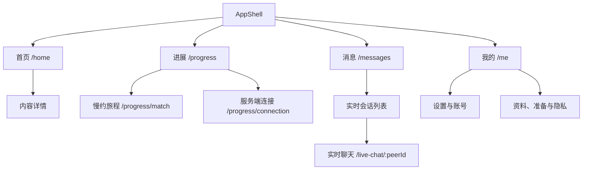

# v10.1.5 UI 导航与控件清单

本文供项目源 GPT 顾问总验收使用，按注册路由、主导航和已核实控件回调整理。源码存在不等于运行通过；本清单不替代逐页实机走查。当前已安装 APP 源码 `0badb31c38db63fe0fb1b5fcbfb43e5cb4e68d3f`，后端源码 `6549f02880968f99ae3f45439d15a37c1b3d5251`。当前安装包和manifest身份已对齐。本清单保留其它历史候选的证据归属。

状态标记：`SRC_ONLY` 表示从源码核实入口、条件或回调，不代表运行或实机通过。实机通过仅对明确写出的流程、设备和候选身份有效。

## 导航层级

### 启动与全局门控

启动默认进入 `/splash`。`SplashPage` 在引导状态恢复后，未登录转 `/auth/login`；已登录但准备状态未建立时转 `/me/readiness`；其余按环境初始路由进入，默认 `/home`。这是启动页自己的分流。另有全局路由重定向：未登录访问受保护路径转登录；已登录访问登录/注册转首页；准备状态不足时，仅匹配相关入口在非恢复本地构建中转 `/me/readiness`。恢复本地构建让匹配页展示服务端实际资格/拒绝结果。无效路径显示恢复页，可重试或回首页。

### 四个底栏分支

| 底栏位置 | 路径 | 页面/子层级 | 导航行为 |
|---|---|---|---|
| 首页 | `/home` | 首页 | 切换分支保留其它分支的导航栈；再次点当前项回该分支初始位置 |
| 进展 | `/progress` | `/progress/match`、`/progress/connection` | 匹配、连接分别作为进展分支子页；具体页由构建环境选择 |
| 消息 | `/messages` | 会话列表；会话页由授权会话路由进入 | 会话内容按身份和访问状态解析，失效身份进入无效会话恢复页 |
| 我的 | `/me` | `/me/private-identity`、`/me/matching-inputs`、`/me/readiness`、`/me/showcase`、`/me/privacy-settings` | 从“我的”进入个人身份、匹配输入、准备状态、展示和隐私页面 |

底栏由 `AppShell` 驱动 indexed-stack 分支。当前项再次点击传入 `initialLocation: true`。中心操作未配置（label 与 callback 均为空）；四项图标和标签由 `FloatingDockBottomBar` 提供。是否显示底栏取决于当前路由是否处于 shell 分支。

当前 dev 候选的主导航普通入口（恢复本地构建变体）：

图只展示当前 dev 候选实际使用的现有入口；注册条件、权限和页面按钮细节仍以本文件下表为准。正式构建的消息、匹配和连接页面见相应对照段落。

### 已注册的非底栏路由

| 路由 | 页面/用途 | 条件、重定向或返回关系 |
|---|---|---|
| `/splash`、`/auth/login`、`/auth/register` | 启动、登录、注册 | 受全局登录重定向控制 |
| `/verification/status`、`/verification/submit` | 资格状态、提交 | 登录后页面 |
| `/questionnaire`、`/questionnaire/result`、`/questionnaire/history` | 问卷、结果、历史 | 登录后页面；从页面自身操作进入相邻流程 |
| `/messages/chat/:chatIdentity` | 正式构建会话页 | 解析有效的临时路由状态或已存会话 ID；无法解析时进入无效会话页 |
| `/live-chat/:peerId` | 恢复本地构建会话页 | 仅 `restorationLocalBuild` 时注册，使用显式对端 ID 进入 `LiveChatPage` |
| `/rtc/call/:callId`、`/rtc/incoming/:callId`、`/rtc/result/:callId`、`/rtc/permission` | 通话、来电、结果、权限 | 常规会话通话页返回消息；来电/结果页按状态可查看结果或返回消息；权限页返回原通话页 |
| `/status/square`、`/status/author/:userId`、`/notifications`、`/social-baseline` | 动态广场、作者、通知、社交基线 | 登录后页面；由页面控件进入详情或返回来源 |
| `/content/:contentId` | 内容详情 | 使用内容 ID；返回来源页 |
| `/profile/edit`、`/profile/settings`、`/profile/settings/password`、`/profile/settings/privacy`、`/profile/settings/about` | 编辑资料、设置、密码、隐私、关于 | 登录后页面；页面返回其入口 |
| `/profile/mbti`、`/profile/showcase`、`/profile/astro`、`/profile/astro/overview`、`/profile/astro/bazi`、`/profile/astro/natal`、`/profile/astro/advanced`、`/profile/astro/ziwei`、`/profile/astro/chart-settings` | MBTI、展示与星盘页面 | 从个人资料/展示入口进入；返回来源页 |
| `/admin/dashboard`、`/admin/moderation`、`/admin/verification`、`/admin/users`、`/admin/matching-operations`、`/admin/moderation/reports/:reportId` | Flutter 管理仪表盘、审核、用户、匹配运营、举报详情 | 从列表进入详情；页面返回回到上一层；权限与数据以服务端为准 |
| `/inner-test/feedback` | 问卷/内部测试反馈 | 接收 `category`、`source` 查询参数；返回来源 |

兼容路由 `/discover`、`/match`、`/profile` 分别保留；`/match` 重定向到进展匹配，`/profile` 重定向到“我的”。`/match/countdown`、`/match/result`、`/match/detail`、`/match/intention`、`/match/feedback` 重定向到 `/progress/match`。`/buddy-v1013` 与 `/formal-relationship` 路由已注册，普通用户入口按页面状态控制。`/live-connection`、`/live-chat/:peerId` 仅恢复本地构建注册；若干 `/debug/...` fixture 按开发条件注册，不作为普通用户入口。通知合成回跳路由仅在对应开关启用时注册。

页面跳转不全由 GoRouter 管理：头像管理、账号状态、好友/账号安全、通知偏好、关系隐私、部分动态/MBTI/星盘页使用 `Navigator.push(MaterialPageRoute)` 或根 navigator。它们按入口和系统返回回到来源页，不对应上表中的路径。验收截图索引应同时记录 named route 与 MaterialPageRoute 入口。

## 已核实控件逻辑

以下是源码控件回调及状态门控，不代表本清单已逐个在设备上操作。明确的运行/Owner结果见[实施报告](IMPLEMENTATION_REPORT.md)。

### 会话列表和聊天

`restorationLocalBuild` 下 `/messages` 显示 `LiveConversationListPage`，会话行进入 `/live-chat/:peerId` 的 `LiveChatPage`。正式构建下 `/messages` 显示 `ConversationListPage`，会话详情经 `/messages/chat/:chatIdentity` 进入 `ChatRoomPage`。下表前半的刷新/隐藏与离线只读行为属于恢复本地构建实现；不得据此推断正式构建具有相同控件或回调。正式构建页面的实际控件仍需逐项对照其页面源码与最终候选截图。

| 控件 | 显示/启用条件 | 行为与结果 |
|---|---|---|
| 刷新会话 | 请求未忙 | 在线请求会话并核验登录及对端身份，成功后更新列表并保存加密离线副本；仅传输故障时可只读展示仍有效的已核验副本；权限拒绝、响应无效或缓存过期按实现撤销/锁定 |
| “查看我隐藏的会话”开关 | 非忙、非离线只读且可信上下文未锁定 | 切换可见/隐藏过滤并重新读取；隐藏列表不等同于撤销关系授权 |
| 会话行 | 可见列表且在线可写 | 打开 `/live-chat/:peerId`；离线只读时不开放新会话 |
| 行菜单/在线长按 | 有有效会话 ID 且在线 | “仅对我隐藏”或“找回会话入口”向服务端更新可见性；成功后失效旧授权 epoch 并重新读取 |
| 刷新对话 | 聊天页 | 重新读取最近消息，刷新头像及会话数据，并按当前在线授权更新加密副本；授权失效会撤销副本并锁页 |
| 语音/视频通话 | 非忙且非草稿处理；需当前登录、在线和有效会话 | 创建通话，按返回状态进入 `/rtc/call/:callId` 或 `/rtc/result/:callId`；失败在页面显示提示 |
| 发送文字/图片/短视频 | 无忙任务、离线只读、锁定、待确认消息或待处理媒体；消息文本上限 5000 字符 | 媒体先重验会话权限，再上传并发送；待确认 POST 以同一 client message ID 显式重试，未知结果不自动换 ID；成功后清理输入/草稿并刷新 |
| 保存/清除草稿 | 当前在线授权已核验，无忙或待确认发送 | 草稿加密保存在本机，不发送消息；清除仅删除本地草稿 |
| 重试上传/发送附件、移除附件 | 存在待处理媒体且满足在线与非忙状态 | 重试沿用当前媒体及会话授权；移除清除待处理附件 |
| 图片缩略图、私有视频、加载更早消息 | 图片已获授权并在内存；有视频附件；或在线且存在更早页 | 图片打开同页预览，返回只清预览态；视频打开播放器对话框；分页按 before ID 读取，授权错误撤销缓存并锁定 |

### 正式构建消息列表与聊天（SRC_ONLY）

当前 dev 候选启用 `restorationLocalBuild`，使用上表的 `LiveConversationListPage`/`LiveChatPage`；下表记录正式构建的另一套页面。构建身份不同，控件和行为不得互相代证。正式 `ConversationListPage` 包在外层 `ConversationAccessGate` 中；`ChatRouteState` 绑定合法 canonical route，非法 route 显示无效会话页。

| 页面/控件 | 条件与动作 | 证据状态 |
|---|---|---|
| 会话访问门 | 外层 `ConversationAccessGate` 根据登录和会话权限决定是否显示列表/会话；拒绝态由 gate 展示 | SRC_ONLY |
| 列表搜索 | 多于1个会话时显示；输入实时按昵称和末条消息过滤；回车保存最近词并收键盘；空查询聚焦时可点最近词回填；清除按钮/chip 清空 | SRC_ONLY |
| 列表刷新 | 顶部或下拉刷新重新核验并重读列表；错误态可重试 | SRC_ONLY |
| 未读/已读分类 | 仅同时存在已读、未读时显示分类；无未读时隐藏并纠正保存的分类；空筛选可清除过滤 | SRC_ONLY |
| 正式会话行 | 仅在线且未重新核验时进入 canonical `/messages/chat/:chatIdentity`；离线只读点击提示并阻止打开；加密缓存只显示获准的只读内容 | SRC_ONLY |
| 会话列表空态 | 真正无会话时“回到慢约会”前往 `/match` 兼容路由 | SRC_ONLY |
| 聊天页刷新/错误 | 顶部或下拉刷新重读；加载错误提供重试和返回会话列表；无消息空态可返回列表 | SRC_ONLY |
| 聊天页语音/视频 | 先弹节奏确认；可继续文字取消或确认发起。缺媒体权限时进入 `/rtc/permission?mode=...`，获准后最多进行一次权限失败恢复重试；成功进入 `/rtc/call/:id` 或 `/rtc/result/:id` | SRC_ONLY |
| 聊天页举报/拉黑 | 顶栏菜单进入举报或屏蔽流程，由 moderation provider 处理 | SRC_ONLY |
| 附件 | 非发送/上传中可打开底部选择菜单；原生媒体选择器进入待传、上传、就绪或失败状态。移除/重试按当前媒体状态启用；编辑草稿仅在同会话重新在线核验后恢复 | SRC_ONLY |
| 文本发送/失败重试 | 发送需在线读写授权且状态允许；失败重试沿用原 payload/key，直到修改文本或附件才构成新消息；前后台返回时按条件显示重新核验控件 | SRC_ONLY |
| 聊天建议卡 | Icebreaker 点击可填入输入框；语音节奏入口可重开说明，不自动发送消息 | SRC_ONLY |

代码中的 `_MessagesOverviewStatusCard` 标记为 legacy unused，不视为当前可达的会话列表控件。

### 首页、进展、慢约与关系入口

| 页面/控件 | 显示/启用条件 | 行为与返回关系 |
|---|---|---|
| 首页下一步按钮 | 由当前 projection 的 `nextDecision` 提供 | 标签与目标路由均取 projection；点击 `go` 至该目标；摘要只读 |
| 首页“隐私与数据设置” | 首页 | `go /me/privacy-settings` |
| 首页构建变体 | `ELITESYNC_V1014_LOCAL_BUILD` 显示 `PlatformHomePage`；V1012/V1013 本地编译标志显示 `SlowDatingHomePage`；否则显示普通状态摘要/下一步/支持 | 具体构建标志，不由路由自身推断；此摘要不写入状态 |
| 进展“匹配”“连接” | 进展页 | 分别 `go /progress/match`、`go /progress/connection`；恢复构建可落到慢约旅程/LiveConnection，普通构建使用匹配/连接页 |
| 进展“查看准备状态”“正式恋爱关系” | 进展页 | `push /me/readiness` 或恢复关系路径 `/formal-relationship`；从子页系统返回回进展页 |
| 进展“独立吃饭/学习搭子”“好友可见社区” | V1013/V1014编译标志开启对应活动区域 | 分别 push 搭子页和动态广场；不由按钮创建资格 |
| 慢约旅程顶部搭子/社区 | 恢复路径打开旅程页 | push 搭子页、动态广场 |
| 慢约旅程意图编辑/参与状态 | 意图≤1000字符；参与操作由服务端状态、准备资格和 revision 决定 | 保存草稿/报名/重新报名/暂停/退出分别 PUT journey participation；退出先确认；成功失效旧授权并刷新，失败清投影并显示错误 |
| 慢约候选提案操作 | 有有效非终态 proposal、revision/id，并由服务端标志允许 | 接受、拒绝、撤回以 proposal ID 和幂等键 POST；双方接受且连接资格/对端有效时可进入关系权限页；底部正式关系入口 push 管理页 |
| LiveConnection 刷新/连接请求 | 恢复本地构建专用页 | 刷新读取当前匹配及连接/同意状态；缺少对端先从当前匹配解析。`CN_NONE`/`MC_NONE`显示“请求连接”/“请求消息同意”；pending 时请求人可撤回、另一方可接受/拒绝；`CN_ACTIVE`/`CN_PAUSED`可关闭连接；`MC_ACTIVE`可撤销消息同意，且消息同意操作仅在连接 active 时显示。均带 revision 提交并读回；失败标记“操作未确认” |
| LiveConnection“进入消息” | 服务端 `live_read_allowed` 与 `live_send_allowed` 均为真、对端有效且非忙 | push `/live-chat/:peerId`；无门控时按钮禁用 |
| 搭子页刷新/接收请求开关 | 恢复路径 `/buddy-v1013`；状态和 revision 有效 | 刷新 GET；开关更新偏好；身份/授权变化清空页面状态与敏感凭据 |
| 搭子邀请、一次性凭据及活动动作 | 服务端 `allowed_actions`、活动 ID/revision 有效 | 邀请、创建/撤销凭据及 `open/request/confirm/decline/decline_invite/withdraw/cancel/complete` 状态动作先确认，再 POST/DELETE 并刷新；创建草稿表单检查字段后仅保存本人草稿；兑换凭据仅申请参与，不自动加入 |
| 正式关系申请/关系动作 | 登录本人、对端 ID 合法且非忙；关系动作由服务端 allowed_actions 决定 | 申请前确认双方自愿并 POST；关系确认/拒绝/撤回/暂停/结束/恢复等逐项先确认并带 revision/幂等键提交；管理字段分享入口 push 对端隐私页；普通返回回来源 |

搭子页活动动作由服务器 `allowed_actions` 控制，包含 `open`、`request`、`confirm`、`decline`、`decline_invite`、`withdraw`、`cancel`、`complete`；动作均先确认并携带 revision/idempotency key。邀请好友需输入正整数 ID 并确认；生成/撤销一次性凭据需确认，撤销后旧凭据不可恢复。草稿创建需主题≤100字符、粗略城市≤40字符，日期有效且结束晚于开始；兑换凭据最多256字符，确认后只提出参与申请。正式关系记录中的具体动作同样以服务端 `allowed_actions` 与 revision 为准，结束确认说明不可恢复。

### 发现、匹配与连接（SRC_ONLY）

当前 dev 候选启用恢复本地构建变体：进展匹配使用 `SlowDatingJourneyPage`，连接使用 `LiveConnectionPage`；正式构建使用常规匹配入口 `MatchPortalPage` 和非权威示范态 `ConnectionPage`。本节各行都是源码盘点。

| 页面/控件 | 条件与动作 | 证据状态 |
|---|---|---|
| Discover 刷新/内容卡 | 下拉刷新；错误态重试；内容卡“查看/打开”进入 `/content/:id` | SRC_ONLY；`/discover` 是兼容直达路由，不是底栏入口 |
| Discover 说明/详情/稍后 | 说明打开 bottom sheet；查看详情先关闭 sheet 再进入内容；“稍后再看”只关闭 sheet 并提示，没有书签持久化动作 | SRC_ONLY |
| 常规 MatchPortal 刷新/状态 | 顶部或下拉刷新，错误重试；无轮次/无候选时主要动作回 `/home`，其它状态重新读取 projection；revealed 状态显示候选卡，其余以解释卡为主 | SRC_ONLY；此页没有提交兴趣/发消息动作 |
| LiveMatch 内部页面 | 非一般 v10.1.5 主路由入口；有对端时“连接与消息同意”进入 LiveConnection | SRC_ONLY；不列为常规匹配页 |
| 常规 ConnectionPage | 默认 provider 为非权威示范态，转移按钮是禁用 chips；仅本机 synthetic authority state 才显示请求、模拟接受/拒绝、撤回、过期、暂停、恢复、关闭和重置本地演示控件 | SRC_ONLY；演示操作不代表服务器连接 |
| 恢复 LiveConnection 刷新/连接操作 | 仅 `restorationLocalBuild` 注册；刷新读取服务端连接/消息同意，按钮按状态、请求方与权限动态生成：连接请求/接受/拒绝/撤回/关闭；消息同意请求/接受/拒绝/撤回/撤销 | SRC_ONLY；忙时禁用，提交带 revision 并读回 |
| 恢复 LiveConnection“进入消息” | connection 与 messaging 两个服务端 gate 均允许时可用 | SRC_ONLY；进入 `/live-chat/:peerId` |

### 问卷、头像与展示资料控件

| 页面/控件 | 条件与动作 | 证据状态 |
|---|---|---|
| 问卷题目选项 | 未忙、题库不需重载时可选；非最后题先保存当前账户草稿，成功后才进入下一题；失败留在当前题并提示 | SRC_ONLY |
| 问卷最终提交 | 最后一题选项提交；成功刷新资料/准备状态并进入 `/questionnaire/result`；失败留在本页 | SRC_ONLY |
| 问卷题库重载/错误重试 | 题库/草稿不兼容或错误时出现；提交/保存中禁用 | SRC_ONLY |
| 问卷调试填充/提交 | 仅 debug 模式，题目已加载且无提交/重载 | 源码调试入口，不是用户验收流程 |
| 问卷结果“查看匹配资格” | 重新读取资料后进入 `/profile` 兼容入口（重定向 `/me`），不直接匹配 | SRC_ONLY |
| 问卷结果/历史“查看历史”“重新作答” | 查看历史 push `/questionnaire/history`；重新作答先清答卷草稿状态再回问卷页 | SRC_ONLY |
| 头像更换 | 快照已读且非忙；原生相册只接受 JPEG/PNG 且≤5 MiB；上传后 GET 读回 revision/path 才提示确认 | SRC_ONLY |
| 头像移除/刷新 | 有头像且非忙时可移除；移除先确认，DELETE 后读取默认头像状态；刷新重读头像数据 | SRC_ONLY |
| 展示资料私有草稿 | 介绍≤500、兴趣标签/生活线索各≤10项且每项≤24、开场话题≤280；保存/重试为 PUT 草稿，错误按字段/服务状态呈现 | SRC_ONLY |
| 展示资料安全审核 | 草稿已保存、无脏编辑且状态允许时提交审核；审核状态按钮重读；清除私有草稿需确认，只删除草稿、不删除已发布版 | SRC_ONLY |
| 展示资料发布 | 仅审核通过、具备公开资格且未发布的有效草稿显示发布按钮；确认后 POST 明确公开确认值；失败不标记已发布 | SRC_ONLY |
| 展示页调试夹具 | `/debug/profile/showcase/...` 仅开发环境注册，无后端写入 | 源码调试入口，不是正式发布或实机证据 |

### MBTI 与星盘页面控件

| 页面/控件 | 条件与动作 | 证据状态 |
|---|---|---|
| 星盘主页刷新/登录 | 按 `astroSummaryProvider` 状态显示重读或去登录；下拉刷新重新读取摘要 | SRC_ONLY |
| 星盘主页输入与排盘/行星落宫/紫微/反馈 | 输入与排盘打开本地 `NatalRestorationPage` 并在返回时刷新；行星落宫和有紫微数据时的主星详情分别进入 `/profile/astro/natal`、`/profile/astro/ziwei`；反馈进带来源的反馈页 | SRC_ONLY |
| 星盘总览三个主入口 | 有效资料时“查看本命盘/八字/紫微详情”分别进入对应详情页；卡片内视觉层级项的 `onTap` 为空，不是入口 | SRC_ONLY |
| 八字页 | 下拉刷新；出生资料、五行、运势时间线等内容和展开区域只读，无写按钮 | SRC_ONLY |
| 本命盘页刷新/设置/出生资料 | 刷新读取本人排盘；设置图标按响应数据进入输入与排盘设置或盘面显示设置；“编辑出生资料”进入资料编辑。参数/星体/宫位/相位区域展开只控制本页显示 | SRC_ONLY |
| 紫微页分视图/反馈 | “三合/飞星/四化”仅本地切换视图；详情展开只读；反馈进入带类别与来源的反馈页 | SRC_ONLY |
| 动态星盘重新读取/历史选择 | 重新读取 GET 本人记录；历史项读取指定记录；有 `next_before_id` 时“加载更早历史”分页。选历史/改输入设置后隐藏旧结果并标记未保存/冲突状态 | SRC_ONLY |
| 动态星盘新建、输入和盘型 | “另建私有盘”保留表单并清当前记录身份；盘型包含合盘/比较/推运/太阳回归/月亮回归；按类型显示两盘或事件输入。来源可手填或明确读取本人已确认本命快照 | SRC_ONLY |
| 动态星盘计算设置/保存 | 选择热带/恒星黄道、宫制、相位集合、容许度与点集；保存计算在忙/冲突时禁用。POST 新建/更新后 GET 读回并比对 ID、输入和结果 revision；失败或冲突不显示旧盘 | SRC_ONLY；盘面算法/科学有效性不在此 UI 清单验收范围 |
| 动态星盘回归事件/结果展开 | 回归事件选择将所选 index 保存并读回；跨盘相位、宫位叠加是只读展开内容 | SRC_ONLY |
| MBTI 开始/重做/刷新 | 读取结果；开始或重做读取并校验题目、清旧答案；刷新重读结果 | SRC_ONLY |
| MBTI 题目与提交 | A/B 仅更新本地答案；全部作答且非忙时可提交，之后再次读回并验证结果存在。切换登录身份清空旧题目/结果 | SRC_ONLY；页面定位为可选自评，不作心理诊断或匹配排序 |

### 盘面设置、关系安全和本人状态入口

| 页面/控件 | 条件与动作 | 证据状态 |
|---|---|---|
| 盘面设置摘要重读 | 加载或错误时显示进度/重新读取；重读使本人星盘摘要重新加载 | SRC_ONLY |
| 原生本命设置 | 摘要含 `natal` 时显示；可进入 `NatalRestorationPage` 重新计算，回到页面刷新摘要及本命盘；“恢复展示默认”和本机显示开关不改变计算记录 | SRC_ONLY |
| 普通星盘展示设置 | 摘要不含 `natal` 时显示；路线标准/古典/现代、完整版/平衡/极简预设、黄道/宫制/角度/容许度/点位，以及摘要与图形元素和密度偏好 | SRC_ONLY；设置仅影响当前展示偏好 |
| 高级时法入口 | 盘面设置页按钮 push `/profile/astro/advanced`，正常返回设置页 | SRC_ONLY；页面交互已列于上表 |
| 账号安全页 | 设备会话撤销、退出全部设备、离线撤销补偿；账号注销需要确认和安全凭据，随后显示本地注销回执 | SRC_ONLY；没有真实账号注销验收 |
| 关系中心/对端关系页 | 请求开关、好友/消息用途授权、邀请/凭据、请求接受/拒绝/撤回、好友或邀请撤销等操作依服务端权限与状态显示；部分操作打开对端关系页 | SRC_ONLY；由关系页面提供，不能泛化为全局授权 |
| 关系隐私页 | 可由当前关系页/连接页的字段分享入口进入；根据当前关系及服务端许可提供可见字段的管理/读取 | SRC_ONLY |
| ServerPrivacyPage | 当前未找到现行调用点 | 不可达旧入口；不是 RelationshipPrivacyPage 的替代名称 |
| 本人资格/运营状态/申诉 | 仅恢复构建或指定本地构建标志显示；安全案件页仅 v1014/v1015_r1 标志显示 | SRC_ONLY；页面显示不代表真实案件或申诉已处理 |

星盘/MBTI 路由存在及页面回调只说明源码行为，不代表计算结果、心理测量或实机验收通过。

### RTC 通话、来电、权限与结果

| 页面/控件 | 状态条件 | 行为与返回关系 |
|---|---|---|
| 通话页刷新 | 通话页 | 重新读取当前 call；失败页可重试或返回 `/messages` |
| “重试声音”/“重试媒体” | Room 已连接且媒体接收失败；操作期间禁用 | 重试输出/媒体恢复；失败给错误反馈 |
| “重新连接” | 曾尝试连接但未连上且通话仍有效 | 重新读取非终态 session，离开旧媒体并使用最新加入信息连接 |
| 静音/开启麦克风 | 已连接 | 切换当前通话采集；失败有错误反馈。后台暂停采集，返回后不自动恢复，需用户再次开启 |
| 听筒/扬声器切换 | 平台支持、当前 call 已连接且非终态 | 切换系统音频输出偏好；仅切换成功后更新偏好，失败提示重试 |
| 摄像头开关/切换摄像头 | 视频通话；当前通话有效 | 切换本机视频采集或镜头；摄像头关闭时镜头切换禁用 |
| 接听/拒绝/进入通话/挂断 | 根据 incoming、canAccept、canConnect、canHangup 和终态选择显示 | 接听前检查麦克风/视频相机权限，缺失时进入权限页；成功后更新会话状态。终态提供查看结果、返回消息 |
| 来电页刷新、接听、拒绝、返回 | 来电页 | 当前前台、非busy、已有有效非终态数据时每4秒重读，刷新保留内容与滚动。错误或终态停住，错误可手动重试。动作失败同call/epoch补一次读取。接听成功进入通话，拒绝成功进入结果，返回回消息 |
| 结果页刷新、返回上一页 | 结果页 | 刷新事件；离开时释放当前 call 媒体；底部按钮实际返回 `/messages`。时间线、状态 chips、“回到文字/低压接续/稍后再聊”均为只读建议，不写数据 |
| 权限页刷新、申请权限、打开系统设置、返回 | 以当前可信通话和前后台状态门控 | 刷新系统权限；请求麦克风及视频所需相机；全部允许时返回原通话页并重读状态；设置页回来自动刷新；拒绝/后台不自动接听或恢复媒体 |

### 我的、资料、设置与通知控件

| 页面/控件 | 条件与动作 | 证据状态 |
|---|---|---|
| 我的：设置、头像 | 设置图标 push `/profile/settings`；头像有 user ID 时打开头像管理，返回后刷新资料 | SRC_ONLY |
| 我的：私密身份、匹配输入、准备、展示、隐私 | 分别 go 对应 `/me/...` 子路由；资格/状态/申诉行仅恢复构建或指定本地构建标志显示，点击 push 账号状态页 | SRC_ONLY |
| 我的：通知、动态、MBTI、星盘 | 进入通知中心、动态广场、MBTI、本命盘/动态盘/关系盘/八字对应页面 | SRC_ONLY |
| 设置：主题、盘面、通知、好友请求、账号安全、隐私、密码、反馈、版本 | 主题开关更新主题；其它设置项分别进入现存目标页或带来源参数的反馈页 | SRC_ONLY |
| 设置：性能模式、浏览排序 | 本机保存；浏览排序变化同时清浏览缓存。开发预览仅 debug 环境显示 | SRC_ONLY |
| 设置：运营管理 | 已识别管理员或权限请求成功时显示管理组，进入各管理路由 | SRC_ONLY；权限显示不替代服务端写操作授权 |
| 设置：重播引导、清缓存、退出 | 重播引导后回首页；缓存重置/清理先确认并只处理对应偏好/缓存，不包含账号聊天记录；退出先确认，凭据安全队列入队成功后本机登出并回登录，后台撤销 session | SRC_ONLY |
| 修改密码页面字段与显隐 | 设置页进入 `/profile/settings/password`；当前、新密码、确认新密码三个密码框各有显隐切换按钮；顶部返回回设置来源 | SRC_ONLY |
| 修改密码校验 | 当前密码去首尾空格后必填；新密码去空格后至少8位；确认值必须与新密码一致；新密码不得与当前密码相同。提示建议8–20位并包含字母/数字，但源码校验实际仅强制最少8位 | SRC_ONLY |
| 修改密码提交 | “保存新密码”在加载时显示loading并阻止重复提交；POST `/api/v1/auth/password`，提交当前/新密码及确认值。NetworkFailure 显示未完成提示并保留输入；成功显示成功提示并清空三个字段 | SRC_ONLY；未提交真实密码/未实机验证 |
| 编辑资料：昵称/城市 | 可单独保存；另一项或整体保存进行中时禁用；成功有服务端确认读回提示，异常提示未确认 | SRC_ONLY；昵称请求字段为 `name`，资料响应可由 `name` 映射到客户端昵称 |
| 编辑资料：性别、目标、生日、出生时间/地点 | 选择控件打开 dropdown/date/time picker；恢复构建可填出生地及坐标，普通构建提供搜索及最多10个结果选择 | SRC_ONLY |
| 编辑资料：保存并重算 | 与其它保存互斥；检查坐标；缺出生时间时先确认是否继续，再更新资料并说明重算/降级结果；顶部返回 pop | SRC_ONLY |
| 隐私设置：资料受众与本人预览 | 进入关系隐私页；六个有效导航控件进入私密身份、匹配输入、展示、连接、消息和设置；未建立区域显示只读状态，无写 API | SRC_ONLY |
| 关于/版本：手动检查更新 | GET `/api/v1/app/version/check`；根据平台、channel、版本展示状态，不自动下载。可用更新需先确认，校验 URL 后交系统外部打开 | SRC_ONLY；不是安装/升级验收 |
| 关于/版本：反馈、版本信息 | 反馈进入带类别/来源的反馈页；版本与资格历史只读；顶部返回 pop | SRC_ONLY |
| 通知中心：刷新、通知设置 | 图标/下拉刷新列表与未读数；设置进入通知偏好页 | SRC_ONLY |
| 通知中心：全部已读、单条已读 | 有未读时显示；成功更新计数，失败只提示，不导航 | SRC_ONLY |
| 通知中心：打开通知 | 根据隐私化动作标签点击；重新核验当前登录、authority epoch 和目标权限后才导航，并在成功打开后标已读。按通知类型进入会话、匹配、问卷、内容、RTC、设置或社交；搭子/活动/Safety/动态评论等受控资源先读取再打开。目标缺失、权限或网络错误不导航 | SRC_ONLY |
| 通知中心：稍后、加载更多 | “稍后”保留通知中心；有更早页时显示加载更多，忙时禁用，失败保留内容并显示重试 | SRC_ONLY |
| 通知偏好：系统权限 | “请求授权”请求 Android 通知权限后重读系统状态；不创建推送供应商/token 注册 | SRC_ONLY；真实 Push 仍 PENDING |
| 通知偏好：静默与消息类别 | 获取到经验证的类别配置后可切换；忙时禁用。PUT 失败显示未完成/重试；重读只刷新值，不会把失败 PUT 当成功 | SRC_ONLY；主代理在Owner测试手机的实测范围见下 |
| 通知偏好：重新读取 | 配置无法加载时显示；重新 GET 当前账户设置 | SRC_ONLY |

### 认证、资格、内容与社交控件（SRC_ONLY）

| 页面/控件 | 条件与动作 | 证据状态 |
|---|---|---|
| 登录表单 | 手机号、密码、协议勾选；校验失败显示错误，提交时按钮禁用/显示加载；成功设置会话并刷新资料，按初始路由或 `/home` 进入；失败由认证错误映射显示 | SRC_ONLY；运行验收按候选另记 |
| 登录次级入口 | “注册”进入注册页；“查询本机注销处理回执”用 MaterialPageRoute 打开本地回执；显示 session rejection notice | SRC_ONLY |
| 注册表单 | 手机号、密码、可选昵称、协议；成功提示注册完成并返回登录，不自动登录；失败显示映射错误 | SRC_ONLY |
| 资格状态 | 加载骨架/空态；错误时刷新重试；有状态时显示认证状态与要求；“去提交认证”进入 `/verification/submit` | SRC_ONLY；不代表真实身份审核 |
| 资格提交 | 姓名和身份证号输入；提交后读取最新状态。源码的 await 后 pop 会在页面仍 mounted 时返回状态页，包括提交错误分支 | SRC_ONLY；未实测真实身份数据 |
| 内容详情 | 按内容 ID 和可选 seed 读取；加载骨架、错误重试、正文/标签/媒体；图片加载失败占位，非图片媒体点击交系统外部打开 | SRC_ONLY；无点赞/评论控件 |
| 动态广场刷新/分页 | 顶部或下拉刷新；分页每次最多20条，可回首屏 | SRC_ONLY |
| 动态发布 | 标题、正文、城市、SELF/FRIENDS受众；可选单图封面并经媒体 API 上传。上传中/失败禁止发布；标题/正文必填；提交成功清表并刷新，失败提示 | SRC_ONLY |
| 动态帖子操作 | 点赞/取消、举报、作者入口、低压力聊天/继续了解/看资料进入作者页；“保存稍后”仅本机提示；本人帖可改受众或确认删除 | SRC_ONLY；作者页当前不读取资料 |
| 作者页 | 按 user ID 和可选名字 query 打开；当前实现固定显示受众权限未建立，不请求作者/资料数据；顶部返回 | SRC_ONLY；不是作者资料加载验收 |
| Social Baseline | 选择4类意图和4类近期计划后生成本地介绍预览；反馈选择只记录在页面 state 并提示已记录；不上传、不公开、不写正式资料 | SRC_ONLY；不是真实动态发布 |

### 首次使用引导、本命资料与本地反馈草稿（SRC_ONLY）

| 页面/控件 | 条件与动作 | 证据状态 |
|---|---|---|
| 首次使用自动引导 | 挂在 `AppShell` body；本机 `firstUseOnboardingV1Status` 为空且当前 session eligible 时自动弹出不可点背景关闭的 5 步引导；一次性尝试 | SRC_ONLY；引导完成不等于准备状态/账号设置完成 |
| 引导步骤控制 | “继续”“上一步”“跳过”“完成引导”；系统返回也转为跳过。完成/跳过写本机 completed/skipped，超时或写入错误不困住用户，再安全关闭弹层 | SRC_ONLY |
| 设置中重播引导 | “新手引导”以 replay 模式打开；重播不改首次状态，完成返回 `/home`，跳过留在原设置页 | SRC_ONLY |
| 本命资料自动读取/重读 | 以当前登录 session 为边界读取 `/api/v1/profile/natal`；失败清掉旧结果并提示未展示旧结果；“重新读取已保存资料（替换当前输入）”覆盖当前草稿；切换登录身份清空输入/结果/版本 | SRC_ONLY |
| 本命出生资料表单 | 日期、出生时间精度（未知/分/秒）、当地时间、IANA 时区、夏令时 fold、地点名、成对可选的 WGS84 经纬度、独立算法性别。纬度/经度需成对且有限，范围分别±90/±180；时间按精度校验 | SRC_ONLY |
| 本命计算设置 | 黄道回归或 CRC1956 自定义恒星黄道、Placidus/整宫/Alcabitius、主要/标准/扩展相位、3°/6°/8°容许度、核心/扩展/完整点集、真太阳时、1800–2100可选目标年份 | SRC_ONLY；控件说明不代表计算方法验收 |
| 本命“保存、计算并持久重读” | 表单有效且非忙/冲突时启用；POST 输入和 settings、expected_revision 后再读回核对输入/结果版本及签名。409 锁定保存并要求重读；其它保存/重读错误清结果并提示冲突 | SRC_ONLY |
| 本命结果与解释提示 | 仅持久化保存并重读成功后显示三盘状态/内容；解释提示开关仅本地显隐。八字大运/流年、紫微飞化/运限、西方行星/宫位/相位为只读可展开结果 | SRC_ONLY；不代表盘面算法或科学接受 |
| 内测反馈类别与来源 | `/inner-test/feedback` 可接 category/source；无效类别回退默认类别；8类选项切换会清空旧草稿，来源展示入口类别 | SRC_ONLY |
| 反馈文本及生成草稿 | 文本最多800字；编辑时清除已生成草稿。点击“生成反馈草稿”只在本地拼接来源、类别、文本及相应边界提醒，SelectableText 显示 | SRC_ONLY；不改资料/星盘/匹配权重 |
| 复制反馈内容 | 无草稿时先生成；调用 ClipboardWriter 后提示成功或未完成。页面没有服务端提交或自动发送 | SRC_ONLY；手动复制后的用户动作不在页面自动执行 |

### Flutter 管理面板（SRC_ONLY）

Flutter 管理路由为 `/admin/dashboard`、`/admin/moderation`、`/admin/verification`、`/admin/users`、`/admin/matching-operations` 和 `/admin/moderation/reports/:reportId`。它与 Laravel Web 管理面板是两个独立 UI。

| 页面/控件 | 条件与动作 | 证据状态 |
|---|---|---|
| 管理看板 | governance 行可打开说明弹层；快捷按钮进入举报/运营、验证、用户、匹配运营页面 | SRC_ONLY；服务端仍核权限 |
| 举报列表 | 刷新按钮重读；举报行打开详情；验证/用户快捷入口进入对应页 | SRC_ONLY |
| 举报详情 | 备注输入；受理、调查、驳回、限制、封禁、恢复、关闭等动作按 submitting 禁用并提交备注；状态更新后仍留在详情页 | SRC_ONLY；接口校验能力/版本 |
| 验证列表 | 每个用户行可选“通过”“驳回”“待审”并写回状态 | SRC_ONLY |
| 用户列表 | 搜索关键字；过滤 chips：全部、普通用户、测试账号、已封禁、合成用户、可匹配、广场可见、排除指标、待审、已通过、已驳回；用户行进入详情 | SRC_ONLY |
| 匹配运营 | 刷新；审计记录展开/收起，审计错误或空态可重试；按服务端 capabilities 每轮只显示 execute/reveal/retry/close 中允许的一项，忙时禁用。执行器未配置显示说明 | SRC_ONLY；页面无二次确认，服务端校验操作权限 |

### Laravel Web 独立管理面板

`/admin` Web 路由在 `auth:web`、`account.active`、`admin.phone` 中间件下提供管理 UI；登录为手机号/密码表单，退出由 POST 完成。顶部管理导航包含用户审核、举报、匹配、问卷、发布版本、审计、搭子社区、平台活动与 Safety 等页面。主代理已在真实 Chrome 正常登录、浏览10个管理页并正常登出；4个长页有完整截图。下表仍是源码控件映射（SRC_ONLY），不表示本次浏览覆盖了每个控件，也不表示管理写操作已运行验收。

| 页面/控件 | 条件与动作 | 证据状态 |
|---|---|---|
| 用户列表与详情 | 列表按关键词、验证状态、moderation 状态查询、清除过滤、分页并进入详情；停用账号须选版本/原因并确认。详情可保存身份验证状态/原因；限制、封禁、恢复需处罚 ID、原因及确认 | SRC_ONLY |
| 举报列表/详情 | 列表分页；详情可选 triage、investigate、dismiss、restrict、banned、restore、remove_post、close，填写处罚 ID/原因并勾选确认后提交 | SRC_ONLY |
| 匹配运营 | 创建准备轮次填写 cadence、揭晓时间、原因并确认；已有轮次按可用状态选择 executeRequest/reveal/retry/close，填写原因并确认；后端继续核权限/capabilities | SRC_ONLY |
| 问卷管理 | 选择题目 ID 与 enabled 状态；先 dry-run 预览，预览签名后填写原因并确认 apply | SRC_ONLY |
| 版本发布管理 | 编辑/清空元数据；force_update 需原因/确认；逐版本编辑，激活/停用需原因 | SRC_ONLY |
| 账号安全与审计 | 页面提供只读分页 | SRC_ONLY |
| 搭子社区 | 仅新举报且评论仍 ACTIVE 时显示“隐藏单条评论”，需原因和确认 | SRC_ONLY |
| 平台活动 | 建立 `TEST_ONLY` 合成活动及活动状态动作；写操作需原因/确认 | SRC_ONLY；此处映射不表示发布真实活动 |
| Safety 案件与申诉 | 由具名案件理由进入 case/appeal 工作区；裁定需要关联 case UUID、人工发现、证据已核实、revision、复审时间、原因与确认；申诉复核选择 outcome、原因并确认 | SRC_ONLY；不表示真实案件已操作 |

最初一组共采集11张页面截图，其中通知偏好流程仅对应005/006/007三张：静默/类别切换、服务端读回、页面重新进入保持、恢复原设置。主代理在Owner测试手机通过正常UI实测此流程。之后已累积120张截图，完整索引见SCREENSHOTS；旧截图按原候选身份保留。通知偏好通过不代表其它资料、设置或星盘控件通过。

版本中心既有缺陷修复记录：原解析把 `10.1.5-dev` 当作 `0`，界面因此误报强制更新到 `0.07.04`。后端修复候选源码标识 `6549f028` 已本地保存，支持 legacy 字母后缀并改进 dev/metadata 版本比较；主代理提供的定向验证为9 tests / 54 assertions GREEN，真实 HTTP `has_update=false`、`force_update=false`。主代理已在Owner测试手机上使用同一安装包经正常UI复测，未再误报强制降级更新。此结果不代表下载或安装其它更新包已验收，也不记作Owner亲自操作或接受。

通知中心闪烁缺陷与修复：根因是来电扫描每2秒 invalidate 共享 UI 数据，造成通知中心列表刷新闪烁。早期修复候选 `e5aa6a29...` 将后台读取独立化，通知列表 provider 采用 autoDispose/一次读取，失败不自动循环、由用户手动重试。工程证据为45项定向检查和受影响 analyze 通过，非作者复核覆盖 coordinator/provider。`8216` 包在手机上跨扫描周期滚动稳定，单条未读计数由50减至49；e5包受控503后停在错误态，服务恢复不自动刷新，手动重试后恢复。Owner已手动确认当前通知页正常、不再闪烁且按钮可用。该确认仅覆盖当前页面观感/可用性，不代替整体产品验收。

## 当前实机与页面观察（证据按候选分开）

| 范围/候选 | 已观察结果 | 限制/边界 |
|---|---|---|
| `26c88ddb` 同包消息媒体 | 正常UI发送双向文字120/121、图片122/asset17、视频123/asset18，手机预览视频播放至0:02。最终0bad的对应业务源码相同 | 只覆盖这些具名消息，不延伸到全部媒体或权限用例 |
| `bd4c` 手机流程 | MBTI三题普通UI提交并服务端读回ENFP；20题逐题正常UI提交、读回结果并读取两条历史（非debug）；本人虚构出生资料三盘版本1/1、4柱/12宫/10主体；两个本人虚构Synastry快照版本1/1、44相位，peer历史一致 | 手机仅测Synastry；其它动态盘型沿用历史 `5a762582` 截图/模拟器证据。peer/正式用户记录保持范围仅限该虚构链 |
| `bd4c` 登录与设置 | 账号B正常退出且服务端撤销读回确认，再正常登录并打开已有A对话；注册只看表单、注销回执只读空态；重播5步引导完成回首页；主题日间切换后恢复夜间；空密码触发本地校验 | 未注册账户、未执行注销、未改密码；校验通过不代表密码修改成功 |
| 来电45及最终46/47 | 45真实发现后自然missed，原页须手动刷新。最终0bad的46自然过期自动终态，47正常UI拒绝，均未接听 | call44清晰听感保持原5e身份，完整RTC矩阵待完成 |
| 首页/进展/关系页面 | 首页、进展、搭子/社区空态、正式关系、匹配和连接已采集手机截图 | 平台A无访问权；连接页无当前匹配对象；仅记录页面观察范围，不声称业务链完成 |
| Laravel Web管理 | Chrome正常登录、浏览10个管理页并正常退出回登录；4个长页面有完整截图 | 管理写操作仅沿用具名历史范围，不将本轮浏览扩大为新写操作验收 |

## 截图与验收状态

当前120张截图已完成索引；最初11张中通知偏好操作仅对应005/006/007。消息列表、“我的”及其它候选截图仍保留各自源码/APK身份。最终验收索引记录候选身份、账号类型（去敏）、进入路径、状态/动作、结果、文件路径与本地保留状态；真实账号信息、原始设备日志、凭据、APK 和媒体文件不得复制到公开材料。

当前控件盘点已覆盖正式/恢复构建消息链、Discover/Match/Connection、密码修改页，以及 Flutter 与 Laravel Web 管理页面的源码映射。除本文件“实机/运行记录”明确列出的页面浏览外，源码映射仍为 SRC_ONLY，不代表实机或管理写操作验收。截图索引已标注来源候选，尚未覆盖的状态与条件继续保留待验身份。密码修改页面的服务端成功/失败和规则边界未运行验收；密码空输入本地校验已通过，服务端密码变更边界为NOT_RUN。

## 源码定位

- 路由名和路径：`apps/flutter_elitesync_module/lib/app/router/app_route_names.dart`
- 注册路由、重定向、身份解析：`apps/flutter_elitesync_module/lib/app/router/app_router.dart`
- 四项底栏和分支切换：`apps/flutter_elitesync_module/lib/app/router/app_shell.dart`
- 首页/进展/关系入口：`apps/flutter_elitesync_module/lib/features/home/presentation/pages/home_page.dart`、`apps/flutter_elitesync_module/lib/features/progress/presentation/pages/progress_page.dart`、`apps/flutter_elitesync_module/lib/features/slow_dating_v1012/slow_dating_journey_page.dart`、`apps/flutter_elitesync_module/lib/features/connection/presentation/pages/live_connection_page.dart`、`apps/flutter_elitesync_module/lib/features/buddy_v1013/buddy_page.dart`、`apps/flutter_elitesync_module/lib/features/slow_dating_v1012/formal_relationship_page.dart`
- 问卷/头像/展示：`apps/flutter_elitesync_module/lib/features/questionnaire/presentation/pages/questionnaire_page.dart`、`apps/flutter_elitesync_module/lib/features/questionnaire/presentation/pages/questionnaire_result_page.dart`、`apps/flutter_elitesync_module/lib/features/questionnaire/presentation/pages/questionnaire_history_page.dart`、`apps/flutter_elitesync_module/lib/features/profile/avatar/avatar_management_page.dart`、`apps/flutter_elitesync_module/lib/features/profile/presentation/pages/personal_showcase_page.dart`
- 我的/资料/通知：`apps/flutter_elitesync_module/lib/features/me/presentation/pages/me_landing_page.dart`、`apps/flutter_elitesync_module/lib/features/profile/presentation/pages/settings_page.dart`、`apps/flutter_elitesync_module/lib/features/profile/presentation/pages/change_password_page.dart`、`apps/flutter_elitesync_module/lib/design_system/components/fields/app_password_field.dart`、`apps/flutter_elitesync_module/lib/features/profile/presentation/pages/edit_profile_page.dart`、`apps/flutter_elitesync_module/lib/features/profile/presentation/pages/privacy_settings_page.dart`、`apps/flutter_elitesync_module/lib/features/profile/presentation/pages/about_update_page.dart`、`apps/flutter_elitesync_module/lib/features/notification/presentation/pages/notification_center_page.dart`、`apps/flutter_elitesync_module/lib/features/notification/presentation/pages/notification_preferences_page.dart`
- MBTI/星盘：`apps/flutter_elitesync_module/lib/features/profile/presentation/pages/mbti_center_page.dart`、`apps/flutter_elitesync_module/lib/features/profile/presentation/pages/astro_profile_page.dart`、`apps/flutter_elitesync_module/lib/features/profile/presentation/pages/astro_overview_page.dart`、`apps/flutter_elitesync_module/lib/features/profile/presentation/pages/astro_bazi_page.dart`、`apps/flutter_elitesync_module/lib/features/profile/presentation/pages/astro_natal_chart_page.dart`、`apps/flutter_elitesync_module/lib/features/profile/presentation/pages/astro_ziwei_page.dart`、`apps/flutter_elitesync_module/lib/features/profile/presentation/pages/dynamic_chart_page.dart`、`apps/flutter_elitesync_module/lib/features/profile/presentation/pages/natal_restoration_page.dart`、`apps/flutter_elitesync_module/lib/features/profile/presentation/pages/astro_chart_settings_page.dart`
- 关系、安全与本人状态：`apps/flutter_elitesync_module/lib/features/relationships_v1011/account_security_page.dart`、`apps/flutter_elitesync_module/lib/features/relationships_v1011/relationship_center_page.dart`、`apps/flutter_elitesync_module/lib/features/relationships_v1011/peer_relationship_page.dart`、`apps/flutter_elitesync_module/lib/features/relationships_v1011/privacy_controls.dart`、`apps/flutter_elitesync_module/lib/features/slow_dating_v1012/relationship_privacy_page.dart`、`apps/flutter_elitesync_module/lib/features/me/presentation/pages/account_status_page.dart`、`apps/flutter_elitesync_module/lib/features/platform_v1014/safety_cases_page.dart`
- 认证/资格/内容/动态与社交：`apps/flutter_elitesync_module/lib/features/auth/presentation/pages/login_page.dart`、`apps/flutter_elitesync_module/lib/features/auth/presentation/pages/register_page.dart`、`apps/flutter_elitesync_module/lib/features/verification/presentation/pages/verification_status_page.dart`、`apps/flutter_elitesync_module/lib/features/verification/presentation/pages/verification_submit_page.dart`、`apps/flutter_elitesync_module/lib/features/home/presentation/pages/content_detail_page.dart`、`apps/flutter_elitesync_module/lib/features/status/presentation/pages/status_square_page.dart`、`apps/flutter_elitesync_module/lib/features/status/presentation/pages/status_author_page.dart`、`apps/flutter_elitesync_module/lib/features/social/presentation/pages/social_baseline_page.dart`
- 本命资料/反馈/首次引导：`apps/flutter_elitesync_module/lib/features/profile/presentation/pages/natal_restoration_page.dart`、`apps/flutter_elitesync_module/lib/features/feedback/presentation/pages/inner_test_feedback_page.dart`、`apps/flutter_elitesync_module/lib/features/onboarding/presentation/first_use_onboarding_page.dart`
- 正式消息/发现/匹配/连接/Flutter管理：`apps/flutter_elitesync_module/lib/features/chat/presentation/pages/conversation_list_page.dart`、`apps/flutter_elitesync_module/lib/features/chat/presentation/pages/chat_room_page.dart`、`apps/flutter_elitesync_module/lib/features/chat/presentation/widgets/conversation_access_gate.dart`、`apps/flutter_elitesync_module/lib/features/chat/domain/entities/chat_route_state.dart`、`apps/flutter_elitesync_module/lib/features/discover/presentation/pages/discover_page.dart`、`apps/flutter_elitesync_module/lib/features/match/presentation/pages/match_portal_page.dart`、`apps/flutter_elitesync_module/lib/features/connection/presentation/pages/connection_page.dart`、`apps/flutter_elitesync_module/lib/features/admin/presentation/pages/admin_dashboard_page.dart`、`apps/flutter_elitesync_module/lib/features/admin/presentation/pages/admin_moderation_page.dart`、`apps/flutter_elitesync_module/lib/features/admin/presentation/pages/admin_report_detail_page.dart`、`apps/flutter_elitesync_module/lib/features/admin/presentation/pages/admin_verification_page.dart`、`apps/flutter_elitesync_module/lib/features/admin/presentation/pages/admin_users_page.dart`、`apps/flutter_elitesync_module/lib/features/admin/presentation/pages/admin_matching_operations_page.dart`
- Laravel Web管理路由/视图：`services/backend-laravel/routes/web.php`、`services/backend-laravel/resources/views/admin/login.blade.php`、`layout.blade.php`、`users.blade.php`、`user.blade.php`、`reports.blade.php`、`report.blade.php`、`matching.blade.php`、`questions.blade.php`、`releases.blade.php`、`audits.blade.php`、`account-security.blade.php`、`buddy-community.blade.php`、`platform-events.blade.php`、`safety-case.blade.php`
- 恢复本地构建会话/RTC页面回调：`apps/flutter_elitesync_module/lib/features/chat/presentation/pages/live_conversation_list_page.dart`、`apps/flutter_elitesync_module/lib/features/chat/presentation/pages/live_chat_page.dart`、`apps/flutter_elitesync_module/lib/features/rtc/presentation/pages/rtc_call_page.dart`、`apps/flutter_elitesync_module/lib/features/rtc/presentation/pages/rtc_incoming_call_page.dart`、`apps/flutter_elitesync_module/lib/features/rtc/presentation/pages/rtc_call_result_page.dart`、`apps/flutter_elitesync_module/lib/features/rtc/presentation/pages/rtc_permission_page.dart`
