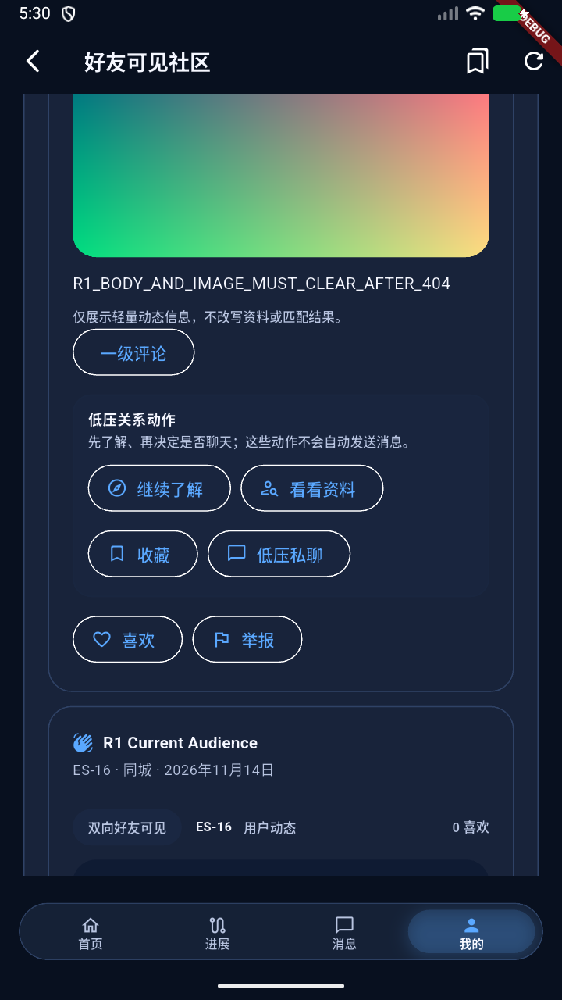
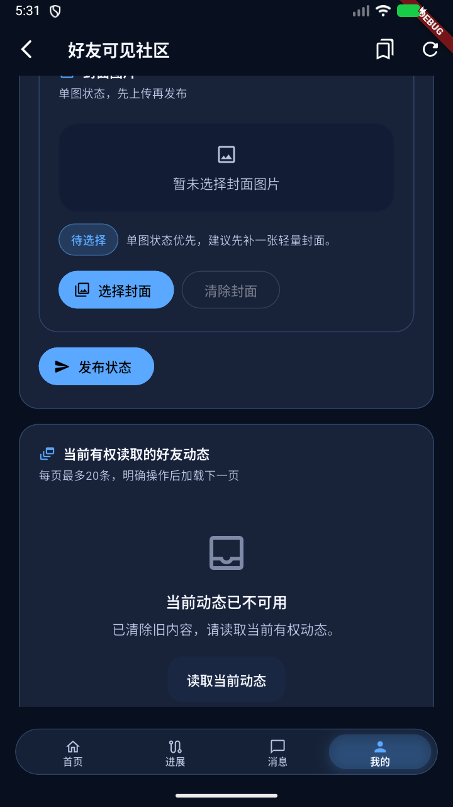

# v10.1.9 R1 工程交付

2026-11-14。唯一补修 V1019-R1-01 / P2 工程自验 PASS，顾问 R1 关闭与 Owner 接受均 PENDING。任务依据顾问固定提交 `7648d72d0e48ef9fc3f9fe4f437365571b10f266`，原交付 `6a9f28d9e60ff8abbad96494925ccea3b2dd46a4`。详细身份及证据见 [EVIDENCE_SUMMARY.json](EVIDENCE_SUMMARY.json) 和 [版本 manifest](../artifact_manifest.json)。

## 修复及验证

| 子项 | 最小修复 | 本轮工程结果 |
|---|---|---|
| A 联系人分页 | 401/403 清旧联系人、游标、has_more 与可选项，递增局部查询代际 | PASS，受控 Widget 先显示再分页403 |
| B 旧动态收藏 | 401/403/404 卸载当前旧动态正文、图片组件与旧动作，明确反馈当前不可用，失效两处动态 provider | PASS，Widget404反例与真实 APP/API404链 |
| C 搭子发现分页 | 401/403 清旧卡、游标、has_more 与申请动作，递增局部查询代际 | PASS，受控 Widget 先显示再分页403 |

共享 `SessionBoundPage.run` 增加可选失败回调，在 mounted、当前账号及权限代际检查通过后执行。A/C 的回调仅处理明确拒绝。同账号筛选输入、合法发布草稿与未确认搭子命令原 key/payload 得到保留。B 用局部不可用状态屏蔽迟到缓存，当前会话检查隔离旧账号与旧权限代际响应。普通网络未知或503保留当前数据及重试语义，收藏重试仍提交原 `{favorited:true}`。

APP 源码位于 `apps/flutter_elitesync_module/lib/features/` 下的 `relationships_v1011/session_bound_page.dart`、`relationships_v1011/contact_picker_page.dart`、`buddy_v1013/buddy_discovery_page.dart` 和 `status/presentation/pages/status_square_page.dart`。另有三份定向测试及 Android 候选编号变更，共8份文件。

最终 `directed-final-v2` 批次五份测试共41项 PASS，含15项新增与26项既有受影响回归，重叠批次只计一次。覆盖三条先显示后拒绝、网络未知/503对照、合法输入与原请求保留、切号/权限代际迟到失败。七份改动 Dart 源/测试分析 PASS。共享调用方的收藏列表、平台页面定向回归包含在41项内。

修复前 A/C 批次19项中两条403反例失败，B批次5项中404清理反例失败。中间新增测试缺大括号的一条分析提示已修复，原日志保留本机。全库既有12项静态问题沿原 FAIL 档案保留。

## 真实 APP 拒绝链

使用虚构作者16、查看者17，普通上传新封面27并创建 FRIENDS 动态8。查看者在1010903实际 APP 成功收藏、取消。作者经正常 API 改为 SELF，查看者旧页面仍显示正文、图片与收藏按钮，随后点击收藏。APP 日志实读 `2026-11-14T05:31:20.960253+00:00` 的 `404 PUT badResponse`，当前页面立即清除旧正文、图片及旧动作，显示当前动态已不可用。当前详情及媒体 API 均404，查看者没有该动态收藏关联。

404观察使用当前 Debug APP 的只读 Logging 订阅。响应注入为 false，调试 evaluate/invoke 为 NOT_RUN。两张精选截图已检查，只含虚构开发内容。

A/C 的真实分页403链 NOT_RUN，以任务允许的受控 Widget 证明。旧图片26复用尝试未取得 APP 图片，原记录保留，正式链使用普通上传的新图片27与动态8。首次切换安卓用户后启动短暂报 Activity 不存在，重读当前用户与包后正常启动，精确瞬态机制 UNKNOWN。额外自动点击“读取当前动态”未定位到控件，该可选 APP 操作 NOT_RUN。

## 最终候选与运行状态

- APP 源码 `000025dea4d6c13e01397fa8fb8b9ae833bc2812`。后端源码沿用 `dfcef55a9801e2b2a4e80c59013f35c2f0d82ef6`，R1 后端及迁移差异为空。
- 候选 `10.1.9-dev / 1010903`，包名 `com.elitesync.v1015dev`，source Debug / arm64-v8a，APK 123861454 bytes。
- APK SHA256 `e627e796e96f7670ffb22cdf31a8feca650d63e90a5637828b9cf88a166def6b`。签名 SHA256 `7c023c0fbdab8cd4f53daedbc95badb47d5f968b2c267d94fa695655f391bd42`。
- 复用稳定构建目录和离线依赖，保留数据安装于模拟器B、安卓用户12，安装包实读 hash 与候选一致。模拟器A本轮 NOT_STARTED，手机 NOT_USED。
- 资源实读 `2026-11-14T13:35:23.108507+08:00`，DB/API/WS/SFU running。模拟器B已正常停止且数据保留，调试连接及本轮 forward 已移除，ADB5038 USB排除通过。R1 DB/API/WS重启与SFU媒体测试 NOT_RUN。

## 同步、继承及复核

顾问文档在 `2026-11-14T13:09:00.097487+08:00` 安全快进到固定提交，六份必要文档 Git Blob 一致，状态 LOCAL_DOCS_SYNCED。完成时原主库 HEAD、NUL分隔 status、diff 与 index hash 均匹配开工保护基线，受保护目录保留。完整原证、APK、数据库、凭据及私有工具留 Owner 本机。

原工程六项 PASS、原顾问 AC19-01/02/03 PARTIAL 与 CHANGES_REQUIRED、1010902身份均保留。AC19-04/05/06按顾问已接受且组件未变范围继承，部署、迁移、持久化沿原交付具名证据。未变通信继承 v10.1.8 call63/call64 的具名接受范围。真实 Push 保持 REAL_PUSH_PROVIDER_PENDING，历史非注入 SFU/RPC 精确根因 UNKNOWN。

本次公开文本摘要 hash 按 Git canonical LF 字节计算。固定交付身份为包含本报告及 manifest 的最终提交，远端固定回读在交付回复及本机回执记录。交付后停下供顾问复核。
