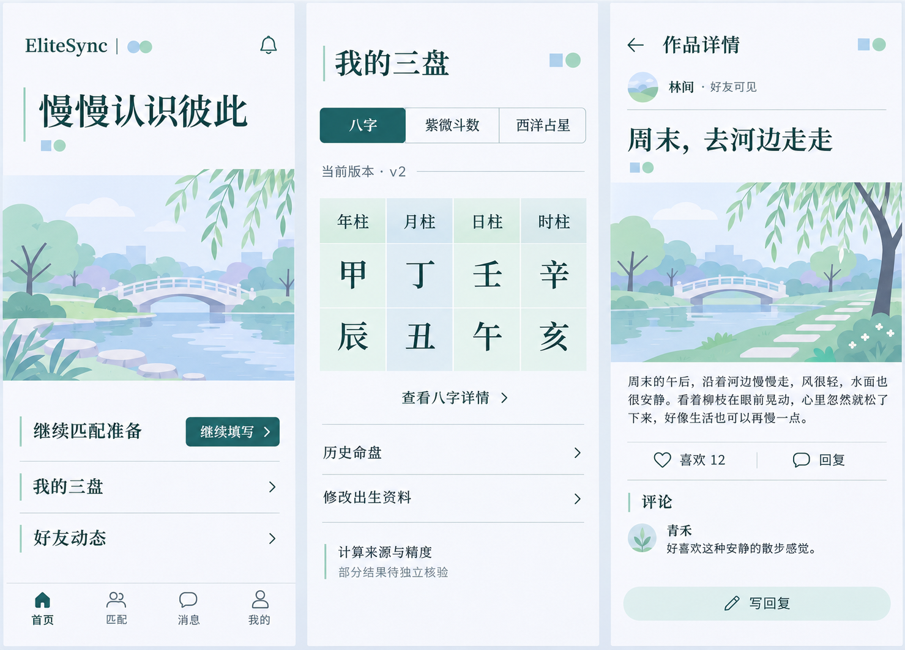

# EliteSync V2｜UI-S1 方案 2 顾问评审材料

2026-11-28。**Owner 已通过当前交互原型，多处页面背景留白交由 GPT 顾问修改设计。** 当前停在顾问评审。首页和「我的三盘」是产品辨识度的重点。 [Owner 原结论](../../../../decisions/OWNER_V2_UI_S1_DIRECTION_2_PROTOTYPE_ACCEPTANCE_20261128.md)

## 已选视觉方向

方案 2 沿用构成主义几何分区与极简河岸插画，使用淡绿、淡蓝、灰青与深青操作色。下图为选型时的三联原稿。

## 当前原型快照

六张图共 24 个页面或状态，均为独立浏览器原型在 393 × 852 CSS 像素视窗的实渲染，由虚构资料生成。快照记录 Owner 通过的方案，供顾问定位背景留白。页面主体采用青灰底色。低内容密度页面易见较长的纯色区域。

| 快照 | 覆盖页面 |
| --- | --- |
| [01 首页和三盘](design/01-home-and-charts.png) | 首页、我的三盘八字首页、紫微宫位、西洋星盘 |
| [02 历史、资料和注册](design/02-chart-settings-and-entry.png) | 历史盘面、首次出生资料、欢迎、注册 |
| [03 问答和作品详情](design/03-onboarding-and-content.png) | Lifestyle、匹配准备、开局问答、作品详情 |
| [04 社区和关系](design/04-community-and-relationship.png) | 好友动态、候选、关系进度、私信列表 |
| [05 消息和基础资料](design/05-messages-and-profiles.png) | 仅文字会话、站内通知、个人中心、基础资料 |
| [06 展示资料和隐私](design/06-showcase-buddy-and-privacy.png) | 私有展示草稿、Buddy 搭子、隐私与授权、设置 |

## 原型已演示的关键路径

- 首页从匹配准备或当前关系状态直达下一步，同时在首屏进入「我的三盘」和好友动态。
- 三盘共用一次出生资料与版本，分别用四柱、十二宫和圆形星盘呈现，解释按需展开。盘面重入恢复上次浏览，计算设置独立核对，历史只读，时间未知状态明确。算法来源和核验范围可查看。
- 注册与五场景、开局问答续填与回改、基础资料与私有展示草稿、社区点赞与回复、双方候选决定、独立联系和聊天许可、附件失败恢复、Buddy、通知、隐私撤权及账号切换均有可操作状态。正式协议正文仍沿 UI-S0-R 原结论待证。
- 浏览器原型从首次打开、填写三项注册资料并回改一次五场景答案到首页为 16C / 0S / 3I / 12N，UI-S0 对应任务记录为 20C / 0S / 3I / 16N。从首页打开已有三盘并浏览三个概览为 3C / 0S / 0I / 3N。完整 U05 含历史、详情和更正，保持独立口径。真实 Android APP、完整 UI-S4 计量和服务等待仍待后续验收。 [UI-S0 原始矩阵](../ui-s0-20261127/INTERACTION_COST_MATRIX.csv)

## 顾问待评

Owner 的背景反馈覆盖多处界面，未逐页指定。请先用六张快照标出需要调整的页面与状态，给出可复用的背景设计规则，并标明哪些留白有助于阅读。首页与三盘优先看视觉辨识度，再看列表、表单、空态、隐私和设置如何延续同一套语言。

评审交付应明确每类背景的用法、代表页面示意、适用区域、对比度和触控可读性。主要操作、双方同意、明确确认、撤权、退出和隐私控制继续保留。背景设计修订进入 Owner 复审，设计合同冻结后再安排 Flutter 实施。

**交付状态** `UI_S1_OWNER_PROTOTYPE_ACCEPTED / UI_S1_BACKGROUND_ADVISOR_REVIEW_PENDING / UI_S1_DESIGN_CONTRACT_NOT_FROZEN`。

**发布状态** `R1_PARTIAL / CLOSED_BETA_NO_GO / PRODUCTION_NO_GO`。
