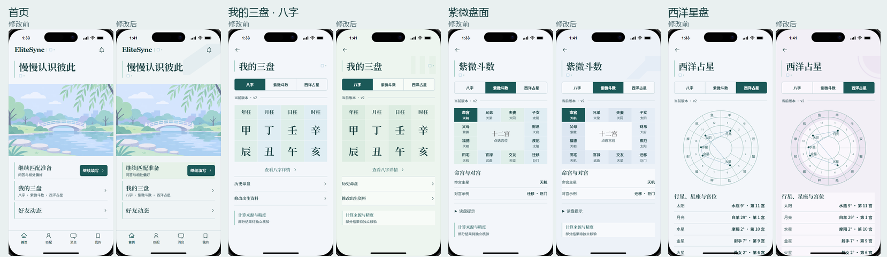
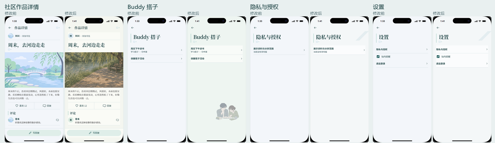

# EliteSync V2｜UI-S1 方案 2 背景修改版评审

2026-11-28。依据网页 GPT 顾问对 24 个状态的评审，方案 2 背景修改版已完成。当前提交给顾问复审，待 Owner 最终确认。首页和「我的三盘」为重点。 [Owner 通过的原型与反馈](../../../../../decisions/OWNER_V2_UI_S1_DIRECTION_2_PROTOTYPE_ACCEPTANCE_20261128.md) · [修改前的原稿和 24 个状态](../V2_UI_S1_ADVISOR_REVIEW_20261128.md)

## Owner 对本版的评价

> 我认为这一版设计的很好

## 重点页面前后对照

基础画布、内容承载面、主题分区、装饰插画构成四层背景。首页保留河岸主视觉。八字采用淡青绿，紫微采用灰蓝，西洋星盘采用淡紫灰。关系进度的几何节点沿用现有独立授权状态，Buddy 与已有空状态使用轻量插画。注册、表单、聊天及隐私保留净空。虚构角色使用不同的首字头像，示例作品采用独立配图。 [背景 Token 清单](UI_S1_D2_BACKGROUND_TOKENS.md)

## 24 个修改版快照

| 快照 | 页面或状态 |
| --- | --- |
| [01 首页与三盘](design/01-home-and-charts.png) | 首页、八字、紫微、西洋占星 |
| [02 历史、资料与注册](design/02-chart-settings-and-entry.png) | 历史盘面、首次填写出生资料、欢迎、注册 |
| [03 问答与作品详情](design/03-onboarding-and-content.png) | Lifestyle、匹配准备、开局问答、作品详情 |
| [04 社区与关系](design/04-community-and-relationship.png) | 好友动态、候选、关系进度、消息列表 |
| [05 消息与基础资料](design/05-messages-and-profiles.png) | 聊天、站内通知、个人中心、基础资料 |
| [06 展示资料与隐私](design/06-showcase-buddy-and-privacy.png) | 展示资料、Buddy、隐私与授权、设置 |

24 个原始尺寸 PNG 均为 393 × 852，使用虚构资料。下载包 SHA-256 为 `80594cae8de5724e12398b99485cfec6d2a215f33e2d129a63182f12ed1c4f0c`。 [下载 24 张修改版 PNG](design/UI_S1_D2_BACKGROUND_AFTER_24.zip?raw=1)

## 回归与复审停点

前后测量覆盖 24 个状态和 250 个界面元素。路由、控件属性、布局坐标、字体和业务文字一致。首次注册至首页仍为 16 次点击，首页浏览三盘概览仍为 3 次点击及 0 次滑动。社区点赞回复、双方候选决定、独立聊天许可、附件按原编号核对、撤权、Buddy 申请与撤回、退出换号均已在独立原型复测。构建及四项打包测试通过。

请顾问复审三种盘面的辨识度、低内容密度页面的留白与层级，以及阅读、表单和隐私界面的背景可读性。Owner 确认修订后再冻结设计合同并安排 Flutter 实施。发布状态沿用 `R1_PARTIAL / CLOSED_BETA_NO_GO / PRODUCTION_NO_GO`。
